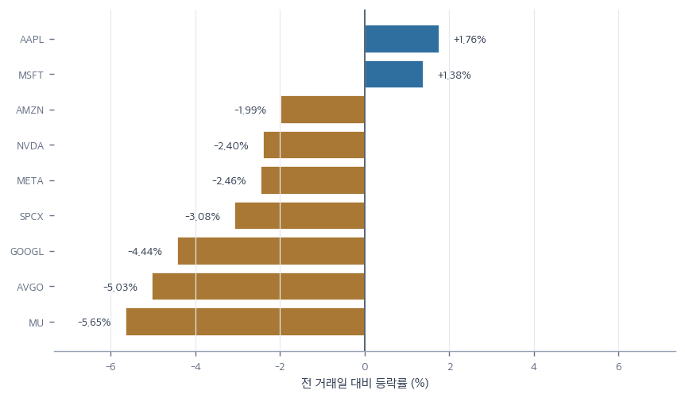
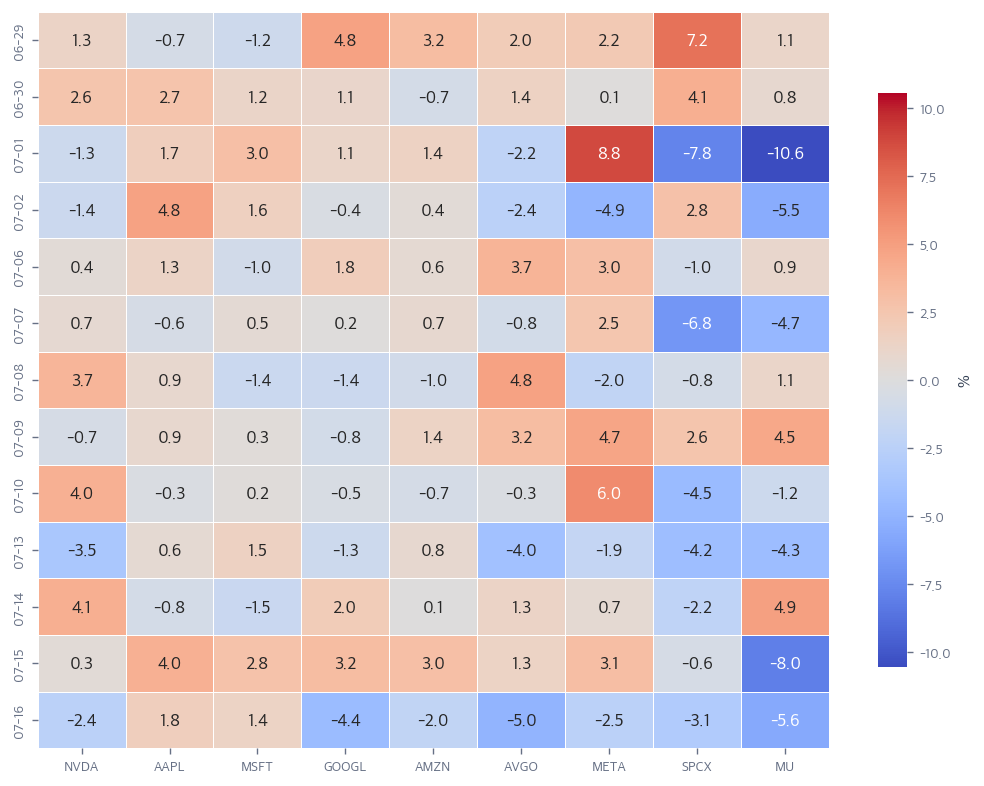
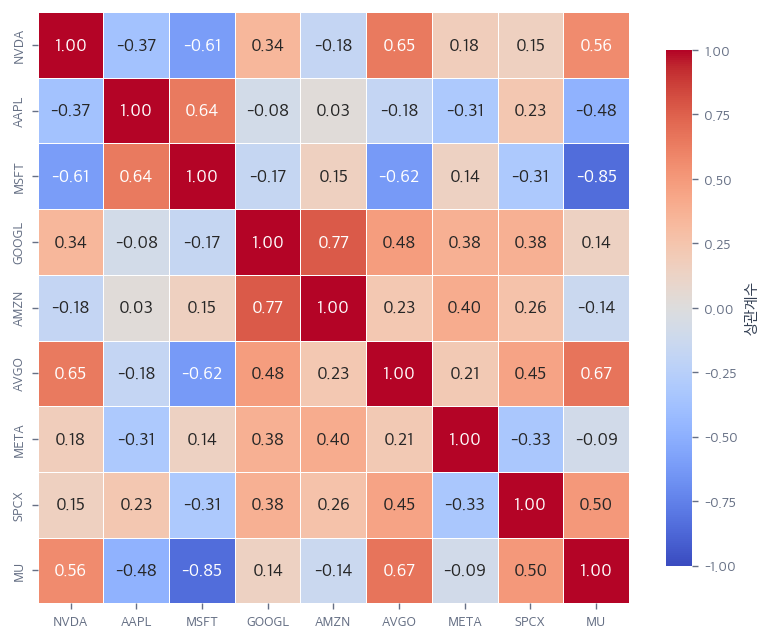
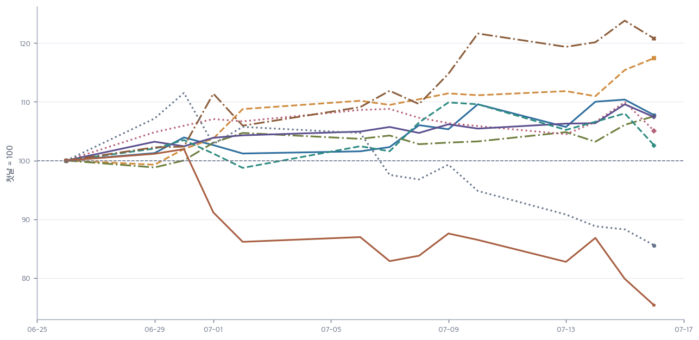
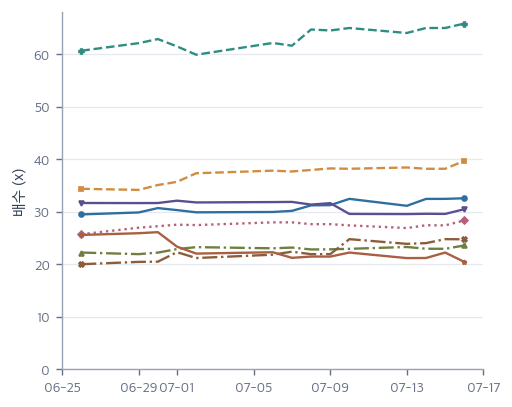
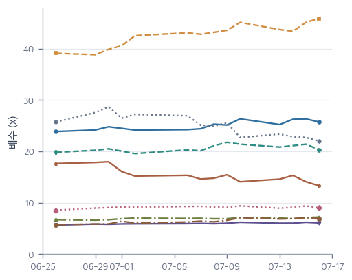
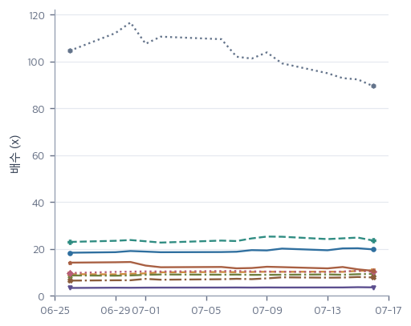

# 나스닥 일일 주가 리포트 - 2026-07-16

- 데이터 날짜: 2026-07-16
- 비교 기준일: 2026-07-15
- 생성 시각(UTC): 2026-07-21T16:37:19+00:00
- 3% 이상 변동 기준: abs(change_pct) >= 3.0%

## 전체 종목 변화율

### 당일 종목별 등락률

| 종목 | 종가 | 등락률 |
| --- | --- | --- |
| AAPL | 333.26 | +1.76% |
| MSFT | 401.10 | +1.38% |
| AMZN | 249.89 | -1.99% |
| NVDA | 207.40 | -2.40% |
| META | 664.54 | -2.46% |
| SPCX | 131.11 | -3.08% |
| GOOGL | 354.46 | -4.44% |
| AVGO | 374.45 | -5.03% |
| MU | 853.20 | -5.65% |

## 시장 흐름 히트맵

### 날짜별 등락률 히트맵

### 종목 간 수익률 상관 히트맵

## 종목별 변화 추이

### 기준일 대비 정규화 종가

## PER·PBR·PSR 변화 추이

### PER 변화 추이

### PBR 변화 추이

### PSR 변화 추이

## 3% 이상 변동 종목

| 종목 | 종가 | 등락률 |
| --- | --- | --- |
| SPCX | 131.11 | -3.08% |
| GOOGL | 354.46 | -4.44% |
| AVGO | 374.45 | -5.03% |
| MU | 853.20 | -5.65% |

## 원인 메모

### SPCX (-3.08%)
<!-- CAUSE:SPCX:START -->
- 정규장 하락을 설명할 뚜렷한 단일 기업 공시는 확인되지 않았으며, IPO 직후 급등분에 대한 포지션 축소와 높은 밸류에이션 재평가가 이어진 것으로 보임. [TheStreet](https://www.thestreet.com/investing/stocks/spacex-spcx-stock-record-low-analyst-price-targets)
- 보호예수 해제 뒤 추가 주식 공급 우려, 중국의 재사용 로켓 기술 진전, 금리 경로 불확실성 등도 투자심리를 압박한 배경으로 거론됨. [Fast Company](https://www.fastcompany.com/91574475/spacex-stock-today-update-spcx-fell-below-ipo-price)
- Starship 13차 시험비행 중단은 미국 정규장 마감 뒤 발생했으므로 이날 -3.08% 하락의 직접 원인으로 보기는 어려움. [AP News](https://apnews.com/article/starship-spacex-rocket-musk-nasa-455927b93b0fdc5512a4567a53eb3228)
<!-- CAUSE:SPCX:END -->

### GOOGL (-4.44%)
<!-- CAUSE:GOOGL:START -->
- Google의 차세대 주력 AI 모델 Gemini 3.5 Pro 출시가 수개월 지연됐다는 보도가 핵심 하락 촉매였음. 코딩 성능 개선 과정에서 내부 목표를 충족하지 못한 것으로 전해짐. [Investing.com](https://www.investing.com/news/stock-market-news/alphabet-stock-falls-on-report-of-gemini-ai-model-delays-4796594)
- 경쟁사 대비 AI 코딩 모델 주도권이 약화될 수 있다는 우려가 다음 주 실적 발표를 앞둔 경계심과 겹치며 매도 폭을 키운 것으로 분석됨. [9to5Google](https://9to5google.com/2026/07/16/gemini-3-5-pro-delays/)
<!-- CAUSE:GOOGL:END -->

### AVGO (-5.03%)
<!-- CAUSE:AVGO:START -->
- 명확한 단일 기업 공시는 확인되지 않았고, 당일 하락은 AI·반도체주 전반의 고평가 성장주 재평가와 위험회피 매도가 주된 배경으로 보임. [AP News](https://apnews.com/article/stock-markets-iran-inflation-oil-e1c646be279423406586c67c79e738e4)
- Broadcom은 AI 인프라·커스텀 ASIC 기대가 큰 종목이라, 하이퍼스케일러 주문 둔화 우려와 금리 부담이 투자심리를 더 약화시켰다는 시장 분석이 있었음. [TradingKey](https://www.tradingkey.com/news/market-movers/262035166-market-movers-avgo-20260716)
<!-- CAUSE:AVGO:END -->

### MU (-5.65%)
<!-- CAUSE:MU:START -->
- AI 메모리주의 차익실현과 메모리 가격·공급 지속성 우려가 직접적인 부담으로 거론됨. [IBTimes Australia](https://www.ibtimes.com.au/micron-technology-shares-decline-memory-chip-volatility-1872367)
- SK하이닉스·삼성전자 급락과 한국 증시 변동성이 메모리 섹터 전반으로 전이됐고, Micron도 같은 매도 압력을 받았음. [AP News](https://apnews.com/article/stock-markets-iran-inflation-oil-e1c646be279423406586c67c79e738e4)
- 전날 제기된 중국 CXMT의 85억달러 IPO 계획과 미국의 HBM 수출 제한 검토가 ‘메모리 공급 부족·가격 강세’ 투자 논리를 흔든 점도 악재로 분석됨. [TradingKey](https://www.tradingkey.com/analysis/stocks/us-stocks/262033102-micron-mu-stock-falls-cxmt-ipo-hbm-export-restriction-2026-tradingkey)
<!-- CAUSE:MU:END -->
