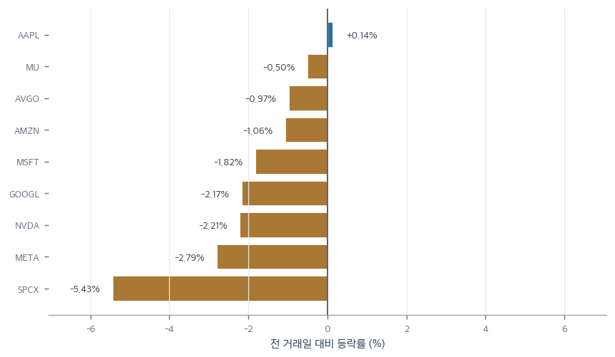
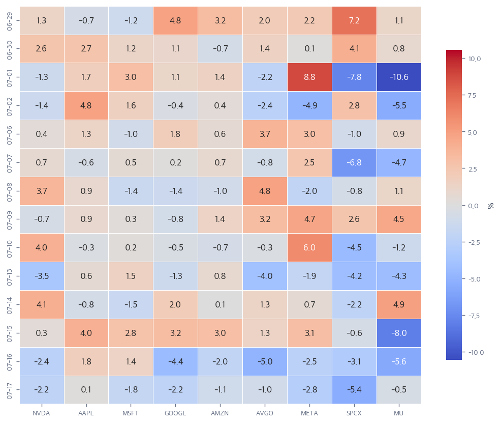
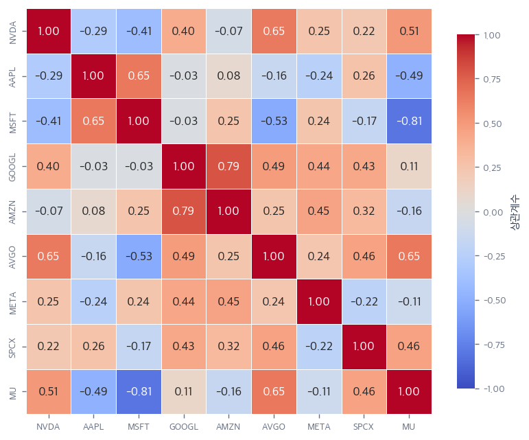
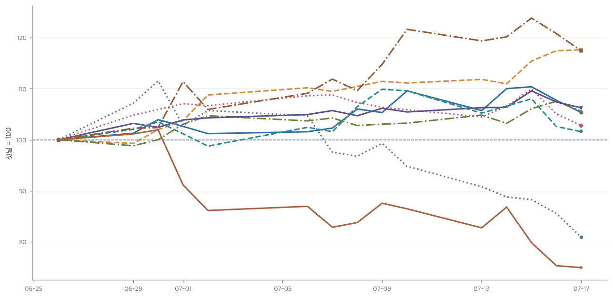
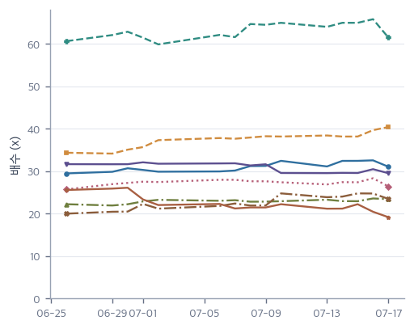
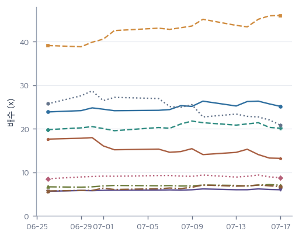
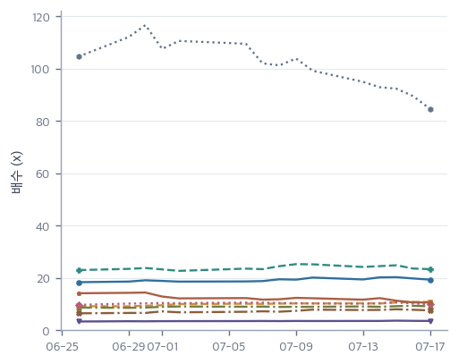

# 나스닥 일일 주가 리포트 - 2026-07-17

- 데이터 날짜: 2026-07-17
- 비교 기준일: 2026-07-16
- 생성 시각(UTC): 2026-07-21T16:37:19+00:00
- 3% 이상 변동 기준: abs(change_pct) >= 3.0%

## 전체 종목 변화율

### 당일 종목별 등락률

| 종목 | 종가 | 등락률 |
| --- | --- | --- |
| AAPL | 333.74 | +0.14% |
| MU | 848.95 | -0.50% |
| AVGO | 370.83 | -0.97% |
| AMZN | 247.23 | -1.06% |
| MSFT | 393.82 | -1.82% |
| GOOGL | 346.77 | -2.17% |
| NVDA | 202.81 | -2.21% |
| META | 646.01 | -2.79% |
| SPCX | 123.99 | -5.43% |

## 시장 흐름 히트맵

### 날짜별 등락률 히트맵

### 종목 간 수익률 상관 히트맵

## 종목별 변화 추이

### 기준일 대비 정규화 종가

## PER·PBR·PSR 변화 추이

### PER 변화 추이

### PBR 변화 추이

### PSR 변화 추이

## 3% 이상 변동 종목

| 종목 | 종가 | 등락률 |
| --- | --- | --- |
| SPCX | 123.99 | -5.43% |

## 원인 메모

### SPCX (-5.43%)
<!-- CAUSE:SPCX:START -->
- 7월 16일 Starship 13차 시험비행이 일부 엔진의 점화 실패로 이륙 직전 자동 중단됐다. 로이터는 이 차질로 7월 17일 SpaceX의 시가총액이 약 1,000억 달러 감소했다고 보도해, 당일 하락의 가장 직접적인 단일 기업 요인으로 판단된다. ([로이터 보도](https://www.investing.com/news/stock-market-news/spacex-targets-next-week-for-another-starship-launch-attempt-as-shares-slide-on-abort-4798908), [AP 보도](https://apnews.com/article/455927b93b0fdc5512a4567a53eb3228))
- 미 국방부에 AI 연산 능력을 공급하는 협상 소식으로 장중 낙폭을 잠시 줄였지만 반등은 오래가지 못했다. 즉, 긍정적 계약 기대보다 발사 중단과 최근 약세에 대한 부담이 더 크게 반영됐다. ([Investing.com](https://www.investing.com/news/stock-market-news/spacex-stock-sees-brief-pentagon-ai-bump-while-coreweave-slides-on-pricing-threat-4798980))
- 기술주 전반도 약세(XLK -0.8%, XSD -1.2%)여서 위험회피 심리가 하락을 보탰지만, SPCX의 낙폭은 더 커 회사 고유의 발사 차질이 핵심 원인으로 보인다. ([MT Newswires/Fidelity](https://www.fidelity.com/news/article/us-markets/202607171455MIDNIGHTUSEQUITY_A3668129))
<!-- CAUSE:SPCX:END -->
