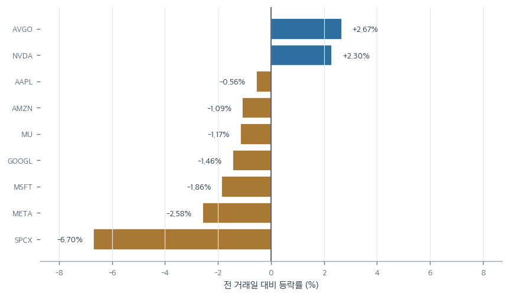
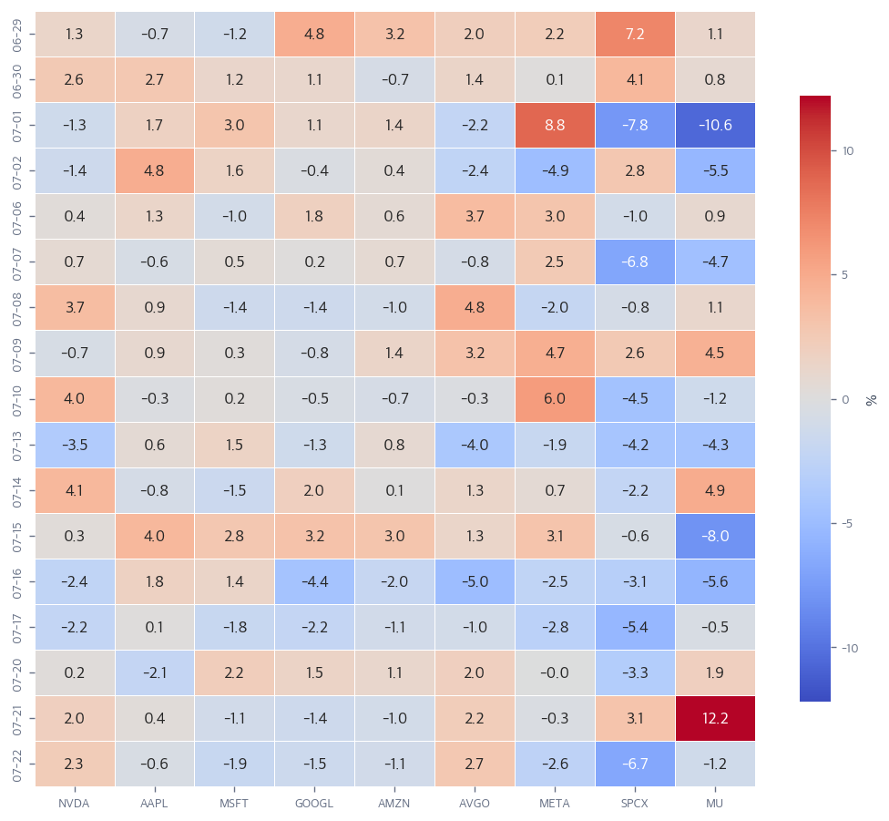
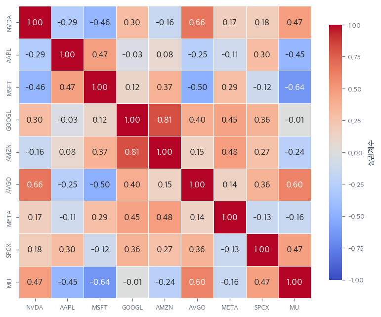
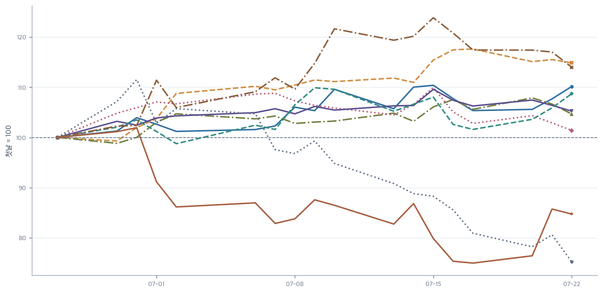
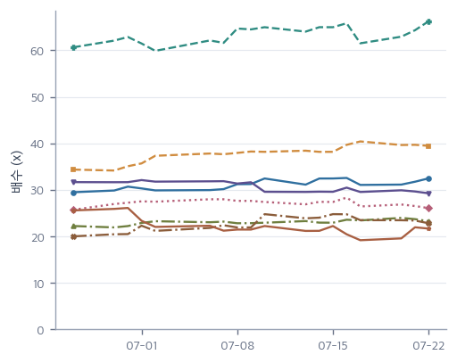
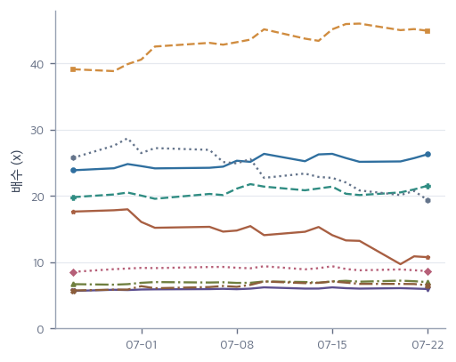
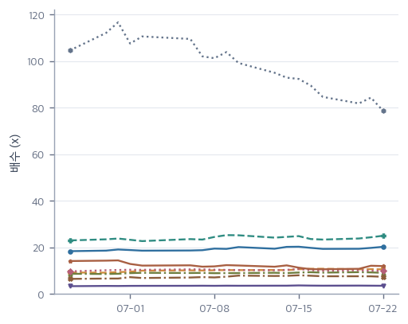

# 나스닥 일일 주가 리포트 - 2026-07-22

- 데이터 날짜: 2026-07-22
- 비교 기준일: 2026-07-21
- 생성 시각(UTC): 2026-07-23T00:04:04+00:00
- 3% 이상 변동 기준: abs(change_pct) >= 3.0%

## 전체 종목 변화율

### 당일 종목별 등락률

| 종목 | 종가 | 등락률 |
| --- | --- | --- |
| AVGO | 396.81 | +2.67% |
| NVDA | 212.06 | +2.30% |
| AAPL | 325.89 | -0.56% |
| AMZN | 244.85 | -1.09% |
| MU | 959.48 | -1.17% |
| GOOGL | 342.09 | -1.46% |
| MSFT | 390.34 | -1.86% |
| META | 627.17 | -2.58% |
| SPCX | 115.26 | -6.70% |

## 시장 흐름 히트맵

### 날짜별 등락률 히트맵

### 종목 간 수익률 상관 히트맵

## 종목별 변화 추이

### 기준일 대비 정규화 종가

## PER·PBR·PSR 변화 추이

### PER 변화 추이

### PBR 변화 추이

### PSR 변화 추이

## 3% 이상 변동 종목

| 종목 | 종가 | 등락률 |
| --- | --- | --- |
| SPCX | 115.26 | -6.70% |

## 원인 메모

### SPCX (-6.70%)
<!-- CAUSE:SPCX:START -->
- 새로 확인된 단일 기업 악재 공시보다는, 7월 21일 반등(+3.08%) 뒤 재개된 상장 후 밸류에이션 재평가와 매물 부담이 이날 하락의 중심으로 보인다. 8월 4일 첫 실적 발표 뒤 9억1,150만 주 락업 해제가 예정돼 있어 공급 과잉 우려가 커졌다. ([TipRanks](https://www.tipranks.com/news/spacex-stock-spcx-slips-after-musk-locks-in-historic-first-earnings-date), [Axios](https://www.axios.com/2026/07/17/spacex-lockup-stock-selloff))
- 같은 날 텍사스 AI 데이터센터 확장 계획 보도라는 긍정적 성장 뉴스도 있었지만 주가는 6.70% 하락해, 당일 시장은 AI 옵션보다 IPO 이후 급락·고평가 부담과 임박한 실적/락업 이벤트를 더 크게 반영한 것으로 해석된다. ([Reuters](https://www.reuters.com/business/media-telecom/spacex-plans-texas-data-center-expansion-information-reports-2026-07-22/), [MarketBeat](https://www.marketbeat.com/articles/a-1t-black-hole-spacex-eyes-pentagon-ai-to-break-free/))
- 따라서 확정적인 신규 악재에 따른 급락이라기보다, 실적에서 발사 활동·Starlink 매출·2026년 전망을 확인하기 전까지 이어지는 변동성 확대와 수급/밸류에이션 조정으로 보는 편이 타당하다. ([TipRanks](https://www.tipranks.com/news/spacex-stock-spcx-slips-after-musk-locks-in-historic-first-earnings-date))
<!-- CAUSE:SPCX:END -->
