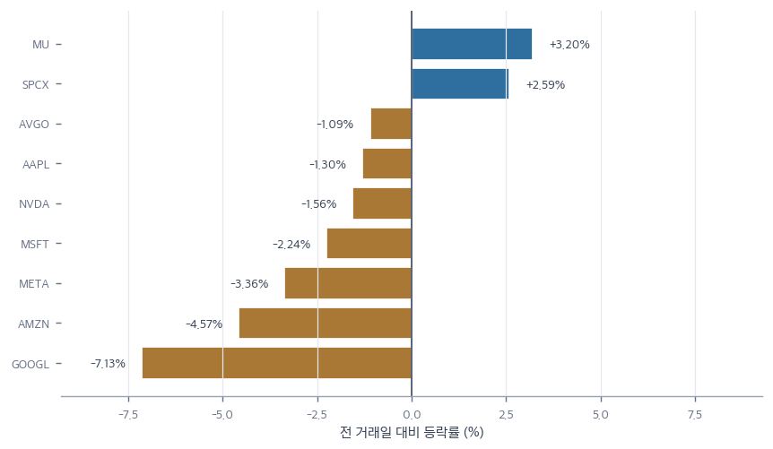
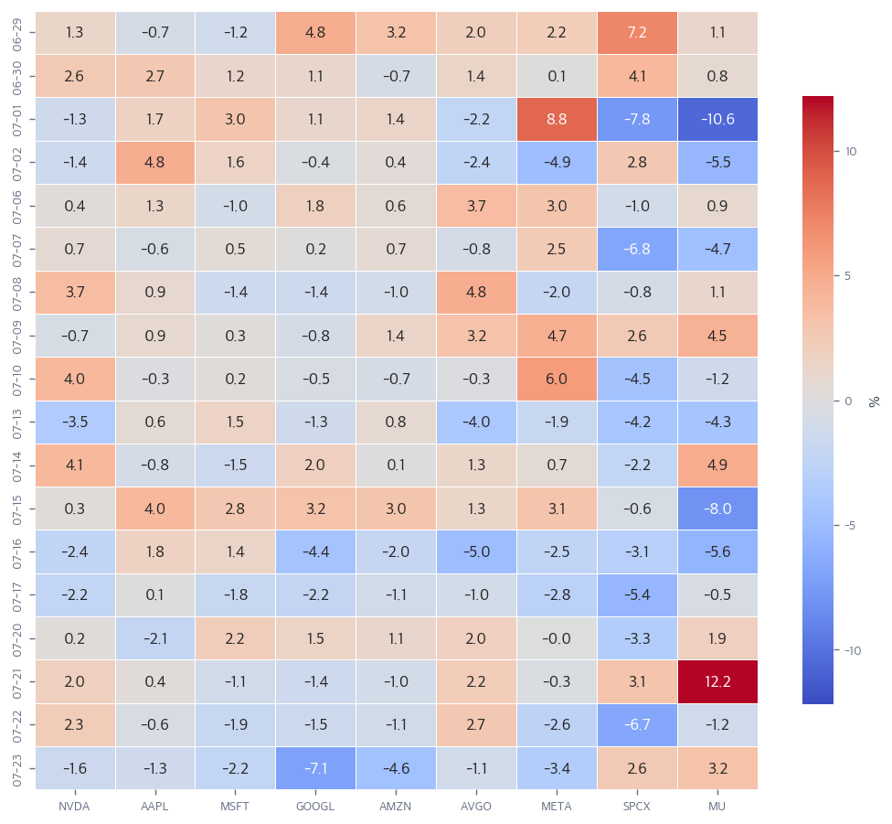
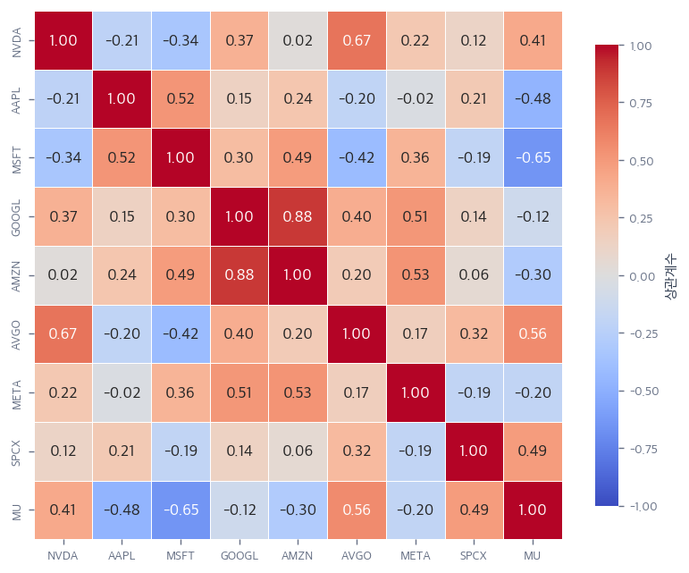
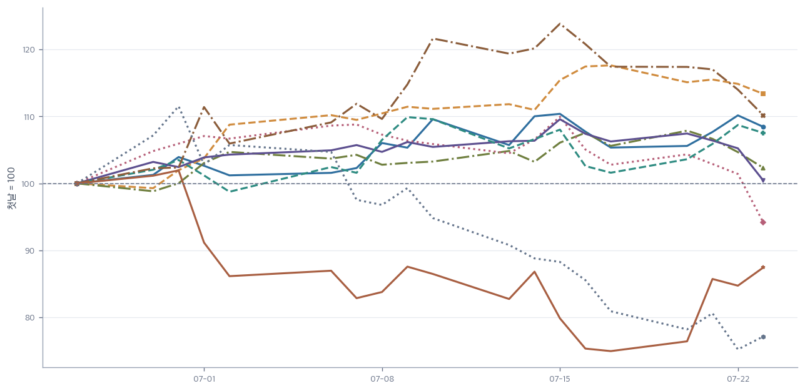
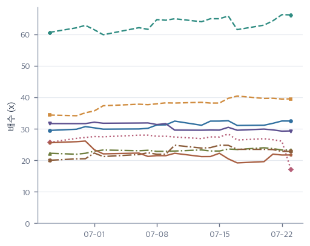
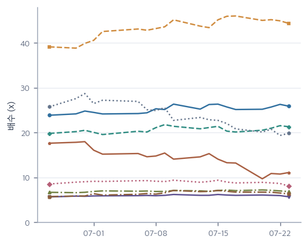
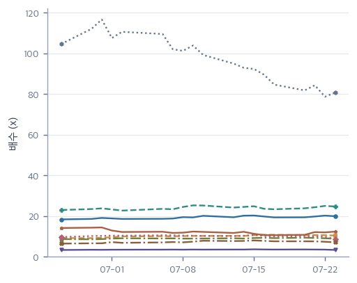

# 나스닥 일일 주가 리포트 - 2026-07-23

- 데이터 날짜: 2026-07-23
- 비교 기준일: 2026-07-22
- 생성 시각(UTC): 2026-07-24T04:14:59+00:00
- 3% 이상 변동 기준: abs(change_pct) >= 3.0%

## 전반적인 장 분위기

<!-- MARKET_SUMMARY:START -->
- **리스크오프 장세:** 2026-07-23 미국 정규장(09:30~16:00 EDT)에서 QQQ는 691.96달러로 **-1.90%**, 나스닥 종합은 **-2.15%**, S&P 500은 **-1.21%** 하락했다. 나스닥 하락 종목이 상승 종목을 3,467 대 1,374로 웃돌아 약세 폭도 넓었다. ([QQQ 정규장 가격](https://www.tallacoptions.com/ETFs/QQQ), [지수·시장 폭](https://www.investing.com/news/stock-market-news/wall-st-futures-ease-as-big-tech-results-revive-ai-spending-worries-oil-jumps-4808085))
- **관측 사실:** Alphabet(-7.13%)과 Tesla(-14.52%)의 실적 반응이 대형 기술주를 눌렀고, 커뮤니케이션서비스(-5.20%)와 경기소비재(-5.12%)가 S&P 500 업종 중 가장 약했다. 이는 정규장 하락이 메가캡 실적·AI 투자비 우려에 집중됐음을 보여준다. ([Reuters 장 마감](https://www.investing.com/news/stock-market-news/wall-st-futures-ease-as-big-tech-results-revive-ai-spending-worries-oil-jumps-4808085))
- **기업 재료:** Alphabet은 클라우드 매출이 82% 늘었지만 분기 잉여현금흐름이 -59억달러였고, 2026년 자본지출 전망을 1,800억~1,900억달러에서 1,950억~2,050억달러로 높였다. 투자자는 성장보다 AI 투자 회수와 현금흐름 부담을 더 크게 반영했다. ([Alphabet 실적 자료](https://s206.q4cdn.com/479360582/files/doc_financials/2026/q2/2026q2-alphabet-earnings-release.pdf), [Reuters 분석](https://www.investing.com/news/stock-market-news/google-quarterly-cloud-revenue-growth-beats-expectations-4806844))
- **거시 재료:** 중동 충돌과 홍해 유조선 공격에 따른 공급 우려로 브렌트유가 장중 102달러를 찍고 100달러 위에서 결제됐으며, 미 10년물 금리는 2025년 초 이후 최고 수준으로 올랐다. 이는 인플레이션·금리 부담을 키워 위험회피를 강화한 보조 요인이었다. ([AP 시장 보도](https://apnews.com/article/stocks-markets-iran-trump-ai-inflation-45b9165d6c518f5bea668b6ba7a89838), [Reuters 장 마감](https://www.investing.com/news/stock-market-news/wall-st-futures-ease-as-big-tech-results-revive-ai-spending-worries-oil-jumps-4808085))
<!-- MARKET_SUMMARY:END -->

## 전체 종목 변화율

### 당일 종목별 등락률

| 종목 | 종가 | 등락률 |
| --- | --- | --- |
| MU | 990.21 | +3.20% |
| SPCX | 118.24 | +2.59% |
| AVGO | 392.47 | -1.09% |
| AAPL | 321.66 | -1.30% |
| NVDA | 208.76 | -1.56% |
| MSFT | 381.58 | -2.24% |
| META | 606.10 | -3.36% |
| AMZN | 233.66 | -4.57% |
| GOOGL | 317.69 | -7.13% |

## 시장 흐름 히트맵

### 날짜별 등락률 히트맵

### 종목 간 수익률 상관 히트맵

## 종목별 변화 추이

### 기준일 대비 정규화 종가

## PER·PBR·PSR 변화 추이

### PER 변화 추이

### PBR 변화 추이

### PSR 변화 추이

## 3% 이상 변동 종목

| 종목 | 종가 | 등락률 |
| --- | --- | --- |
| MU | 990.21 | +3.20% |
| META | 606.10 | -3.36% |
| AMZN | 233.66 | -4.57% |
| GOOGL | 317.69 | -7.13% |

## 원인 메모

### MU (+3.20%)
<!-- CAUSE:MU:START -->
- Alphabet이 2026년 자본지출 전망을 1,950억~2,050억달러로 상향하면서 AI 데이터센터용 HBM·서버 메모리 수요 기대가 다시 강해졌고, MU는 정규장에서 **+3.20%**로 역행 상승했다. ([당일 메모리주 흐름](https://tw.news.yahoo.com/%E5%AD%98%E5%84%B2%E4%BA%94%E9%9B%84%E9%80%B1%E5%9B%9B%E9%80%86%E5%8B%A2%E6%94%B6%E7%B4%85-%E7%BE%8E%E5%85%89%E6%BC%B23-2-%E5%9C%A8%E8%B2%BB%E5%8D%8A%E7%A8%B1%E5%90%8E-sk%E6%B5%B7%E5%8A%9B%E5%A3%ABadr%E5%8D%872-004517870.html), [Alphabet 자본지출](https://www.investing.com/news/stock-market-news/google-quarterly-cloud-revenue-growth-beats-expectations-4806844))
- Micron 공식 뉴스룸에는 7월 23일자 단일기업 발표가 확인되지 않아, 당일 상승은 새 회사 공시보다는 hyperscaler 투자 확대에 대한 업종 반응으로 보는 편이 타당하다. ([Micron 공식 뉴스룸](https://investors.micron.com/latest-news-english))
<!-- CAUSE:MU:END -->

### META (-3.36%)
<!-- CAUSE:META:START -->
- 7월 23일 META 고유의 강한 새 재료는 확인되지 않았다. Alphabet의 첫 분기 음(-)의 잉여현금흐름과 자본지출 상향 뒤, 다음 주 실적을 앞둔 Meta도 AI 투자 확대와 현금흐름 둔화 우려가 번지며 **-3.36%** 하락했다. ([Reuters Big Tech 현금흐름 분석](https://www.investing.com/news/stock-market-news/alphabets-cash-burn-raises-alarm-for-big-tech-as-ai-spending-climbs-4808737))
- 나스닥 하락 종목이 상승 종목의 2.52배였고 커뮤니케이션서비스 업종이 -5.20%로 최약세였던 만큼, 개별 악재보다는 대형 기술주 전반의 리스크오프가 주된 확인 가능한 배경이다. ([Reuters 장 마감](https://www.investing.com/news/stock-market-news/wall-st-futures-ease-as-big-tech-results-revive-ai-spending-worries-oil-jumps-4808085))
<!-- CAUSE:META:END -->

### AMZN (-4.57%)
<!-- CAUSE:AMZN:START -->
- 7월 23일 AMZN 고유의 강한 새 재료는 확인되지 않았다. Alphabet의 AI 자본지출 상향과 현금 소진 뒤, Amazon도 투자비 증가·투자 회수 지연 가능성이 재평가되며 **-4.57%** 하락했다. ([Reuters Big Tech 현금흐름 분석](https://www.investing.com/news/stock-market-news/alphabets-cash-burn-raises-alarm-for-big-tech-as-ai-spending-climbs-4808737))
- Amazon의 2분기 실적 발표는 7월 30일로 예정돼 있어, 당일 움직임은 새 실적 공개가 아니라 다음 주 발표를 앞둔 hyperscaler 전반의 경계와 광범위한 위험회피에 가까웠다. ([Amazon 공식 IR 일정](https://ir.aboutamazon.com/news-release/news-release-details/2026/Amazon-com-to-Webcast-Second-Quarter-2026-Financial-Results-Conference-Call/default.aspx), [Reuters 장 마감](https://www.investing.com/news/stock-market-news/wall-st-futures-ease-as-big-tech-results-revive-ai-spending-worries-oil-jumps-4808085))
<!-- CAUSE:AMZN:END -->

### GOOGL (-7.13%)
<!-- CAUSE:GOOGL:START -->
- Alphabet은 2분기 매출 1,198억달러와 Google Cloud 성장률 82%를 기록했지만, 분기 잉여현금흐름이 사상 처음 **-59억달러**로 돌아서 강한 매출 성장이 주가를 방어하지 못했다. ([Alphabet 실적 자료](https://s206.q4cdn.com/479360582/files/doc_financials/2026/q2/2026q2-alphabet-earnings-release.pdf), [Reuters 실적 보도](https://www.investing.com/news/stock-market-news/google-quarterly-cloud-revenue-growth-beats-expectations-4806844))
- 2026년 자본지출 전망을 기존 1,800억~1,900억달러에서 **1,950억~2,050억달러**로 올린 점이 AI 투자 회수·현금흐름 우려를 키워, GOOGL은 정규장에서 **-7.13%** 하락했다. ([Reuters 실적 보도](https://www.investing.com/news/stock-market-news/google-quarterly-cloud-revenue-growth-beats-expectations-4806844), [AP 시장 보도](https://apnews.com/article/stocks-markets-iran-trump-ai-inflation-45b9165d6c518f5bea668b6ba7a89838))
<!-- CAUSE:GOOGL:END -->
