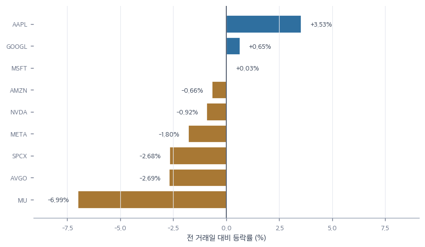
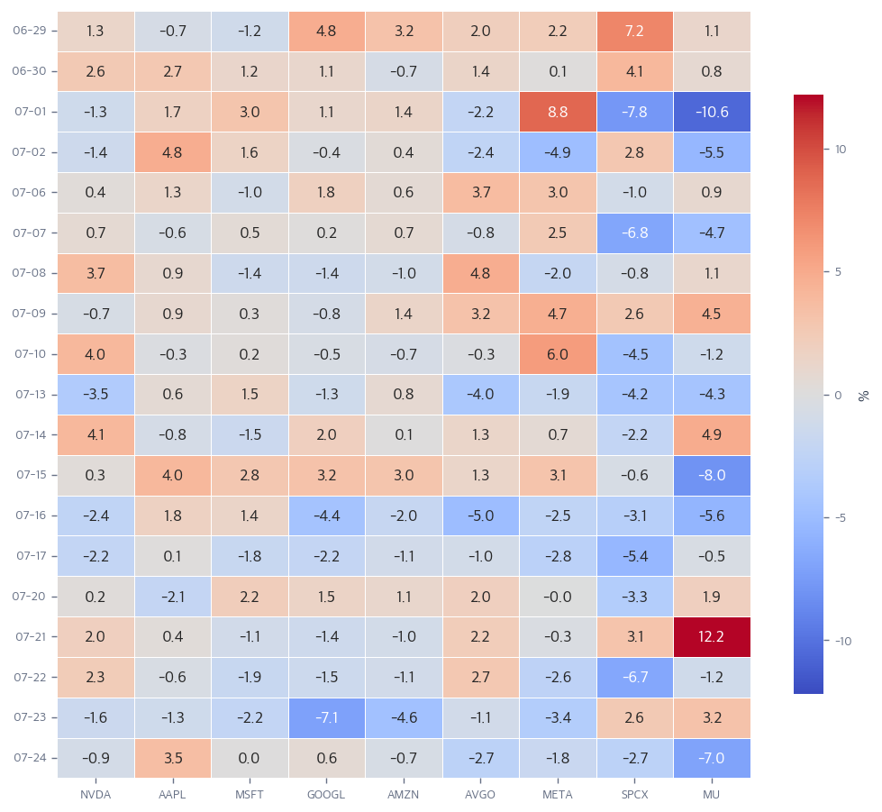
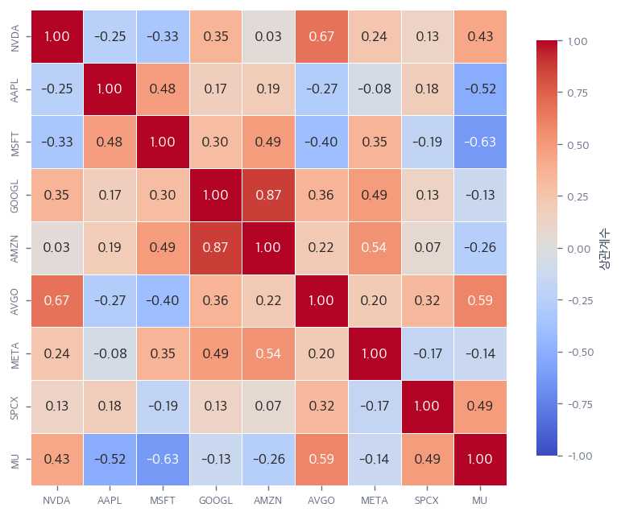
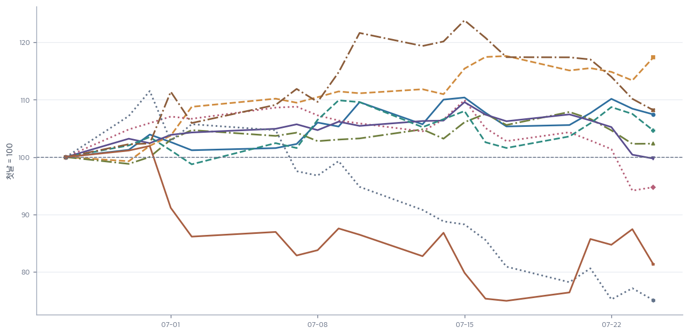
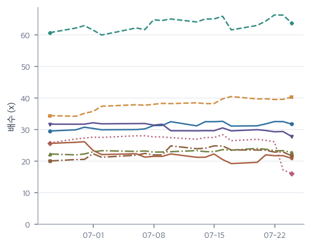
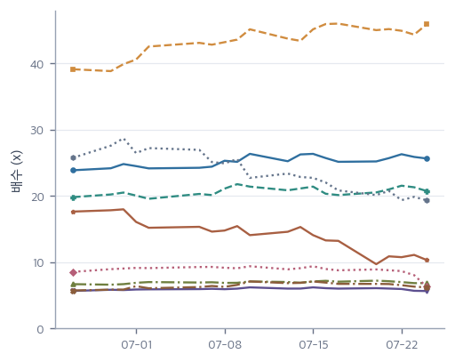
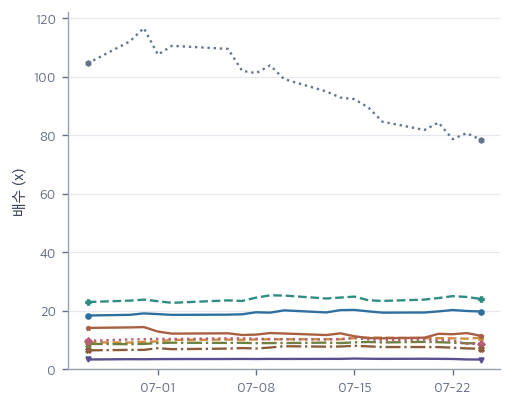

# 나스닥 일일 주가 리포트 - 2026-07-24

- 데이터 날짜: 2026-07-24
- 비교 기준일: 2026-07-23
- 생성 시각(UTC): 2026-07-25T00:01:07+00:00
- 3% 이상 변동 기준: abs(change_pct) >= 3.0%

## 전반적인 장 분위기

<!-- MARKET_SUMMARY:START -->
- **분류(관측+해석): 혼조·기술주 약세형 섹터 로테이션.** 2026-07-24 미국 정규장 09:30~16:00 ET(한국 22:30~익일 05:00 KST)에 QQQ는 691.96→684.23으로 **-1.12%**, 나스닥 종합은 **-0.64%**였지만 S&P 500은 **+0.05%**, 다우는 **+0.46%**로 마감했다. ([QQQ 역사적 시세](https://www.nasdaq.com/market-activity/etf/qqq/historical), [AP 최종 지수 마감](https://apnews.com/article/stocks-dow-nasdaq-iran-oil-02d01b8f38ccd51f605c4414cdd4fa9b))
- **관측:** AI 투자비 부담 우려가 이어지며 필라델피아 반도체지수는 장중 집계 기준 **-3.1%**였고 정보기술주가 눌린 반면, 부동산 업종은 **+2.3%**로 강해 업종 간 차별화가 컸다. ([Reuters 재전재](https://www.brecorder.com/news/40431657/sampp-500-nasdaq-fall-as-investors-juggle-earnings-mideast-risks-and-tariffs))
- **관측:** 미국의 60개 교역 상대 대상 신규 **10%·12.5% 관세**와 이란 관련 군사 긴장이 위험요인이었고, 전날 배럴당 102달러를 웃돌았던 브렌트유는 이날 **3.9% 하락한 96.78달러**로 마감했다. ([Reuters 재전재](https://www.brecorder.com/news/40431657/sampp-500-nasdaq-fall-as-investors-juggle-earnings-mideast-risks-and-tariffs), [AP 원유·시장 마감](https://apnews.com/article/stocks-dow-nasdaq-iran-oil-02d01b8f38ccd51f605c4414cdd4fa9b))
- **해석:** 유가와 미 국채금리 하락은 광범위 지수의 낙폭을 제한했지만, AI 지출 대비 수익성에 대한 경계가 반도체·대형 기술주에 집중돼 QQQ와 나스닥의 상대 약세가 남았다. ([AP 시장 마감](https://apnews.com/article/stocks-dow-nasdaq-iran-oil-02d01b8f38ccd51f605c4414cdd4fa9b), [Reuters 재전재](https://www.brecorder.com/news/40431657/sampp-500-nasdaq-fall-as-investors-juggle-earnings-mideast-risks-and-tariffs))
<!-- MARKET_SUMMARY:END -->

## 전체 종목 변화율

### 당일 종목별 등락률

| 종목 | 종가 | 등락률 |
| --- | --- | --- |
| AAPL | 333.02 | +3.53% |
| GOOGL | 319.74 | +0.65% |
| MSFT | 381.70 | +0.03% |
| AMZN | 232.11 | -0.66% |
| NVDA | 206.84 | -0.92% |
| META | 595.19 | -1.80% |
| SPCX | 115.07 | -2.68% |
| AVGO | 381.92 | -2.69% |
| MU | 920.95 | -6.99% |

## 시장 흐름 히트맵

### 날짜별 등락률 히트맵

### 종목 간 수익률 상관 히트맵

## 종목별 변화 추이

### 기준일 대비 정규화 종가

## PER·PBR·PSR 변화 추이

### PER 변화 추이

### PBR 변화 추이

### PSR 변화 추이

## 3% 이상 변동 종목

| 종목 | 종가 | 등락률 |
| --- | --- | --- |
| AAPL | 333.02 | +3.53% |
| MU | 920.95 | -6.99% |

## 원인 메모

### AAPL (+3.53%)
<!-- CAUSE:AAPL:START -->
- 확인한 당일 기사·공시 범위에서는 **+3.53%를 직접 설명하는 강한 단일 기업 촉매를 찾지 못했다**.
- **관측:** AAPL은 333.02달러에 마감하고 장중 334.37달러까지 올라, 7월 17일의 종가 최고치 333.74달러·장중 최고치 334.99달러 부근으로 복귀했다. 이는 가격 모멘텀의 관측이지 인과 설명은 아니다. ([Nasdaq AAPL 역사적 시세](https://www.nasdaq.com/market-activity/stocks/aapl/historical), [Kiplinger 7월 20일 시장 기사](https://www.kiplinger.com/investing/stocks/dow-drops-305-points-as-apple-falls-from-highs-stock-market-today))
- **맥락:** 같은 날 QQQ가 -1.12%였다는 점에서 시장 베타만으로는 AAPL의 상대 강도를 설명하기 어렵다. 7월 30일 실적 발표가 예정된 근접 이벤트였지만, 이를 당일 상승의 직접 원인으로 단정할 근거는 확인되지 않았다. ([QQQ 역사적 시세](https://www.nasdaq.com/market-activity/etf/qqq/historical), [실적 일정 언급](https://www.kiplinger.com/investing/stocks/dow-drops-305-points-as-apple-falls-from-highs-stock-market-today))
<!-- CAUSE:AAPL:END -->

### MU (-6.99%)
<!-- CAUSE:MU:START -->
- 확인한 당일 공개자료에서는 **MU 고유의 신규 실적·가이던스·공시처럼 낙폭을 단독 설명할 강한 촉매를 찾지 못했다**.
- **관측:** AI 투자비 회수 우려 속에 필라델피아 반도체지수가 장중 집계 기준 -3.1% 하락했고, Intel의 지출 확대 계획도 반도체 업종의 경계심을 키웠다. MU의 -6.99%는 이 광범위한 반도체 약세와 방향이 일치한다. ([Reuters 재전재](https://www.brecorder.com/news/40431657/sampp-500-nasdaq-fall-as-investors-juggle-earnings-mideast-risks-and-tariffs), [Nasdaq MU 역사적 시세](https://www.nasdaq.com/market-activity/stocks/mu/historical))
- **해석:** MU가 업종보다 더 크게 하락한 것은 최근 AI·메모리 랠리 이후의 높은 변동성과 차익실현이 겹친 결과일 가능성이 있으나, 확인된 단일 회사 뉴스에 근거한 결론은 아니다.
<!-- CAUSE:MU:END -->
