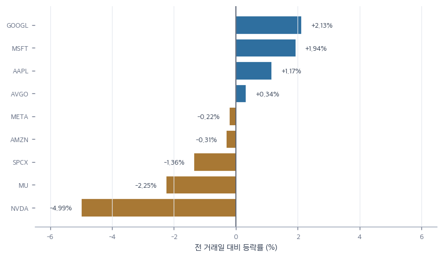
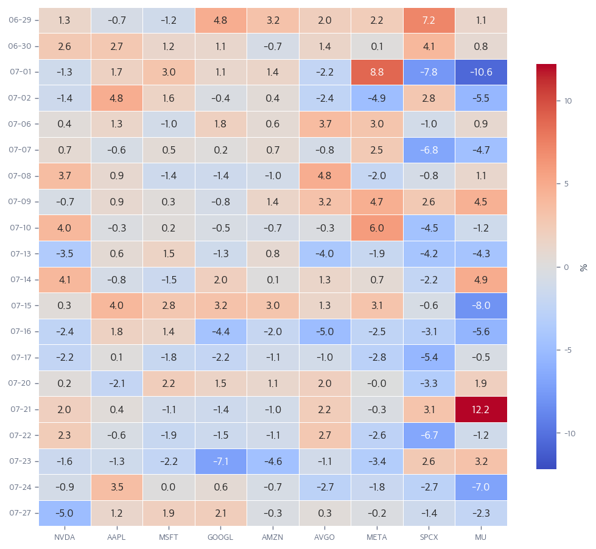
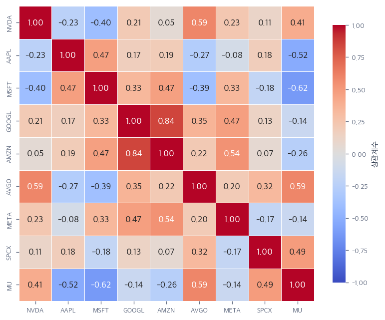
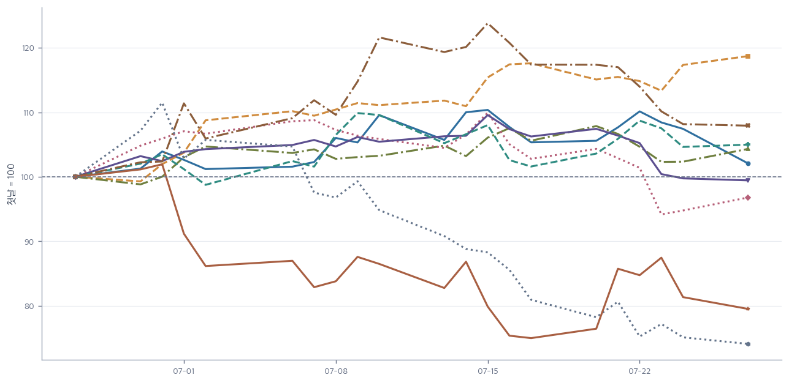
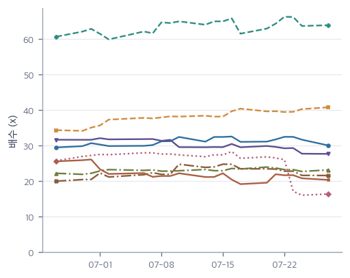
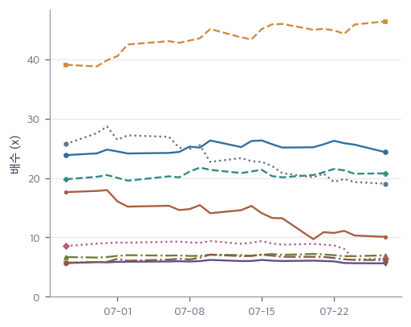
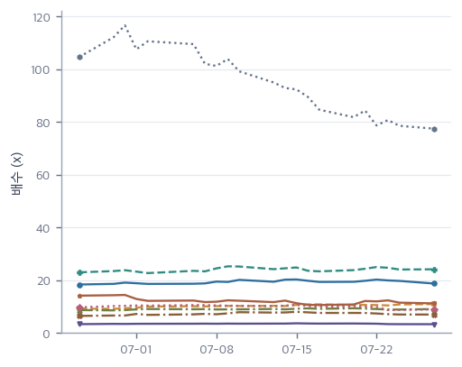

# 나스닥 일일 주가 리포트 - 2026-07-27

- 데이터 날짜: 2026-07-27
- 비교 기준일: 2026-07-24
- 생성 시각(UTC): 2026-07-28T00:02:59+00:00
- 3% 이상 변동 기준: abs(change_pct) >= 3.0%

## 전반적인 장 분위기

<!-- MARKET_SUMMARY:START -->
- **분류(해석): 혼조·섹터 로테이션.** 2026-07-27 미국 정규장(09:30~16:00 ET)에서 [QQQ는 -0.31%](https://kr.investing.com/etfs/powershares-qqqq-historical-data), [나스닥 종합은 -0.18%, S&P 500은 +0.02%](https://au.investing.com/news/economy-news/wall-st-futures-rise-as-us-iran-pause-hostilities-4553224)로 엇갈렸고, S&P 500 상승 종목 수가 하락 종목의 1.9배였다.
- **관찰:** 같은 정규장에서 [다우는 +0.51%, 러셀 2000은 +0.6%](https://apnews.com/article/wall-street-stocks-dow-nasdaq-e7325919557efc52535a96f09ab38b0d)였고 S&P 500 11개 업종 중 7개가 상승해, 대형 기술주 밖으로 매수세가 분산된 흐름이 확인됐다.
- **당일 재료:** [미국과 이란이 공격을 중단하고 협상 재개를 모색하면서 브렌트유가 6.3% 하락한 배럴당 85.87달러, 미 10년물 금리는 4.69%에서 4.65%](https://apnews.com/article/stocks-oil-rates-markets-cxmt-2b81f0e01bb318ae8d4281964f89f2f1)로 내려 에너지·금리 부담은 완화됐다.
- **기술주 부담:** [필라델피아 반도체지수는 -2.23%](https://au.investing.com/news/economy-news/wall-st-futures-rise-as-us-iran-pause-hostilities-4553224)였고 NVDA의 -4.99%가 나스닥을 압박했다. 중국 CXMT 상장과 중국산 DUV 장비 생산 보도가 경쟁 우려를 키운 점은 확인되지만, 시장 전체의 단일 원인으로 단정하기보다 반도체 중심 약세로 해석한다.
<!-- MARKET_SUMMARY:END -->

## 전체 종목 변화율

### 당일 종목별 등락률

| 종목 | 종가 | 등락률 |
| --- | --- | --- |
| GOOGL | 326.56 | +2.13% |
| MSFT | 389.10 | +1.94% |
| AAPL | 336.91 | +1.17% |
| AVGO | 383.22 | +0.34% |
| META | 593.87 | -0.22% |
| AMZN | 231.39 | -0.31% |
| SPCX | 113.50 | -1.36% |
| MU | 900.20 | -2.25% |
| NVDA | 196.51 | -4.99% |

## 시장 흐름 히트맵

### 날짜별 등락률 히트맵

### 종목 간 수익률 상관 히트맵

## 종목별 변화 추이

### 기준일 대비 정규화 종가

## PER·PBR·PSR 변화 추이

### PER 변화 추이

### PBR 변화 추이

### PSR 변화 추이

## 3% 이상 변동 종목

| 종목 | 종가 | 등락률 |
| --- | --- | --- |
| NVDA | 196.51 | -4.99% |

## 원인 메모

### NVDA (-4.99%)
<!-- CAUSE:NVDA:START -->
- **관찰:** NVDA는 2026-07-27 정규장에서 196.51달러로 마감해 전 거래일 대비 4.99% 하락했고, [AP는 이 하락이 나스닥 종합을 끌어내린 주요 요인이라고 전했다](https://apnews.com/article/wall-street-stocks-dow-nasdaq-e7325919557efc52535a96f09ab38b0d).
- **가장 유력한 개별 재료:** Nvidia가 OpenAI의 오하이오 10GW 데이터센터 임차를 위해 약 2,500억 달러 규모 금융 보증을 논의 중이라는 보도가 나왔다. [Reuters는 원보도를 즉시 독립 확인하지 못했다고 명시](https://www.investing.com/news/stock-market-news/nvidia-in-talks-with-openai-to-guarantee-250-billion-financing-for-data-center-wsj-reports-4812926)했으므로 확정 계약이 아니라, 거래상대방·순환금융 우려를 자극한 가능성이 큰 미확정 재료로 본다.
- **업종 맥락:** 같은 날 [필라델피아 반도체지수도 2.23% 하락했고, 중국 CXMT의 상장과 중국산 DUV 장비 생산 보도가 미국 반도체 업계의 경쟁 우려를 높였다](https://au.investing.com/news/economy-news/wall-st-futures-rise-as-us-iran-pause-hostilities-4553224). 이 업종 약세가 NVDA의 개별 악재 반응을 증폭했을 가능성이 있다.
<!-- CAUSE:NVDA:END -->
