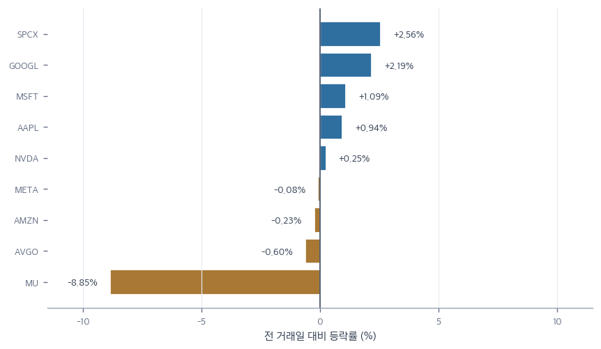
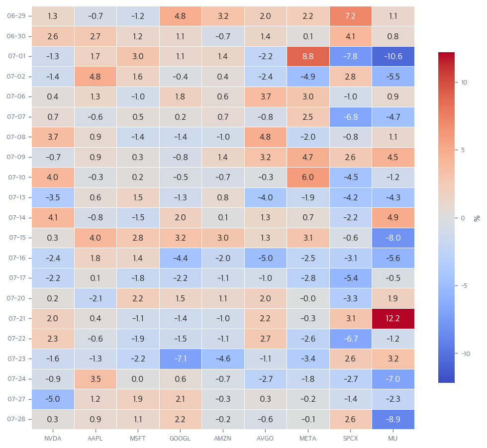
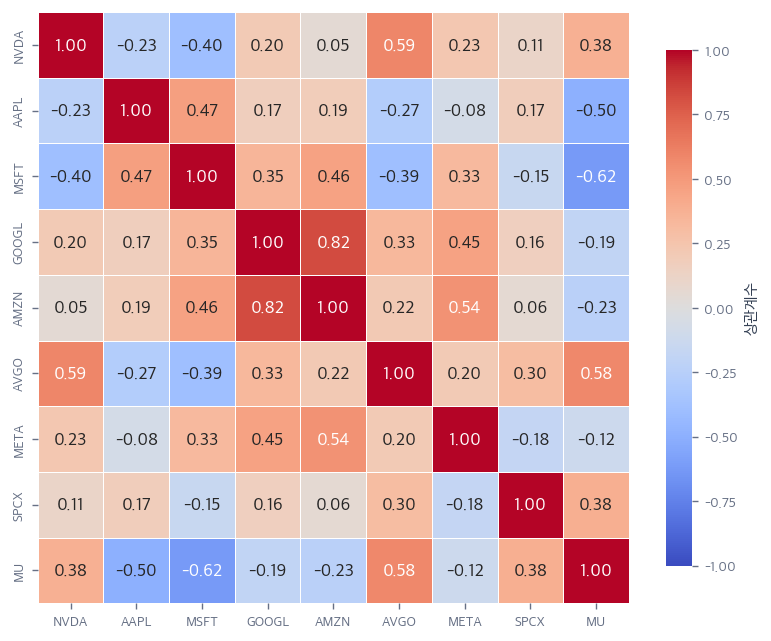
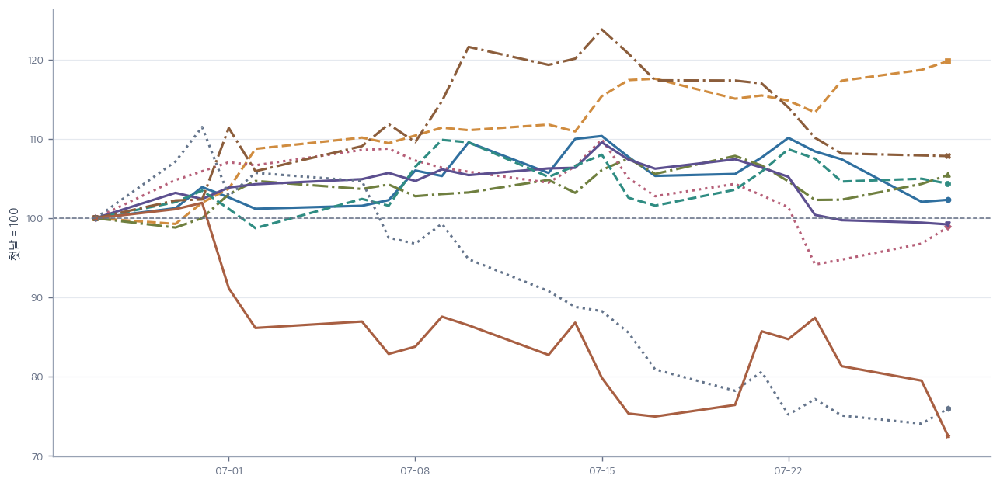
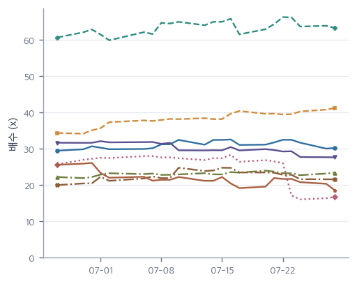
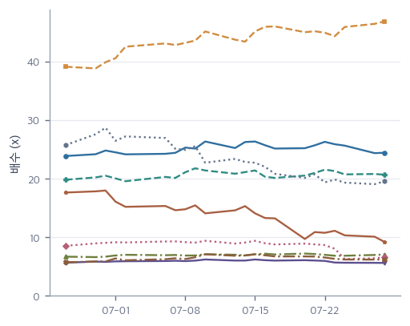
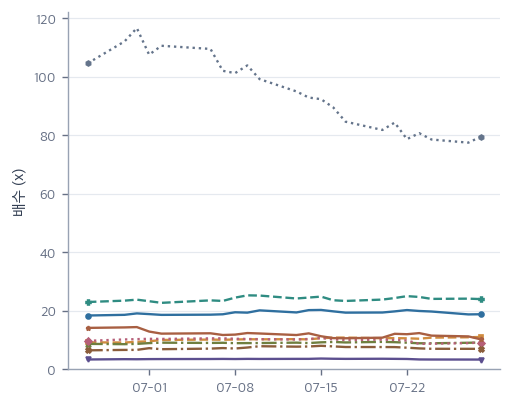

# 나스닥 일일 주가 리포트 - 2026-07-28

- 데이터 날짜: 2026-07-28
- 비교 기준일: 2026-07-27
- 생성 시각(UTC): 2026-07-29T00:02:11+00:00
- 3% 이상 변동 기준: abs(change_pct) >= 3.0%

## 전반적인 장 분위기

<!-- MARKET_SUMMARY:START -->
- 분류(해석): **업종순환형 혼조** — 2026-07-28 미국 정규장(미 동부시간 09:30–16:00)에서 [QQQ는 675.49로 -0.97%](https://finance.yahoo.com/quote/QQQ/history/), [나스닥 종합은 -0.22%](https://apnews.com/article/wall-street-stocks-dow-nasdaq-d2a114bce818cab6ee9583f4815cb89a)였지만 S&P 500은 +0.21%로 마감했다.
- 관찰: [S&P 500은 7,428.78(+15.60포인트), 다우는 52,747.32(+1.03%)](https://apnews.com/article/wall-street-stocks-dow-nasdaq-d2a114bce818cab6ee9583f4815cb89a)였고 시장 다수 종목이 올라, 대형 기술주 약세와 더 넓은 시장의 상승이 엇갈렸다.
- 관찰: [MU -8.9%, AMD -8.1%, AMAT -7.8%](https://apnews.com/article/stock-markets-ai-chips-oil-a880057323bd065c325ad19b23de0cf3) 등 반도체·AI 수혜주 매도가 지수 상단을 눌렀다.
- 관찰: [브렌트유는 4.4% 내린 배럴당 82.08달러, 미 10년물 금리는 4.65%에서 4.60%로 하락](https://apnews.com/article/stock-markets-ai-chips-oil-a880057323bd065c325ad19b23de0cf3)해 비기술주 쪽 위험선호를 일부 뒷받침했다.
<!-- MARKET_SUMMARY:END -->

## 전체 종목 변화율

### 당일 종목별 등락률

| 종목 | 종가 | 등락률 |
| --- | --- | --- |
| SPCX | 116.41 | +2.56% |
| GOOGL | 333.71 | +2.19% |
| MSFT | 393.35 | +1.09% |
| AAPL | 340.08 | +0.94% |
| NVDA | 197.01 | +0.25% |
| META | 593.41 | -0.08% |
| AMZN | 230.86 | -0.23% |
| AVGO | 380.91 | -0.60% |
| MU | 820.53 | -8.85% |

## 시장 흐름 히트맵

### 날짜별 등락률 히트맵

### 종목 간 수익률 상관 히트맵

## 종목별 변화 추이

### 기준일 대비 정규화 종가

## PER·PBR·PSR 변화 추이

### PER 변화 추이

### PBR 변화 추이

### PSR 변화 추이

## 3% 이상 변동 종목

| 종목 | 종가 | 등락률 |
| --- | --- | --- |
| MU | 820.53 | -8.85% |

## 원인 메모

### MU (-8.85%)
<!-- CAUSE:MU:START -->
- 관찰: [MU는 정규장에서 8.9% 하락해 S&P 500의 가장 큰 하방 기여 종목](https://apnews.com/article/stock-markets-ai-chips-oil-a880057323bd065c325ad19b23de0cf3)이었고, AMD(-8.1%)·AMAT(-7.8%)도 함께 급락해 반도체 업종 전반의 매도였다.
- 관찰: [Micron 공식 뉴스 목록](https://investors.micron.com/news-releases)에는 이날 새 기업 공시가 확인되지 않아, 강한 단일 기업 재료는 식별되지 않았다.
- 해석: [중국 반도체 장비 역량 진전 우려와 AI 투자·메모리 수요 성장의 지속 가능성 재평가](https://apnews.com/article/stock-markets-ai-chips-oil-a880057323bd065c325ad19b23de0cf3)가 연초 이후 3배 넘게 오른 MU의 차익실현·디리스크를 증폭한 것으로 보는 것이 가장 근거가 강하다.
<!-- CAUSE:MU:END -->
