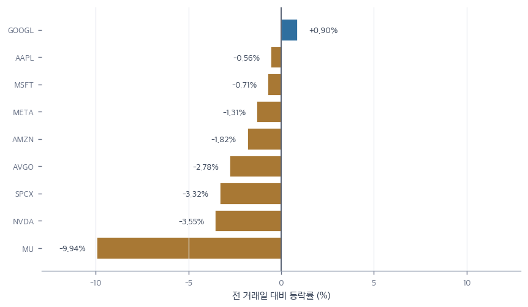
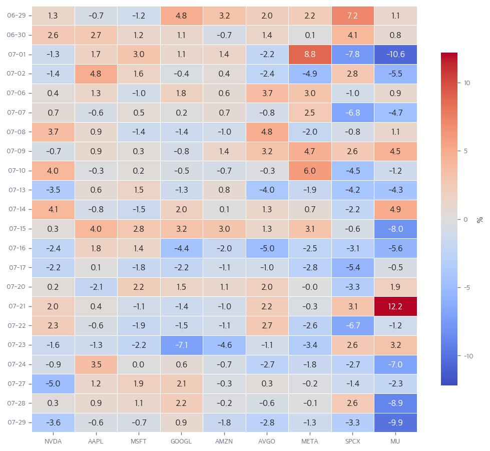
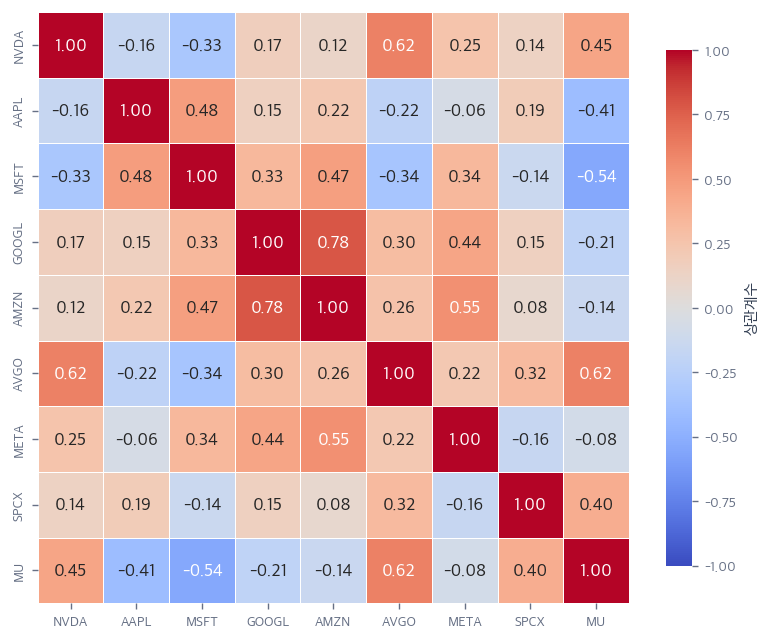
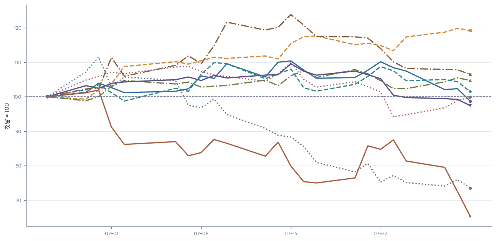
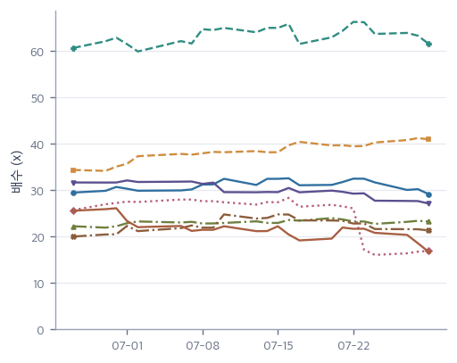
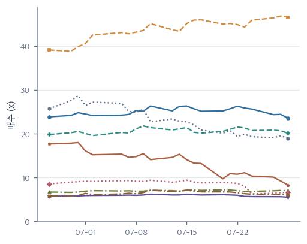
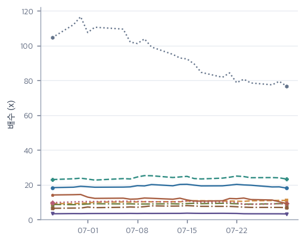

# 나스닥 일일 주가 리포트 - 2026-07-29

- 데이터 날짜: 2026-07-29
- 비교 기준일: 2026-07-28
- 생성 시각(UTC): 2026-07-30T00:12:46+00:00
- 3% 이상 변동 기준: abs(change_pct) >= 3.0%

## 전반적인 장 분위기

<!-- MARKET_SUMMARY:START -->
- **리스크오프:** 2026-07-29 미국 정규장(09:30~16:00 ET)에서 QQQ는 675.49달러에서 661.73달러로 **-2.04%**, 나스닥 종합은 **-1.74%**, S&P 500은 **-1.52%** 하락했고 시장 전반의 종목 다수가 약세를 보였다. ([QQQ 가격 이력](https://finance.yahoo.com/quote/QQQ/history/), [AP 지수 마감](https://apnews.com/article/wall-street-stocks-dow-nasdaq-a483060a0aa9c24c50f589b0b7713497))
- **관측 사실:** AI·반도체 차익실현과 밸류에이션 경계가 확대되며 NVDA가 3.6% 하락해 S&P 500의 최대 하락 기여 종목이 됐고, SK하이닉스는 사상 최대 실적에도 기대치를 밑돌아 9.6% 하락했다. ([AP 시장 보도](https://apnews.com/article/stocks-markets-ai-oil-trump-rates-b8bfaf782877957bbaa7196b70a4d725))
- **거시 재료:** 이란전 교전 재개로 브렌트유가 7.3% 급등해 배럴당 88.09달러에 마감했고, 미국 10년물 금리는 전일 4.61%에서 4.68%로 올라 성장주 할인율 부담을 키웠다. ([AP 유가·금리 보도](https://apnews.com/article/stocks-markets-ai-oil-trump-rates-b8bfaf782877957bbaa7196b70a4d725))
- **정책 재료:** 연준은 기준금리를 동결했지만 3명이 인상을 주장했고 향후 경로에 대한 안내를 줄여, 장 후반 금리·주가 변동성이 커질 여지를 남겼다. ([AP 연준 결정](https://apnews.com/article/stocks-markets-ai-oil-trump-rates-b8bfaf782877957bbaa7196b70a4d725))
<!-- MARKET_SUMMARY:END -->

## 전체 종목 변화율

### 당일 종목별 등락률

| 종목 | 종가 | 등락률 |
| --- | --- | --- |
| GOOGL | 336.71 | +0.90% |
| AAPL | 338.19 | -0.56% |
| MSFT | 390.54 | -0.71% |
| META | 585.61 | -1.31% |
| AMZN | 226.65 | -1.82% |
| AVGO | 370.32 | -2.78% |
| SPCX | 112.55 | -3.32% |
| NVDA | 190.01 | -3.55% |
| MU | 739.00 | -9.94% |

## 시장 흐름 히트맵

### 날짜별 등락률 히트맵

### 종목 간 수익률 상관 히트맵

## 종목별 변화 추이

### 기준일 대비 정규화 종가

## PER·PBR·PSR 변화 추이

### PER 변화 추이

### PBR 변화 추이

### PSR 변화 추이

## 3% 이상 변동 종목

| 종목 | 종가 | 등락률 |
| --- | --- | --- |
| SPCX | 112.55 | -3.32% |
| NVDA | 190.01 | -3.55% |
| MU | 739.00 | -9.94% |

## 원인 메모

### SPCX (-3.32%)
<!-- CAUSE:SPCX:START -->
- 당일 새로 확인된 강한 단일 기업 악재는 없었다. 3.32% 하락은 QQQ·나스닥 동반 약세 속에서 고변동 성장주 전반의 위험회피가 이어진 영향으로 해석하는 것이 타당하다. ([AP 시장 보도](https://apnews.com/article/stocks-markets-ai-oil-trump-rates-b8bfaf782877957bbaa7196b70a4d725))
- 회사별 배경으로는 8월 4일 첫 실적 발표와 8월 6일 9억1,150만 주의 단계적 락업 해제를 앞둔 잠재 매물 부담이 기존 약세 심리를 유지했다. ([Investing.com SPCX 보도](https://www.investing.com/news/stock-market-news/spacex-stock-erases-over-12-trillion-in-value-4817171))
<!-- CAUSE:SPCX:END -->

### NVDA (-3.55%)
<!-- CAUSE:NVDA:START -->
- NVDA는 3.55% 하락해 이날 S&P 500의 최대 하락 기여 종목이 됐다. 이는 개별 신규 악재보다 최근 AI 승자군에 대한 밸류에이션 재평가와 반도체 업종 매도의 성격이 강했다. ([AP 시장 보도](https://apnews.com/article/stocks-markets-ai-oil-trump-rates-b8bfaf782877957bbaa7196b70a4d725))
- 주요 HBM 공급사 SK하이닉스가 사상 최대 실적에도 시장 기대를 밑돌며 9.6% 하락했고, 중국 경쟁·AI 인프라 금융 부담 우려가 글로벌 반도체 심리를 약화시켰다. ([Reuters/Investing.com](https://www.investing.com/news/stock-market-news/samsung-sk-hynix-slide-amid-nvidia-financing-worries-china-competition-4815353))
- 브렌트유 급등과 미국 10년물 금리의 4.61%→4.68% 상승도 고밸류 성장주인 NVDA의 할인율 부담을 높였다. ([AP 유가·금리 보도](https://apnews.com/article/stocks-markets-ai-oil-trump-rates-b8bfaf782877957bbaa7196b70a4d725))
<!-- CAUSE:NVDA:END -->

### MU (-9.94%)
<!-- CAUSE:MU:START -->
- MU의 9.94% 급락을 설명할 만한 당일 신규 기업 악재는 확인되지 않았으며, 메모리·AI 반도체 업종의 디레이팅이 주된 배경으로 보인다. ([AP 시장 보도](https://apnews.com/article/stocks-markets-ai-oil-trump-rates-b8bfaf782877957bbaa7196b70a4d725))
- 직접 비교기업인 SK하이닉스는 사상 최대 매출·이익에도 기대치를 밑돌아 9.6% 하락했고, 중국 메모리 경쟁과 AI 투자 재원 우려가 MU를 포함한 업종 전반의 차익실현을 촉발했다. ([Reuters/Investing.com](https://www.investing.com/news/stock-market-news/samsung-sk-hynix-slide-amid-nvidia-financing-worries-china-competition-4815353))
- MU는 직전까지 연간 주가가 크게 오른 고베타 메모리 종목이라 금리 상승·위험회피 국면에서 업종 평균보다 낙폭이 확대된 것으로 해석된다. ([AP 유가·금리·반도체 보도](https://apnews.com/article/stocks-markets-ai-oil-trump-rates-b8bfaf782877957bbaa7196b70a4d725))
<!-- CAUSE:MU:END -->
