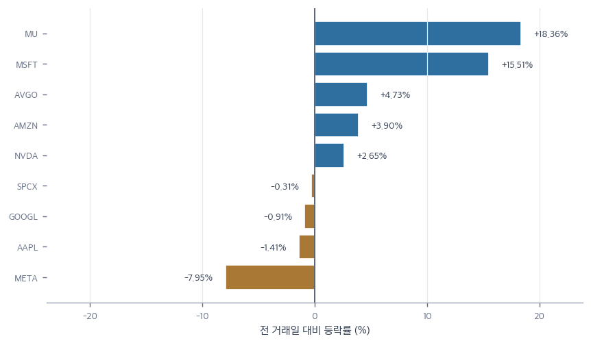
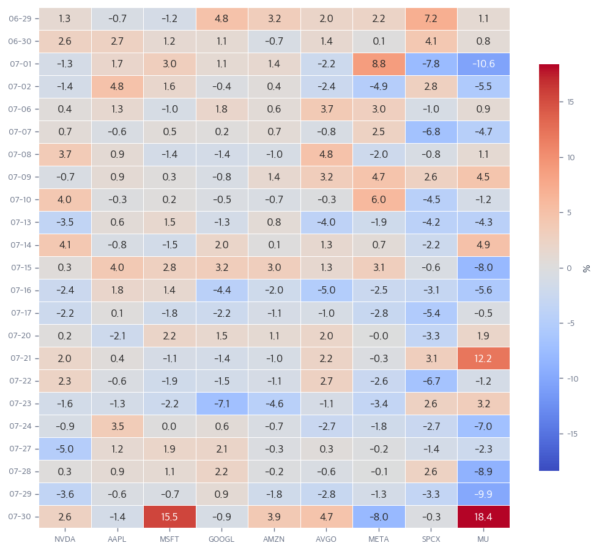
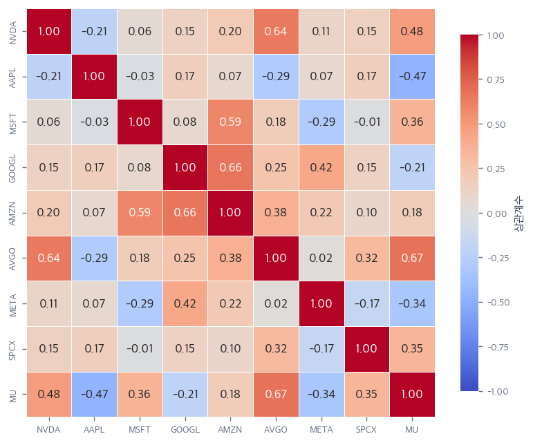
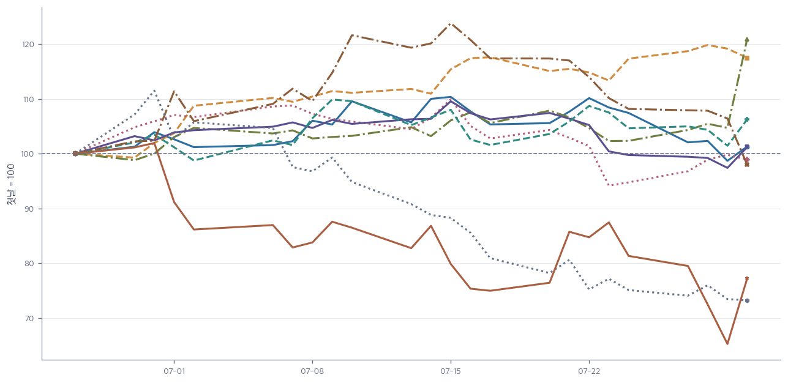
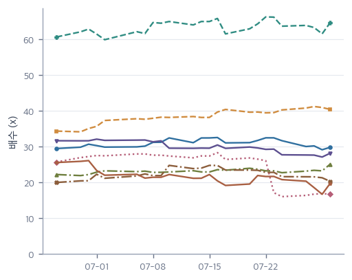
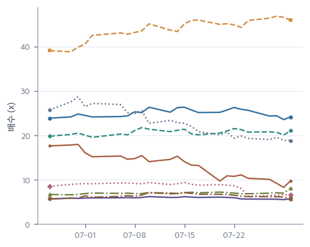
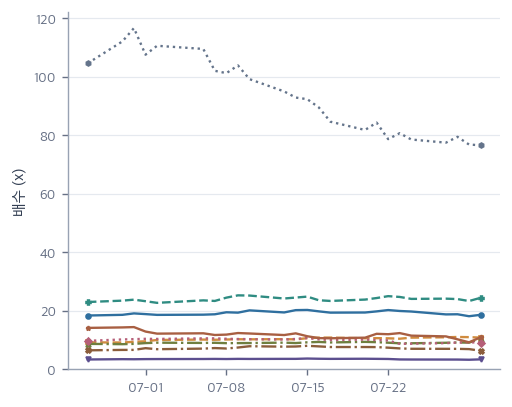

# 나스닥 일일 주가 리포트 - 2026-07-30

- 데이터 날짜: 2026-07-30
- 비교 기준일: 2026-07-29
- 생성 시각(UTC): 2026-07-31T00:01:42+00:00
- 3% 이상 변동 기준: abs(change_pct) >= 3.0%

## 전반적인 장 분위기

<!-- MARKET_SUMMARY:START -->
- **관찰 — 강한 위험선호/AI 반등 장세:** 2026-07-30 미국 정규장(09:30~16:00 ET)에서 QQQ는 661.73에서 683.55로 **+3.30%**, 나스닥 종합지수는 **+2.8%**, S&P 500은 **+1.7%** 상승해 성장주 중심의 상승 폭이 더 컸다. ([QQQ 가격 이력](https://finance.yahoo.com/quote/QQQ/history/), [AP 지수 마감](https://apnews.com/article/wall-street-stocks-dow-nasdaq-212b44c316056c9de10f90db562f3aed))
- **관찰 — 핵심 촉매:** Microsoft가 예상보다 강한 분기 실적과 Azure 성장세를 발표한 뒤 정규장에서 **+15.5%** 급등했고, 회사 발표 기준 Azure 및 기타 클라우드 서비스 매출은 전년 대비 **43%** 늘었다. ([Microsoft FY26 Q4](https://www.microsoft.com/en-us/investor/earnings/FY-2026-Q4/press-release-webcast), [AP 시장 마감](https://apnews.com/article/stock-markets-rates-korea-ai-oil-99b5702d93a2b5c6e513fb952ccdcc92))
- **관찰 — 반도체 동반 반등:** Micron **+18.4%**, Lam Research **+18%**, AMD **+13%** 등 AI 인프라 관련주가 최근 급락분을 일부 되돌렸다. **해석:** Microsoft의 클라우드·AI 수익화 증거가 AI 설비투자 수혜주 전반의 재평가를 촉발한 섹터 반등으로 보인다. ([AP 시장 마감](https://apnews.com/article/stock-markets-rates-korea-ai-oil-99b5702d93a2b5c6e513fb952ccdcc92))
- **관찰 — 남은 부담:** 10년물 미 국채금리는 전일과 같은 **4.67%**, 30년물은 **5.20%에서 5.22%**로 올라 인플레이션·장기금리 우려가 해소되지는 않았다. 따라서 이날 상승은 금리 완화보다 대형 기술주 실적과 AI 섹터 반등이 우세했던 결과로 해석한다. ([AP 금리·거시 맥락](https://apnews.com/article/stock-markets-rates-korea-ai-oil-99b5702d93a2b5c6e513fb952ccdcc92))
<!-- MARKET_SUMMARY:END -->

## 전체 종목 변화율

### 당일 종목별 등락률

| 종목 | 종가 | 등락률 |
| --- | --- | --- |
| MU | 874.66 | +18.36% |
| MSFT | 451.10 | +15.51% |
| AVGO | 387.84 | +4.73% |
| AMZN | 235.50 | +3.90% |
| NVDA | 195.04 | +2.65% |
| SPCX | 112.20 | -0.31% |
| GOOGL | 333.66 | -0.91% |
| AAPL | 333.43 | -1.41% |
| META | 539.03 | -7.95% |

## 시장 흐름 히트맵

### 날짜별 등락률 히트맵

### 종목 간 수익률 상관 히트맵

## 종목별 변화 추이

### 기준일 대비 정규화 종가

## PER·PBR·PSR 변화 추이

### PER 변화 추이

### PBR 변화 추이

### PSR 변화 추이

## 3% 이상 변동 종목

| 종목 | 종가 | 등락률 |
| --- | --- | --- |
| MU | 874.66 | +18.36% |
| MSFT | 451.10 | +15.51% |
| AVGO | 387.84 | +4.73% |
| AMZN | 235.50 | +3.90% |
| META | 539.03 | -7.95% |

## 원인 메모

### MU (+18.36%)
<!-- CAUSE:MU:START -->
- 정규장 **+18.36%**로 Microsoft 다음으로 S&P 500 상승에 크게 기여했다. AP는 이를 AI 관련 반도체주가 최근 급락분을 되돌린 흐름으로 설명했다. ([AP 시장 마감](https://apnews.com/article/stock-markets-rates-korea-ai-oil-99b5702d93a2b5c6e513fb952ccdcc92))
- 같은 날 Lam Research가 예상 상회 실적으로 **+18%**, AMD가 **+13%** 상승해 메모리·AI 인프라주 전반의 강한 동반 반등이 확인됐다. ([AP 시장 마감](https://apnews.com/article/stock-markets-rates-korea-ai-oil-99b5702d93a2b5c6e513fb952ccdcc92))
- 7월 30일 당일의 강한 단일 회사 공시는 확인되지 않았다. 따라서 Micron 고유 재료보다 Microsoft 실적이 되살린 AI 설비투자 기대와 반도체 섹터 숏커버·반등 맥락이 더 직접적인 설명이다. ([Micron 최신 공시 목록](https://investors.micron.com/latest-news))
<!-- CAUSE:MU:END -->

### MSFT (+15.51%)
<!-- CAUSE:MSFT:START -->
- 7월 29일 장 마감 후 발표한 FY26 4분기 매출은 **900억 달러**, 희석 EPS는 **4.81달러**였고, 매출·영업이익·조정 EPS가 회사가 제시한 기대를 웃돌았다. 이 결과가 7월 30일 정규장 **+15.51%** 반응의 핵심 재료였다. ([Microsoft FY26 Q4](https://www.microsoft.com/en-us/investor/earnings/FY-2026-Q4/press-release-webcast))
- Microsoft Cloud 매출은 전년 대비 **27%**, Azure 및 기타 클라우드 서비스 매출은 **43%** 증가해 AI 투자에 대한 실제 수요·수익화 근거를 제시했다. ([Microsoft 공식 발표](https://www.microsoft.com/en-us/investor/earnings/FY-2026-Q4/press-release-webcast), [AP 실적 해설](https://apnews.com/article/microsoft-earnings-results-ai-f7dff4fb9d51a2bdec56a13e5da1053d))
- 시장이 우려하던 2026년 설비투자 기대가 실질적으로 상향되지 않았다는 점도 긍정적으로 받아들여졌고, 주가는 약 18년 만의 최대 일일 상승률을 기록했다. ([AP 시장 마감](https://apnews.com/article/stock-markets-rates-korea-ai-oil-99b5702d93a2b5c6e513fb952ccdcc92))
<!-- CAUSE:MSFT:END -->

### AVGO (+4.73%)
<!-- CAUSE:AVGO:START -->
- 7월 30일 Broadcom의 강한 단일 회사 공시는 확인되지 않았다. 회사 금융뉴스 목록의 최신 당일 항목도 없어 **+4.73%**를 개별 공시로 단정하기 어렵다. ([Broadcom 금융뉴스 목록](https://investors.broadcom.com/financial-information/financial-news-releases))
- 같은 세션에 Microsoft의 Azure 성장과 AI 투자 수익화 신호로 반도체·AI 인프라주가 동반 반등했다. Broadcom 상승은 이 섹터 리스크온 흐름과 일치하지만, 이는 시장 맥락에 근거한 해석이지 확인된 단일 원인은 아니다. ([Microsoft 공식 발표](https://www.microsoft.com/en-us/investor/earnings/FY-2026-Q4/press-release-webcast), [AP 시장 마감](https://apnews.com/article/stock-markets-rates-korea-ai-oil-99b5702d93a2b5c6e513fb952ccdcc92))
<!-- CAUSE:AVGO:END -->

### AMZN (+3.90%)
<!-- CAUSE:AMZN:START -->
- 7월 30일 정규장 **+3.90%**를 직접 설명할 강한 단일 회사 뉴스는 확인되지 않았다. 같은 세션의 QQQ **+3.30%**, 나스닥 종합지수 **+2.8%** 상승과 맞물린 대형 성장주 위험선호가 가장 명확한 시장 맥락이다. ([QQQ 가격 이력](https://finance.yahoo.com/quote/QQQ/history/), [AP 지수 마감](https://apnews.com/article/wall-street-stocks-dow-nasdaq-212b44c316056c9de10f90db562f3aed))
- Amazon은 이날 **정규장 마감 후** 2분기 실적 발표가 예정돼 있어 이벤트 기대·포지셔닝의 영향 가능성은 있었지만, 이를 상승의 단일 원인으로 확정할 근거는 부족하다. ([Amazon 공식 실적 일정](https://ir.aboutamazon.com/news-release/news-release-details/2026/Amazon-com-to-Webcast-Second-Quarter-2026-Financial-Results-Conference-Call/default.aspx))
<!-- CAUSE:AMZN:END -->

### META (-7.95%)
<!-- CAUSE:META:START -->
- 7월 29일 장 마감 후 실적에서 분기 이익이 예상에 못 미쳤고, 3분기 매출 가이던스 중간값도 당시 시장 예상보다 낮았다. 이 발표에 대한 7월 30일 정규장 반응으로 주가는 **-7.95%** 하락했다. ([AP Meta 실적](https://apnews.com/article/meta-earnings-q2-facebook-profit-revenue-ai-bcbc62dde6d2cac724e3b3385fcabeab))
- 2분기 비용은 전년 대비 **55%** 늘어난 **420.3억 달러**였고, 법률 비용 24억 달러와 구조조정 비용 11.8억 달러가 포함됐다. 잉여현금흐름은 전년 대비 **91%** 감소한 7.84억 달러였다. ([AP Meta 실적](https://apnews.com/article/meta-earnings-q2-facebook-profit-revenue-ai-bcbc62dde6d2cac724e3b3385fcabeab))
- 회사가 2026년 총비용 전망의 하단을 올린 점도 AI 투자비와 현금흐름 부담에 대한 우려를 키웠다. 이는 같은 날 Microsoft가 AI 지출 대비 수익화 신뢰를 높인 것과 대조됐다. ([AP 시장 마감](https://apnews.com/article/stock-markets-rates-korea-ai-oil-99b5702d93a2b5c6e513fb952ccdcc92))
<!-- CAUSE:META:END -->
