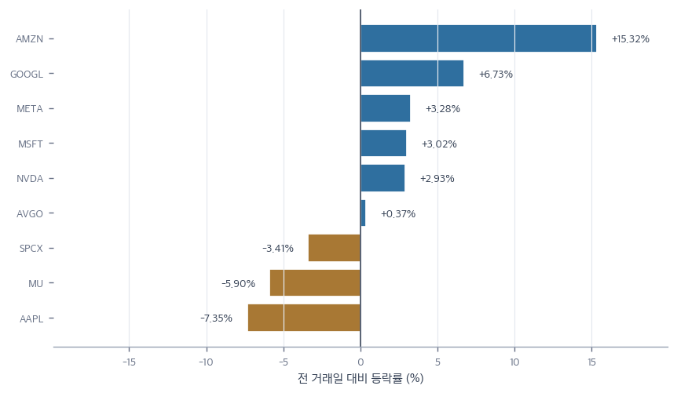
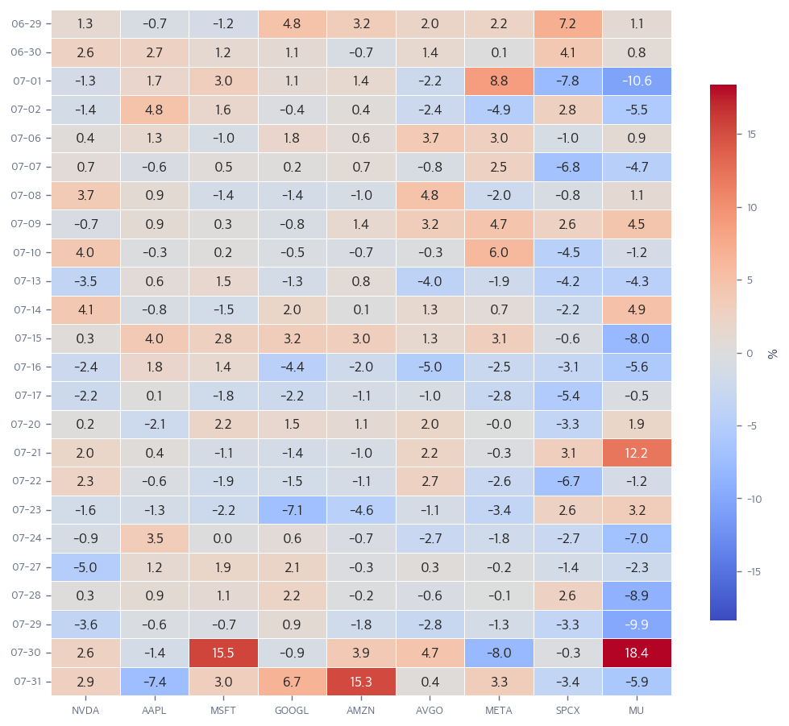
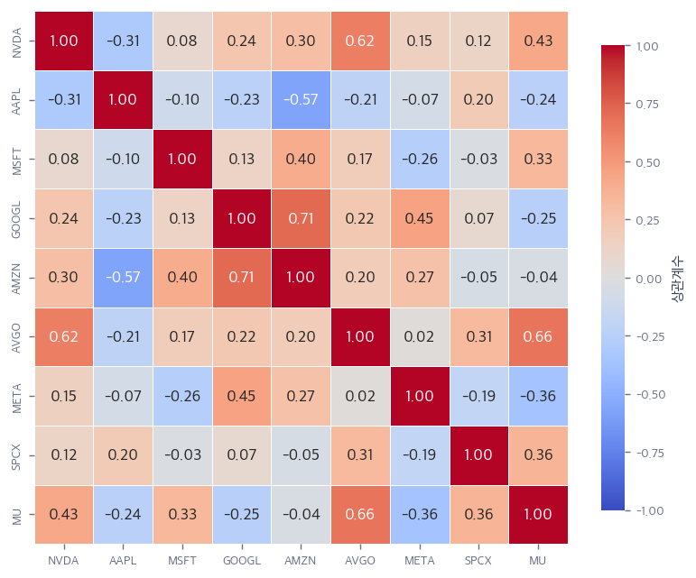
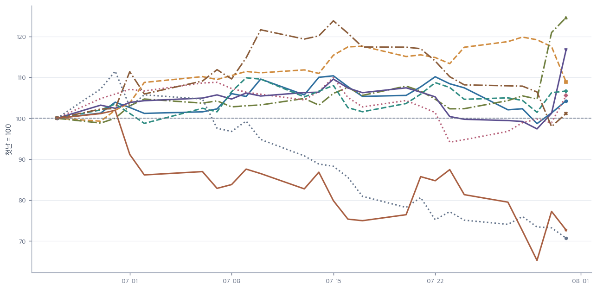
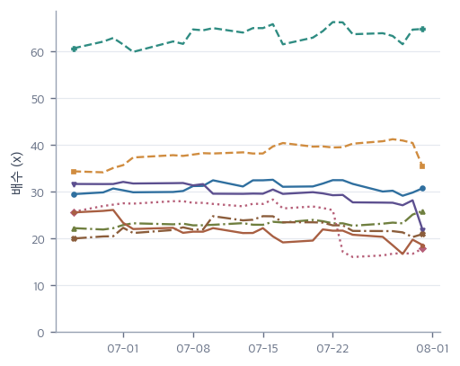
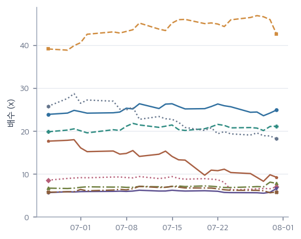
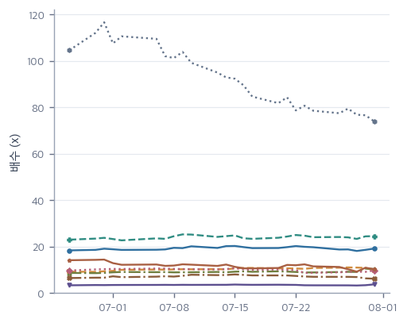

# 나스닥 일일 주가 리포트 - 2026-07-31

- 데이터 날짜: 2026-07-31
- 비교 기준일: 2026-07-30
- 생성 시각(UTC): 2026-08-01T00:01:54+00:00
- 3% 이상 변동 기준: abs(change_pct) >= 3.0%

## 전반적인 장 분위기

<!-- MARKET_SUMMARY:START -->
- **분류(관찰): 대형 기술주 중심의 위험선호였지만 시장 폭은 혼재했다.** 2026-07-31 미국 정규장(09:30~16:00 ET)에서 나스닥 종합지수는 **+1.0%**, S&P 500은 **+0.7%**, QQQ는 **+0.65%**였지만 러셀 2000은 **-0.5%**였다. ([AP 지수 마감](https://apnews.com/article/37d8d182f02f0fcdcf9f7db67e6dfadd), [QQQ 일별 시세](https://finance.yahoo.com/quote/QQQ/history/))
- **관찰:** Amazon은 예상보다 강한 분기 이익과 AWS 매출 **37% 증가**에 힘입어 급등한 반면, Apple은 기대에 못 미친 다음 분기 매출 성장 전망으로 하락해 대형 기술주 내부의 차별화가 컸다. ([AP 시장 보도](https://apnews.com/article/e31b3a442bcb957a53f1823ef21e73e8), [Axios Amazon 실적](https://www.axios.com/2026/07/30/amazon-earnings-revenue-ai))
- **관찰:** 유가 상승과 인플레이션 우려로 미 국채금리가 올랐고, 지수는 장중 상승분을 상당 부분 반납했다가 플러스로 마감했다. ([AP 시장 보도](https://apnews.com/article/e31b3a442bcb957a53f1823ef21e73e8))
- **해석:** 지수 상승이 초대형 기술주 실적 재평가에 크게 의존했고 중소형주는 하락했으므로, 광범위한 위험선호보다는 **메가캡 성장주로의 선택적 순환매** 성격이 강했다.
<!-- MARKET_SUMMARY:END -->

## 전체 종목 변화율

### 당일 종목별 등락률

| 종목 | 종가 | 등락률 |
| --- | --- | --- |
| AMZN | 271.58 | +15.32% |
| GOOGL | 356.13 | +6.73% |
| META | 556.71 | +3.28% |
| MSFT | 464.72 | +3.02% |
| NVDA | 200.75 | +2.93% |
| AVGO | 389.28 | +0.37% |
| SPCX | 108.37 | -3.41% |
| MU | 823.03 | -5.90% |
| AAPL | 308.91 | -7.35% |

## 시장 흐름 히트맵

### 날짜별 등락률 히트맵

### 종목 간 수익률 상관 히트맵

## 종목별 변화 추이

### 기준일 대비 정규화 종가

## PER·PBR·PSR 변화 추이

### PER 변화 추이

### PBR 변화 추이

### PSR 변화 추이

## 3% 이상 변동 종목

| 종목 | 종가 | 등락률 |
| --- | --- | --- |
| AMZN | 271.58 | +15.32% |
| GOOGL | 356.13 | +6.73% |
| META | 556.71 | +3.28% |
| MSFT | 464.72 | +3.02% |
| SPCX | 108.37 | -3.41% |
| MU | 823.03 | -5.90% |
| AAPL | 308.91 | -7.35% |

## 원인 메모

### AMZN (+15.32%)
<!-- CAUSE:AMZN:START -->
- 7월 30일 장 마감 후 공개된 2분기 실적에서 매출과 이익이 시장 예상을 웃돌았고, AWS 매출은 전년 동기 대비 **37% 증가**해 AI·클라우드 투자의 성과 기대를 높였다. ([Axios](https://www.axios.com/2026/07/30/amazon-earnings-revenue-ai))
- AP는 이 실적 호조를 7월 31일 정규장 Amazon 급등과 시장 상승의 핵심 요인으로 지목했다. ([AP](https://apnews.com/article/e31b3a442bcb957a53f1823ef21e73e8))
- 다만 최근 12개월 잉여현금흐름은 대규모 투자로 적자 전환해, 상승 재료와 투자 부담이 함께 남아 있다. ([Axios](https://www.axios.com/2026/07/30/amazon-earnings-revenue-ai))
<!-- CAUSE:AMZN:END -->

### GOOGL (+6.73%)
<!-- CAUSE:GOOGL:START -->
- 7월 31일 정규장 급등을 설명할 강한 단일 기업 뉴스는 확인되지 않았다. 당일 GOOGL 상승은 나스닥 종합지수 **+1.0%**, QQQ **+0.65%**와 함께 나타난 대형 기술주 강세의 일부로 보는 것이 타당하다. ([AP](https://apnews.com/article/37d8d182f02f0fcdcf9f7db67e6dfadd), [GOOGL 일별 시세](https://finance.yahoo.com/quote/GOOGL/history/))
- 따라서 특정 사건이 +6.73%를 직접 유발했다고 단정하지 않으며, AI 투자 성과를 둘러싼 메가캡 재평가와 순환매라는 시장 맥락만 확인된다. ([AP 시장 보도](https://apnews.com/article/e31b3a442bcb957a53f1823ef21e73e8))
<!-- CAUSE:GOOGL:END -->

### META (+3.28%)
<!-- CAUSE:META:START -->
- 7월 31일 정규장 +3.28% 상승을 설명할 뚜렷한 당일 단일 기업 촉매는 확인되지 않았다. 상승은 나스닥·QQQ가 함께 오른 대형 기술주 반등 국면에서 발생했다. ([AP](https://apnews.com/article/37d8d182f02f0fcdcf9f7db67e6dfadd), [META 일별 시세](https://finance.yahoo.com/quote/META/history/))
- 7월 29일 실적 직후에는 AI 비용 증가와 이익 감소 우려로 시간외에서 약세였으므로, 31일 움직임은 새 호재보다는 앞선 실적 반응 뒤의 재평가·되돌림 가능성이 있는 것으로만 해석한다. ([Axios](https://www.axios.com/newsletters/axios-closer-ddc12d61-6e9d-403f-be3c-6e138d44ec88), [Meta 실적 일정](https://investor.atmeta.com/investor-events/event-details/2026/Q2-2026-Earnings-Call/default.aspx))
<!-- CAUSE:META:END -->

### MSFT (+3.02%)
<!-- CAUSE:MSFT:START -->
- 7월 29일 장 마감 후 발표한 분기 실적이 시장 예상을 웃돌았고, Microsoft Cloud 매출은 전년 동기 대비 **27% 증가**해 AI 투자 수익화 기대를 뒷받침했다. ([AP](https://apnews.com/article/f7dff4fb9d51a2bdec56a13e5da1053d))
- 7월 31일 +3.02%는 이 실적 이후 이어진 재평가와 나스닥·QQQ 동반 강세가 겹친 움직임으로 보이며, 별도의 강한 당일 기업 뉴스는 확인되지 않았다. ([Axios](https://www.axios.com/2026/07/31/microsoft-cloud-stock-market-cap), [MSFT 일별 시세](https://finance.yahoo.com/quote/MSFT/history/))
<!-- CAUSE:MSFT:END -->

### SPCX (-3.41%)
<!-- CAUSE:SPCX:START -->
- 7월 31일 정규장 -3.41%를 설명할 신뢰할 만한 단일 기업 뉴스는 확인되지 않았다. 따라서 특정 사건을 원인으로 단정하지 않는다. ([SPCX 일별 시세](https://finance.yahoo.com/quote/SPCX/history/))
- 시장에서는 대형주 지수가 올랐지만 러셀 2000은 **-0.5%**로 하락해 종목·규모별 차별화가 컸으며, SPCX 약세는 이 혼재된 위험선호 환경과 높은 개별 변동성의 맥락에서만 해석할 수 있다. ([AP](https://apnews.com/article/37d8d182f02f0fcdcf9f7db67e6dfadd))
<!-- CAUSE:SPCX:END -->

### MU (-5.90%)
<!-- CAUSE:MU:START -->
- AP에 따르면 MU는 정규장 초반 **+6.4%**까지 올랐다가 **-5.9%**로 마감해, 단일 악재보다 AI·반도체 고평가 우려 속 극심한 장중 포지션 조정이 관찰됐다. ([AP](https://apnews.com/article/e31b3a442bcb957a53f1823ef21e73e8))
- 7월 31일 하락을 직접 설명할 새 회사 공시는 확인되지 않았다. 따라서 확인되지 않은 기업 고유 원인을 붙이지 않고, AI 투자 수익성과 반도체 주가 과열 우려라는 섹터 맥락만 제시한다. ([AP](https://apnews.com/article/e31b3a442bcb957a53f1823ef21e73e8), [Micron 보도자료](https://micron.gcs-web.com/latest-news))
<!-- CAUSE:MU:END -->

### AAPL (-7.35%)
<!-- CAUSE:AAPL:START -->
- Apple은 최근 분기 이익이 예상을 웃돌았지만, 다음 분기 매출 성장 전망이 시장 기대에 못 미쳐 7월 31일 정규장에서 **7.4%가량 하락**했다. ([AP](https://apnews.com/article/e31b3a442bcb957a53f1823ef21e73e8))
- 회사는 낮은 성장 전망의 배경으로 AI 붐이 촉발한 부품 공급 제약을 제시했다. 실적 자체보다 향후 성장 가이던스와 공급 부담이 주가 반응을 지배한 셈이다. ([AP](https://apnews.com/article/e31b3a442bcb957a53f1823ef21e73e8))
<!-- CAUSE:AAPL:END -->
