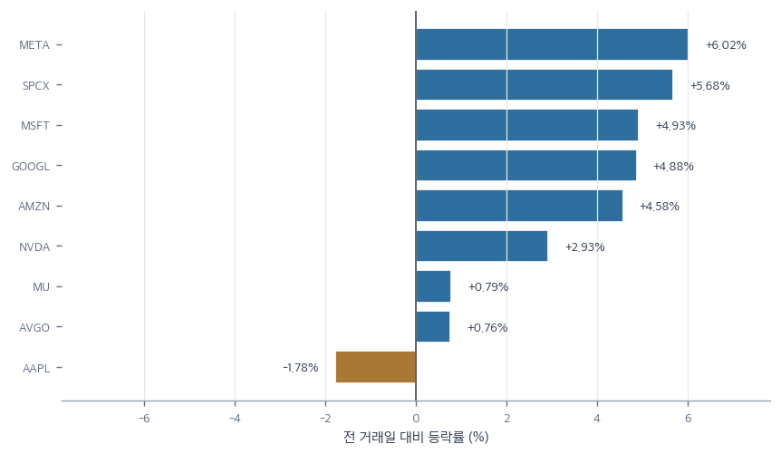
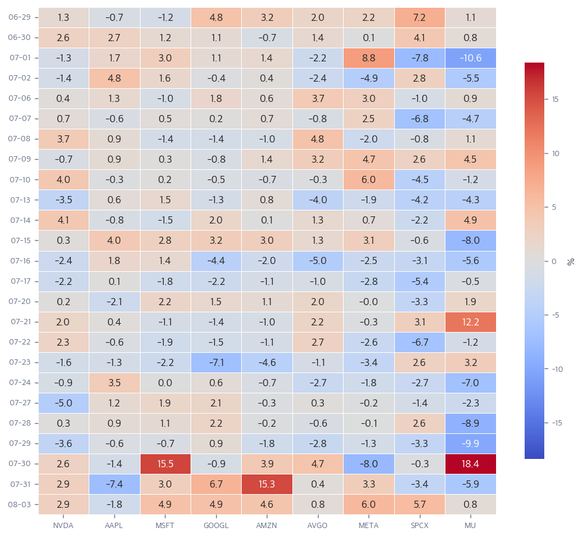
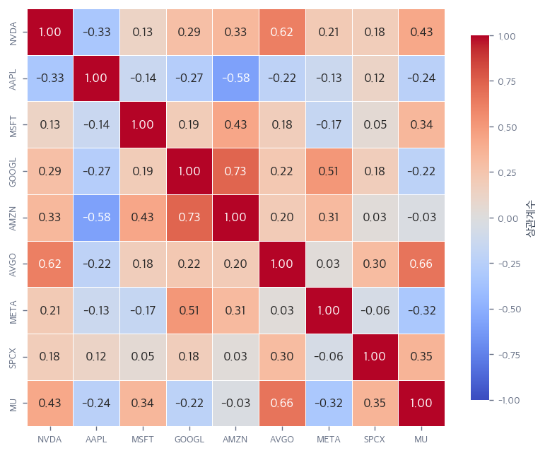
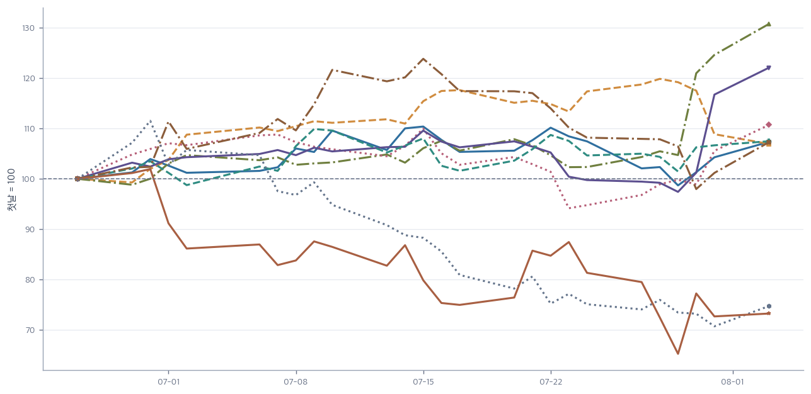
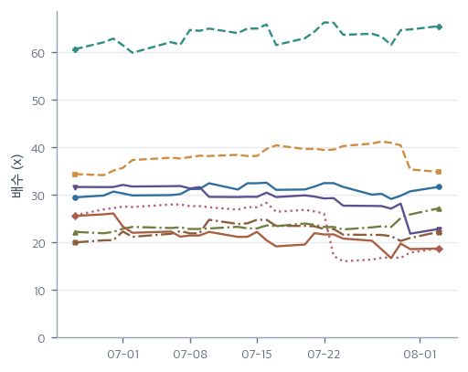
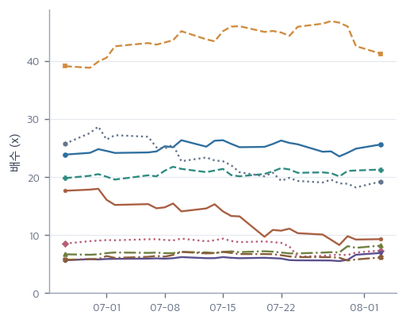
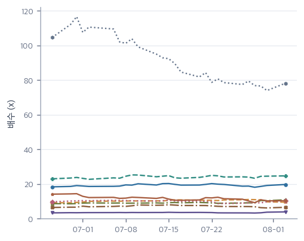

# 나스닥 일일 주가 리포트 - 2026-08-03

- 데이터 날짜: 2026-08-03
- 비교 기준일: 2026-07-31
- 생성 시각(UTC): 2026-08-04T00:02:20+00:00
- 3% 이상 변동 기준: abs(change_pct) >= 3.0%

## 전반적인 장 분위기

<!-- MARKET_SUMMARY:START -->
- **관찰·분류:** 2026-08-03 미국 정규장(미 동부시간 09:30–16:00 EDT)에서 QQQ는 $700.07로 전일 대비 **+1.76%**, 나스닥 종합은 **+2.1%**, S&P 500은 **+1.5%** 올라 기술주가 앞선 폭넓은 **리스크온** 장세였다. ([QQQ 가격](https://finance.yahoo.com/quote/QQQ/history/?period1=1785456000&period2=1785888000), [주요 지수](https://apnews.com/article/wall-street-stocks-dow-nasdaq-f8e5f81b45c83878f5b7f69832bb0c95))
- **관찰:** Dow **+1.3%**, Russell 2000 **+1.7%**까지 동반 상승해 상승세가 대형 기술주에만 한정되지는 않았다. ([AP 지수 마감](https://apnews.com/article/wall-street-stocks-dow-nasdaq-f8e5f81b45c83878f5b7f69832bb0c95))
- **당일 재료:** 트럼프 대통령이 이란에 대한 추가 공격을 보류한다고 밝힌 뒤 Brent유가 **-4.7%($83.77)**로 내려 인플레이션 우려가 완화됐고, 미 10년물 금리는 금요일 **4.75%에서 4.68%**로 하락했다. ([AP 시장 해설](https://apnews.com/article/stocks-markets-dollar-yen-trump-oil-d19a8f9a77b6fceca41da3e4b6bf17aa))
- **해석:** 같은 날 미국 제조업 성장세가 2022년 이후 가장 강했다는 지표도 위험선호를 보탰지만, 종목별 상승을 하나의 촉매로 단정하기보다는 유가·금리 완화와 최근 빅테크 실적 재평가가 겹친 흐름으로 보는 편이 타당하다. ([AP 시장 해설](https://apnews.com/article/stocks-markets-dollar-yen-trump-oil-d19a8f9a77b6fceca41da3e4b6bf17aa))
<!-- MARKET_SUMMARY:END -->

## 전체 종목 변화율

### 당일 종목별 등락률

| 종목 | 종가 | 등락률 |
| --- | --- | --- |
| META | 590.24 | +6.02% |
| SPCX | 114.53 | +5.68% |
| MSFT | 487.65 | +4.93% |
| GOOGL | 373.51 | +4.88% |
| AMZN | 284.02 | +4.58% |
| NVDA | 206.64 | +2.93% |
| MU | 829.50 | +0.79% |
| AVGO | 392.23 | +0.76% |
| AAPL | 303.42 | -1.78% |

## 시장 흐름 히트맵

### 날짜별 등락률 히트맵

### 종목 간 수익률 상관 히트맵

## 종목별 변화 추이

### 기준일 대비 정규화 종가

## PER·PBR·PSR 변화 추이

### PER 변화 추이

### PBR 변화 추이

### PSR 변화 추이

## 3% 이상 변동 종목

| 종목 | 종가 | 등락률 |
| --- | --- | --- |
| META | 590.24 | +6.02% |
| SPCX | 114.53 | +5.68% |
| MSFT | 487.65 | +4.93% |
| GOOGL | 373.51 | +4.88% |
| AMZN | 284.02 | +4.58% |

## 원인 메모

### META (+6.02%)
<!-- CAUSE:META:START -->
- **관찰:** META는 정규장에서 **+6.02%** 상승했으나, 8월 3일 장중 수익률을 직접 설명할 만한 새 회사 공시나 단일 호재는 확인되지 않았다.
- **시장 맥락:** 나스닥 **+2.1%**와 금리 하락이 장기 성장주 전반을 끌어올린 날이어서, META의 상승에도 이 위험선호 회복이 공통 배경으로 작용한 것으로 해석된다. ([AP 시장 해설](https://apnews.com/article/stocks-markets-dollar-yen-trump-oil-d19a8f9a77b6fceca41da3e4b6bf17aa))
- **선행 맥락·해석:** 직전 실적 발표 뒤 META는 7월 30일 **-8.0%** 급락하며 11거래일 연속 하락했으므로, 이번 반등에는 낙폭 되돌림 성격도 있었을 가능성이 크지만 확정 원인은 아니다. ([Kiplinger 7월 30일 마감](https://www.kiplinger.com/investing/stocks/nasdaq-soars-679-points-as-microsoft-pops-stock-market-today))
<!-- CAUSE:META:END -->

### SPCX (+5.68%)
<!-- CAUSE:SPCX:START -->
- **관찰:** SPCX는 정규장에서 **+5.68%** 상승했지만, 같은 날 확인 가능한 확정적 신규 호재는 찾지 못했다.
- **이벤트 맥락:** 8월 3일 보도에 따르면 상장 후 첫 실적 발표가 다음 날(8월 4일) 예정됐고, 8월 6일에는 **9억1,150만 주**의 보호예수 해제가 가능해 실적·수급 이벤트를 앞둔 포지셔닝이 집중됐다. ([Axios](https://www.axios.com/2026/08/03/spacex-stock-lockup-earnings))
- **해석:** 시장 전체의 리스크온 흐름 속에서 실적 전 기대·숏커버 가능성이 상승폭을 키웠을 수 있으나, 거래 자료만으로 이를 단일 원인으로 확정할 수는 없다. ([AP 시장 해설](https://apnews.com/article/stocks-markets-dollar-yen-trump-oil-d19a8f9a77b6fceca41da3e4b6bf17aa))
<!-- CAUSE:SPCX:END -->

### MSFT (+4.93%)
<!-- CAUSE:MSFT:START -->
- **관찰:** MSFT는 정규장에서 **+4.93%** 상승했으며, 8월 3일 당일의 별도 신규 회사 발표는 확인되지 않았다.
- **실적 재평가:** 7월 29일 발표된 분기 매출은 **$900억**으로 시장 예상치를 웃돌았고 Azure 연간 매출이 처음 $1,000억을 넘는 등 클라우드·AI 성장세가 확인돼, 실적 이후의 긍정적 재평가가 이어진 배경이 됐다. ([AP 실적 보도](https://apnews.com/article/f7dff4fb9d51a2bdec56a13e5da1053d))
- **시장 맥락·해석:** 나스닥 강세와 10년물 금리 하락이 더해져 상승폭이 확대된 것으로 보이나, 이는 당일 단일 뉴스에 의한 움직임이라기보다 실적 모멘텀과 리스크온의 결합으로 보는 편이 적절하다. ([AP 시장 해설](https://apnews.com/article/stocks-markets-dollar-yen-trump-oil-d19a8f9a77b6fceca41da3e4b6bf17aa))
<!-- CAUSE:MSFT:END -->

### GOOGL (+4.88%)
<!-- CAUSE:GOOGL:START -->
- **관찰:** GOOGL은 정규장에서 **+4.88%** 상승했으나, 8월 3일의 뚜렷한 단일 회사 촉매는 확인되지 않았다.
- **실적 재평가:** 최근 Q2 발표에서 Alphabet 매출은 전년 대비 **+24%**, Google Cloud 매출은 **+82%**로 제시돼 AI·클라우드 성장 기대가 계속되는 배경이 됐다. ([Google 공식 Q2 설명](https://blog.google/company-news/inside-google/message-ceo/alphabet-earnings-q2-2026/))
- **시장 맥락·해석:** 나스닥 **+2.1%**, QQQ **+1.76%**의 기술주 강세와 금리 하락 속에서 최근 실적의 긍정적 재평가가 이어진 움직임으로 보되, 확정적인 당일 인과로 단정하지 않는다. ([AP 지수 마감](https://apnews.com/article/wall-street-stocks-dow-nasdaq-f8e5f81b45c83878f5b7f69832bb0c95), [QQQ 가격](https://finance.yahoo.com/quote/QQQ/history/?period1=1785456000&period2=1785888000))
<!-- CAUSE:GOOGL:END -->

### AMZN (+4.58%)
<!-- CAUSE:AMZN:START -->
- **관찰:** AMZN은 정규장에서 **+4.58%** 상승했으며, 8월 3일에 새로 나온 강한 단일 회사 촉매는 확인되지 않았다.
- **실적 재평가:** 7월 30일 Q2 발표에서 AWS 매출 성장률이 **+37%**로 18개 분기 중 가장 빨랐고, 이 실적 호조가 직전 거래일부터 이어진 긍정적 배경이었다. ([AP Amazon 실적](https://apnews.com/article/b4ce02b4666a35b8975823c5c22072ee))
- **시장 맥락·해석:** 기술주 중심 리스크온과 금리 하락이 최근 AWS 실적 모멘텀을 강화한 것으로 보이나, 당일 상승을 특정 새 발표 하나로 설명할 근거는 부족하다. ([AP 시장 해설](https://apnews.com/article/stocks-markets-dollar-yen-trump-oil-d19a8f9a77b6fceca41da3e4b6bf17aa))
<!-- CAUSE:AMZN:END -->
