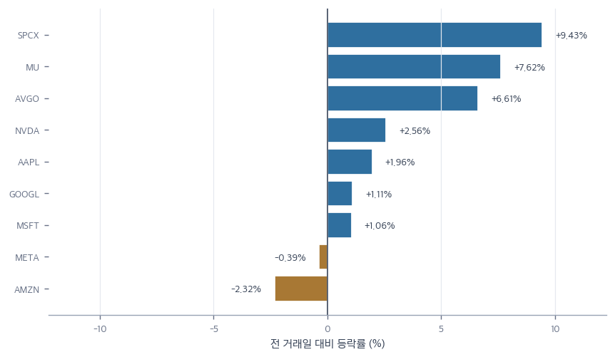
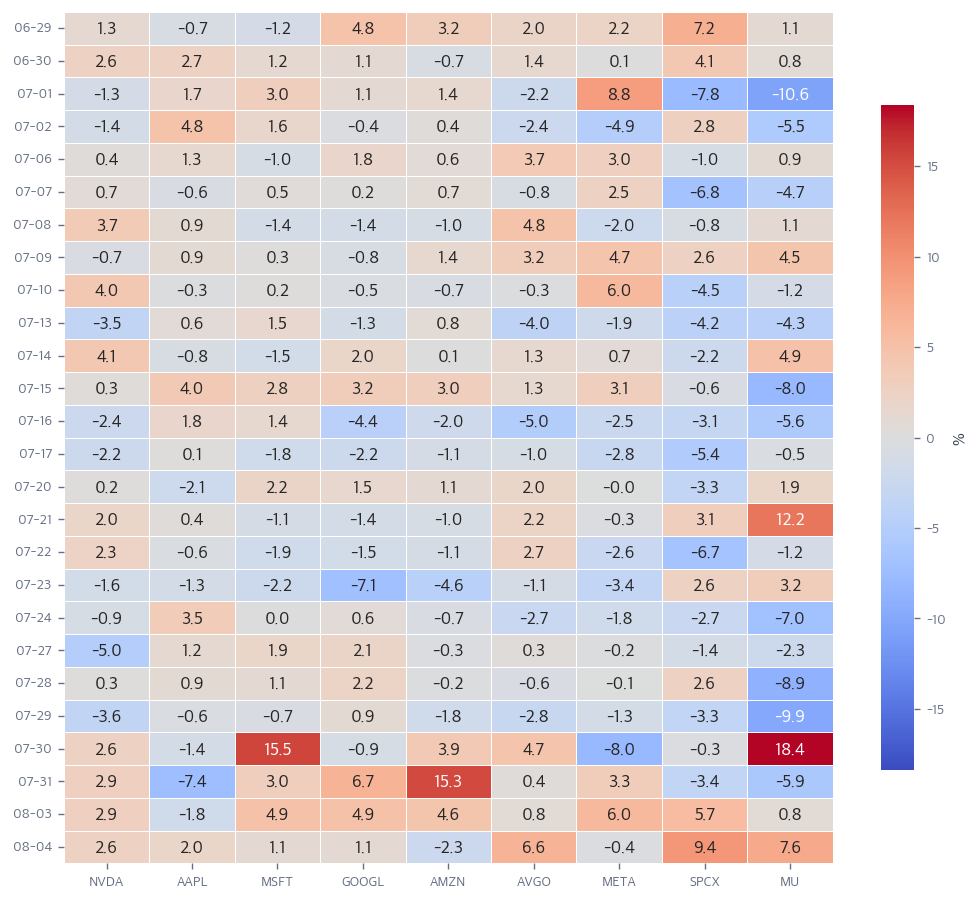
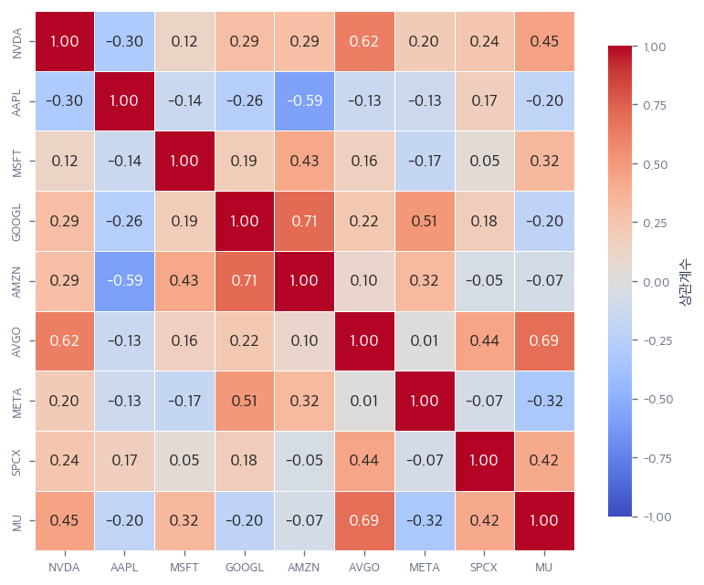
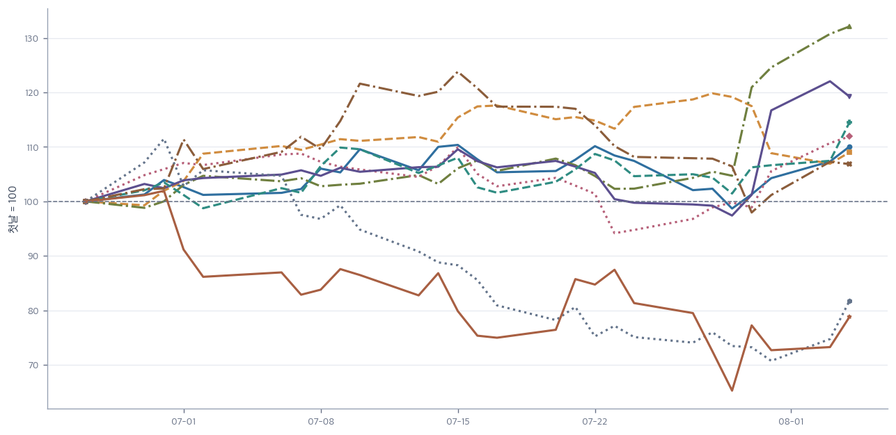
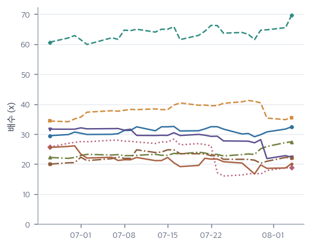
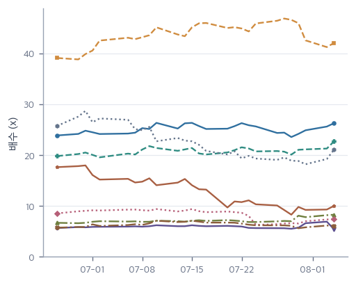
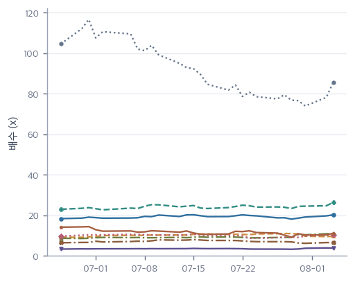

# 나스닥 일일 주가 리포트 - 2026-08-04

- 데이터 날짜: 2026-08-04
- 비교 기준일: 2026-08-03
- 생성 시각(UTC): 2026-08-05T00:01:13+00:00
- 3% 이상 변동 기준: abs(change_pct) >= 3.0%

## 전반적인 장 분위기

<!-- MARKET_SUMMARY:START -->
- **분류(해석):** 2026-08-04 미국 정규장(09:30~16:00 ET)은 QQQ +3.38%, 나스닥 종합지수 +2.6%, S&P 500 +1.8%로 기술주가 주도한 광범위한 **risk-on** 장세였다. ([QQQ 정규장 데이터](https://stockanalysis.com/etf/qqq/history/), [AP 지수 마감](https://apnews.com/article/wall-street-stocks-dow-nasdaq-41726508095971a7ee425362f7669c0f))
- **관찰:** S&P 500과 다우는 사상 최고 종가를 기록했고, 중소형주 Russell 2000도 +1.8% 올라 상승 폭이 대형 기술주에만 국한되지는 않았다. ([AP](https://apnews.com/article/wall-street-stocks-dow-nasdaq-41726508095971a7ee425362f7669c0f))
- **관찰/섹터:** 반도체 ETF SOXX가 정규장 +6.78%로 QQQ를 크게 웃돌아 반도체가 기술주 상승을 주도했다. ([SOXX 정규장 데이터](https://stockanalysis.com/etf/soxx/history/))
- **당일 재료(관찰):** Brent 유가가 배럴당 80달러 아래로 내려가며 국채금리가 완화됐고, Palantir(PLTR)와 Caterpillar(CAT)의 예상을 웃돈 실적이 지수 상승에 힘을 보탰다. ([AP](https://apnews.com/article/wall-street-stocks-dow-nasdaq-41726508095971a7ee425362f7669c0f))
<!-- MARKET_SUMMARY:END -->

## 전체 종목 변화율

### 당일 종목별 등락률

| 종목 | 종가 | 등락률 |
| --- | --- | --- |
| SPCX | 125.33 | +9.43% |
| MU | 892.67 | +7.62% |
| AVGO | 418.16 | +6.61% |
| NVDA | 211.94 | +2.56% |
| AAPL | 309.38 | +1.96% |
| GOOGL | 377.65 | +1.11% |
| MSFT | 492.81 | +1.06% |
| META | 587.94 | -0.39% |
| AMZN | 277.42 | -2.32% |

## 시장 흐름 히트맵

### 날짜별 등락률 히트맵

### 종목 간 수익률 상관 히트맵

## 종목별 변화 추이

### 기준일 대비 정규화 종가

## PER·PBR·PSR 변화 추이

### PER 변화 추이

### PBR 변화 추이

### PSR 변화 추이

## 3% 이상 변동 종목

| 종목 | 종가 | 등락률 |
| --- | --- | --- |
| SPCX | 125.33 | +9.43% |
| MU | 892.67 | +7.62% |
| AVGO | 418.16 | +6.61% |

## 원인 메모

### SPCX (+9.43%)
<!-- CAUSE:SPCX:START -->
- **정규장 관찰/가능 원인:** SPCX는 09:30~16:00 ET 정규장에서 +9.43% 마감했다. Axios는 첫 상장사 분기 실적 발표를 앞둔 기대가 반영되며 정규장에 약 9.4% 올랐다고 전했다. ([Axios Closer](https://www.axios.com/newsletters/axios-closer-f8186890-7ddf-4084-b60d-d84a9e794345))
- **장후 구분:** 16:00 ET 이후 발표된 매출은 전년 대비 92% 증가한 78.1억달러로 예상 69억달러를 웃돌았지만, 장후 주가는 6% 넘게 하락했다. 이 장후 반응은 정규장 +9.43%의 원인과 분리해 봐야 한다. ([Axios 실적 보도](https://www.axios.com/2026/08/04/spacex-earnings-elon-musk), [Axios Closer](https://www.axios.com/newsletters/axios-closer-f8186890-7ddf-4084-b60d-d84a9e794345))
<!-- CAUSE:SPCX:END -->

### MU (+7.62%)
<!-- CAUSE:MU:START -->
- **관찰:** MU는 +7.62%였고, 같은 정규장에 반도체 ETF SOXX가 +6.78%, QQQ가 +3.38% 상승했다. ([SOXX](https://stockanalysis.com/etf/soxx/history/), [QQQ](https://stockanalysis.com/etf/qqq/history/))
- **해석:** 당일 등락을 직접 설명하는 강한 Micron 개별 재료는 확인되지 않았다. 유가 하락·금리 완화 속 나스닥이 +2.6% 오른 risk-on 환경과 반도체 섹터 반등에 동행한 움직임으로 보는 것이 가장 보수적이다. ([AP](https://apnews.com/article/wall-street-stocks-dow-nasdaq-41726508095971a7ee425362f7669c0f))
<!-- CAUSE:MU:END -->

### AVGO (+6.61%)
<!-- CAUSE:AVGO:START -->
- **관찰:** AVGO는 +6.61%였고, 같은 정규장에 반도체 ETF SOXX가 +6.78%, QQQ가 +3.38% 상승했다. ([SOXX](https://stockanalysis.com/etf/soxx/history/), [QQQ](https://stockanalysis.com/etf/qqq/history/))
- **해석:** 당일 등락을 직접 설명하는 강한 Broadcom 개별 재료는 확인되지 않았다. 유가 하락·금리 완화 속 나스닥이 +2.6% 오른 risk-on 환경과 반도체 섹터 반등에 동행한 움직임으로 보는 것이 가장 보수적이다. ([AP](https://apnews.com/article/wall-street-stocks-dow-nasdaq-41726508095971a7ee425362f7669c0f))
<!-- CAUSE:AVGO:END -->
