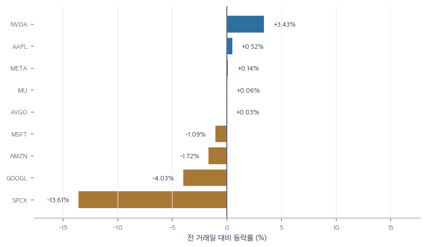
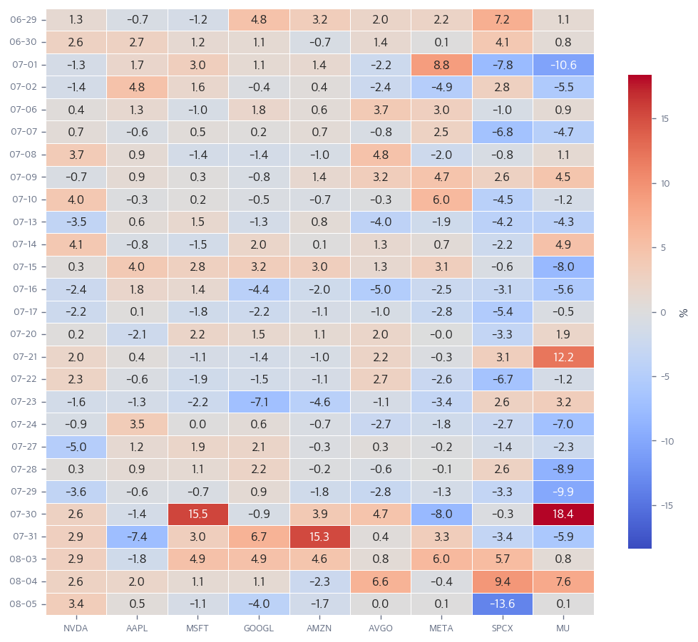
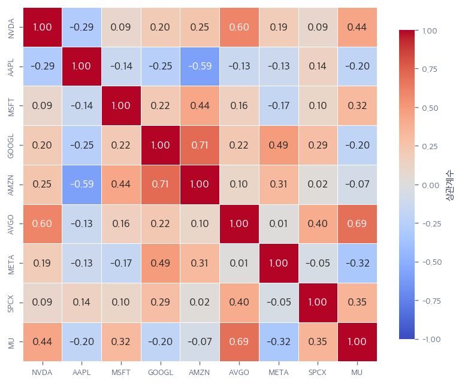
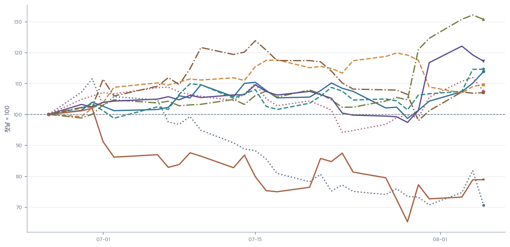
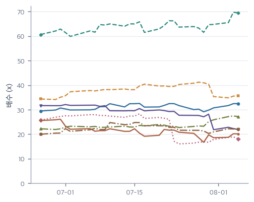
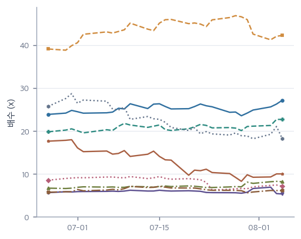
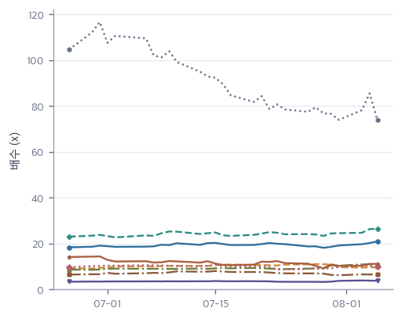

# 나스닥 일일 주가 리포트 - 2026-08-05

- 데이터 날짜: 2026-08-05
- 비교 기준일: 2026-08-04
- 생성 시각(UTC): 2026-08-06T00:01:47+00:00
- 3% 이상 변동 기준: abs(change_pct) >= 3.0%

## 전반적인 장 분위기

<!-- MARKET_SUMMARY:START -->
- **혼조·기술주 중심 조정:** 2026-08-05 미국 정규장(미 동부시간 09:30~16:00)에서 QQQ는 723.85에서 717.30으로 **-0.90%**, 나스닥 종합은 **-0.83%**, S&P 500은 **-0.17%**인 반면 다우는 **+0.49%**로 마감해 전면적 위험회피보다 대형 기술주 약세와 섹터 로테이션이 두드러졌다. ([QQQ 과거 시세](https://finance.yahoo.com/quote/QQQ/history/), [AP 지수 마감](https://apnews.com/article/stocks-markets-rates-oil-prices-53179dc1c0148c5afeb47379b8f5b5c5))
- **관찰 사실:** Alphabet이 약 4%, Microsoft가 1.1% 하락하며 나스닥을 눌렀지만 Nvidia는 3.4% 상승했다. 즉 AI·대형 기술주 내부에서도 방향이 갈려 단일한 리스크오프 장세로 보기는 어렵다. ([AP](https://apnews.com/article/stocks-markets-rates-oil-prices-53179dc1c0148c5afeb47379b8f5b5c5))
- **당일 기업 재료:** SpaceX의 첫 상장사 실적에서 AI 중심 지출 확대가 부각돼 SPCX가 13.6% 하락한 반면, SpaceX가 AI용 칩을 Nvidia 제품으로 단일화한다고 밝히며 NVDA에는 수혜가 집중됐다. ([AP](https://apnews.com/article/stocks-markets-rates-oil-prices-53179dc1c0148c5afeb47379b8f5b5c5))
- **금리·지정학 관찰:** 미 10년물 금리는 4.63%에서 4.61%로 낮아졌고 유가는 거의 보합이었으나, 호르무즈 해협 합의 기대와 이란 전쟁 불확실성이 공존했다. 금리 하락은 완충 요인이었지만 기술주별 재료를 상쇄하지는 못했다. ([AP](https://apnews.com/article/stocks-markets-rates-oil-prices-53179dc1c0148c5afeb47379b8f5b5c5))
<!-- MARKET_SUMMARY:END -->

## 전체 종목 변화율

### 당일 종목별 등락률

| 종목 | 종가 | 등락률 |
| --- | --- | --- |
| NVDA | 219.22 | +3.43% |
| AAPL | 311.00 | +0.52% |
| META | 588.77 | +0.14% |
| MU | 893.19 | +0.06% |
| AVGO | 418.28 | +0.03% |
| MSFT | 487.46 | -1.09% |
| AMZN | 272.65 | -1.72% |
| GOOGL | 362.43 | -4.03% |
| SPCX | 108.27 | -13.61% |

## 시장 흐름 히트맵

### 날짜별 등락률 히트맵

### 종목 간 수익률 상관 히트맵

## 종목별 변화 추이

### 기준일 대비 정규화 종가

## PER·PBR·PSR 변화 추이

### PER 변화 추이

### PBR 변화 추이

### PSR 변화 추이

## 3% 이상 변동 종목

| 종목 | 종가 | 등락률 |
| --- | --- | --- |
| NVDA | 219.22 | +3.43% |
| GOOGL | 362.43 | -4.03% |
| SPCX | 108.27 | -13.61% |

## 원인 메모

### NVDA (+3.43%)
<!-- CAUSE:NVDA:START -->
- **관찰 사실:** SpaceX가 자사 AI 기술에 Nvidia 칩을 독점 사용하겠다고 발표했고, 같은 정규장에서 NVDA는 3.4% 상승했다. ([AP](https://apnews.com/article/stocks-markets-rates-oil-prices-53179dc1c0148c5afeb47379b8f5b5c5))
- **해석:** 나스닥과 일부 대형 기술주가 하락한 날에도 대형 고객의 구체적 채택 발표가 확인돼, 이번 상승은 시장 전반보다 Nvidia의 고객 수요 재료가 주된 동력으로 보인다. ([AP](https://apnews.com/article/stocks-markets-rates-oil-prices-53179dc1c0148c5afeb47379b8f5b5c5))
<!-- CAUSE:NVDA:END -->

### GOOGL (-4.03%)
<!-- CAUSE:GOOGL:START -->
- **관찰 사실:** 당일 Demis Hassabis가 Google DeepMind CEO에서 의장·Alphabet 수석과학자로 이동하고, 수석과학자 Jeff Dean과 여러 AI 인력이 새 회사를 세우기 위해 퇴사한다고 발표됐다. ([Google 발표](https://blog.google/company-news/inside-google/message-ceo/next-chapter-ai-momentum/), [Axios](https://www.axios.com/2026/08/05/google-deepmind-demis-hassabis-ai))
- **시장 반응:** Axios는 이 발표 뒤 Alphabet 주가가 4% 넘게 하락했다고 전했고, AP도 Alphabet의 약 4% 하락이 나스닥 약세의 주요 부담이었다고 집계했다. ([Axios](https://www.axios.com/2026/08/05/google-deepmind-demis-hassabis-ai), [AP](https://apnews.com/article/stocks-markets-rates-oil-prices-53179dc1c0148c5afeb47379b8f5b5c5))
- **해석:** 역할 확대라는 긍정적 설명도 있으나, 핵심 AI 조직의 동시다발적 리더십·인력 이동이 단기 실행력과 인재 유지 우려를 키운 것이 가장 직접적인 하락 재료로 보인다.
<!-- CAUSE:GOOGL:END -->

### SPCX (-13.61%)
<!-- CAUSE:SPCX:START -->
- **실적 관찰:** 8월 4일 장 마감 후 첫 상장사 분기보고에서 SpaceX는 5.41억달러(주당 0.09달러) 손실과 78억달러 매출(+90% 이상)을 발표했으며, 손실은 예상보다 작았다. ([AP 실적 보도](https://apnews.com/article/musk-spacex-tesla-earnings-merger-3b7b66a3e522e51d75caebc40af7e09e))
- **부담 요인:** 인프라·R&D 지출이 전년 30억달러 미만에서 180억달러로 급증했고 향후 두 분기도 비슷한 자본지출이 예고됐다. 8월 6일에는 9억주 넘는 락업 물량이 풀려 유통 가능 주식이 두 배 이상 늘어날 예정이었다. ([AP 실적 보도](https://apnews.com/article/musk-spacex-tesla-earnings-merger-3b7b66a3e522e51d75caebc40af7e09e))
- **해석:** 양호한 매출 성장과 예상보다 작은 손실보다 AI 중심 지출 급증과 임박한 공급 확대 우려가 우세했고, AP도 이 실적 발표 뒤 정규장 13.6% 하락을 직접 연결했다. ([AP 시장 마감](https://apnews.com/article/stocks-markets-rates-oil-prices-53179dc1c0148c5afeb47379b8f5b5c5))
<!-- CAUSE:SPCX:END -->
