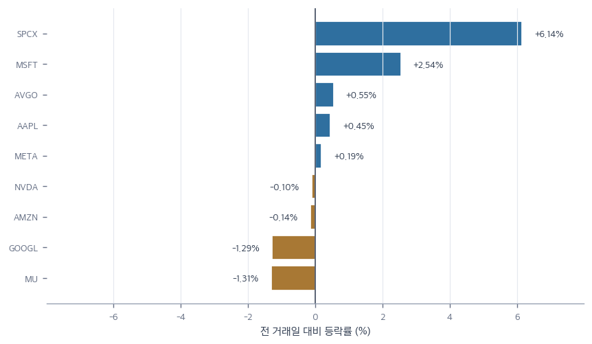
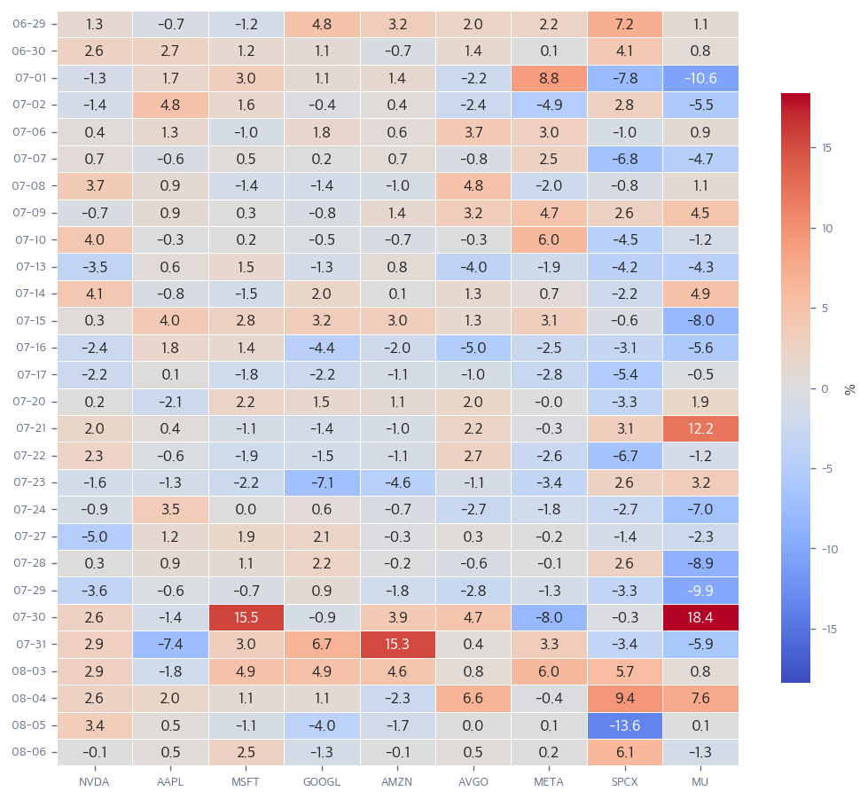
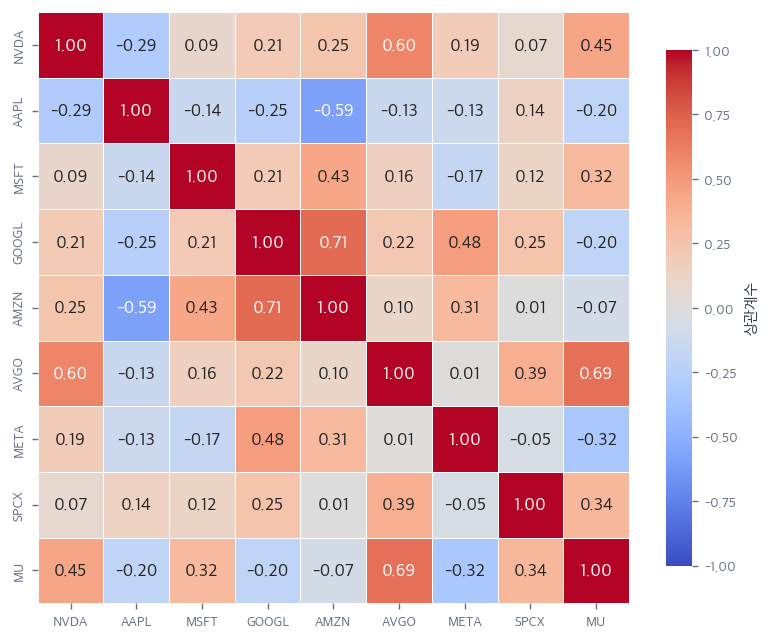
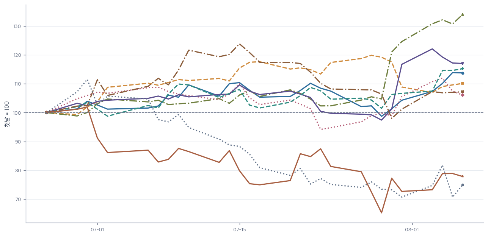
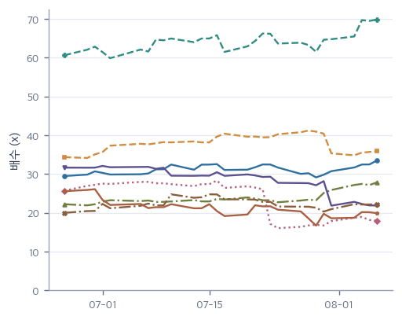
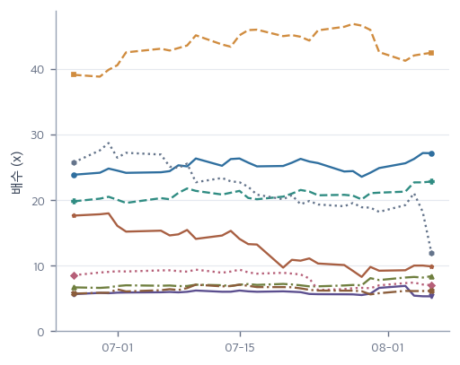
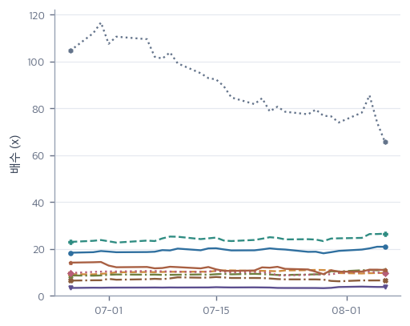

# 나스닥 일일 주가 리포트 - 2026-08-06

- 데이터 날짜: 2026-08-06
- 비교 기준일: 2026-08-05
- 생성 시각(UTC): 2026-08-07T00:02:55+00:00
- 3% 이상 변동 기준: abs(change_pct) >= 3.0%

## 전반적인 장 분위기

<!-- MARKET_SUMMARY:START -->
- **해석 — 완만한 risk-off:** 2026-08-06 미국 정규장(09:30~16:00 ET)에서 QQQ는 714.65로 **-0.37%**, 나스닥 종합은 26,348.35로 **-0.1%**, S&P 500은 7,709.96으로 **-0.2%**, 다우는 53,885.10으로 **-0.9%** 마감해 대형 기술주와 광범위 지수가 함께 약세였다. ([QQQ 정규장 자료](https://stockanalysis.com/etf/qqq/history/), [주요 지수 마감](https://apnews.com/article/stock-market-dow-warner-dow-jones-b13b60e192e74e6dc6ab222dc296b5d2))
- **관찰 — 유가·지정학:** 미국-이란 전쟁과 호르무즈 해협 불확실성이 이어지는 가운데 브렌트유가 **3.8% 올라 $82.49**를 기록해 인플레이션 부담을 키웠다. ([AP 시장 보도](https://apnews.com/article/stocks-markets-ai-spacex-hynix-bonds-2f4f2638cb8430bb7c8e5d59a7b50731))
- **관찰 — 금리:** 미 10년물 국채금리는 전일 4.63%에서 **4.67%**로 상승했다. 같은 날 신규 실업수당 청구는 증가했지만 해고는 역사적으로 낮은 범위에 머물렀고, 시장은 다음 날 7월 고용보고서를 앞두고 있었다. ([AP 시장 보도](https://apnews.com/article/stocks-markets-ai-spacex-hynix-bonds-2f4f2638cb8430bb7c8e5d59a7b50731))
- **해석:** 지수 하락폭은 제한적이었으나 유가와 국채금리의 동반 상승이 밸류에이션 부담으로 작용한 세션으로 보는 것이 타당하며, 단일 강세 촉매가 지배한 장은 아니었다.
<!-- MARKET_SUMMARY:END -->

## 전체 종목 변화율

### 당일 종목별 등락률

| 종목 | 종가 | 등락률 |
| --- | --- | --- |
| SPCX | 114.92 | +6.14% |
| MSFT | 499.86 | +2.54% |
| AVGO | 420.57 | +0.55% |
| AAPL | 312.41 | +0.45% |
| META | 589.90 | +0.19% |
| NVDA | 218.99 | -0.10% |
| AMZN | 272.26 | -0.14% |
| GOOGL | 357.75 | -1.29% |
| MU | 881.47 | -1.31% |

## 시장 흐름 히트맵

### 날짜별 등락률 히트맵

### 종목 간 수익률 상관 히트맵

## 종목별 변화 추이

### 기준일 대비 정규화 종가

## PER·PBR·PSR 변화 추이

### PER 변화 추이

### PBR 변화 추이

### PSR 변화 추이

## 3% 이상 변동 종목

| 종목 | 종가 | 등락률 |
| --- | --- | --- |
| SPCX | 114.92 | +6.14% |

## 원인 메모

### SPCX (+6.14%)
<!-- CAUSE:SPCX:START -->
- **관찰:** SPCX는 2026-08-06 정규장에서 **6.14% 오른 $114.92**에 마감했다. 이날 초기 투자자·직원 보유분 **9억 주 이상**이 처음 매도 가능해졌지만 주가는 상승했다. ([AP 당일 보도](https://apnews.com/article/c75721ec2e43e5304a2184a9e6abae5e))
- **가능한 당일 요인:** Morgan Stanley의 Adam Jonas는 락업 해제를 다른 투자자의 저가 진입 기회로 평가하고 내년 중반 **$300** 목표를 제시했다. 이 낙관론과 전일 약 14% 급락 뒤의 반등 수요가 상승에 기여했을 가능성이 있으나, 단일 원인으로 단정할 수는 없다. ([AP 당일 보도](https://apnews.com/article/c75721ec2e43e5304a2184a9e6abae5e))
- **배경:** 주초 공개된 첫 분기 실적에서 손실은 **$5.41억(주당 9센트)**으로 시장 예상의 절반 미만이었고 매출은 전년 대비 90% 이상 증가한 **$78억**이었다. 다만 AI·인프라 지출 급증 우려가 남아 있어 변동성 요인도 지속됐다. ([AP 실적 보도](https://apnews.com/article/3b7b66a3e522e51d75caebc40af7e09e))
<!-- CAUSE:SPCX:END -->
