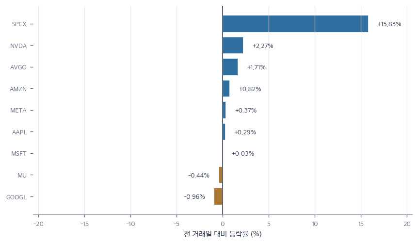
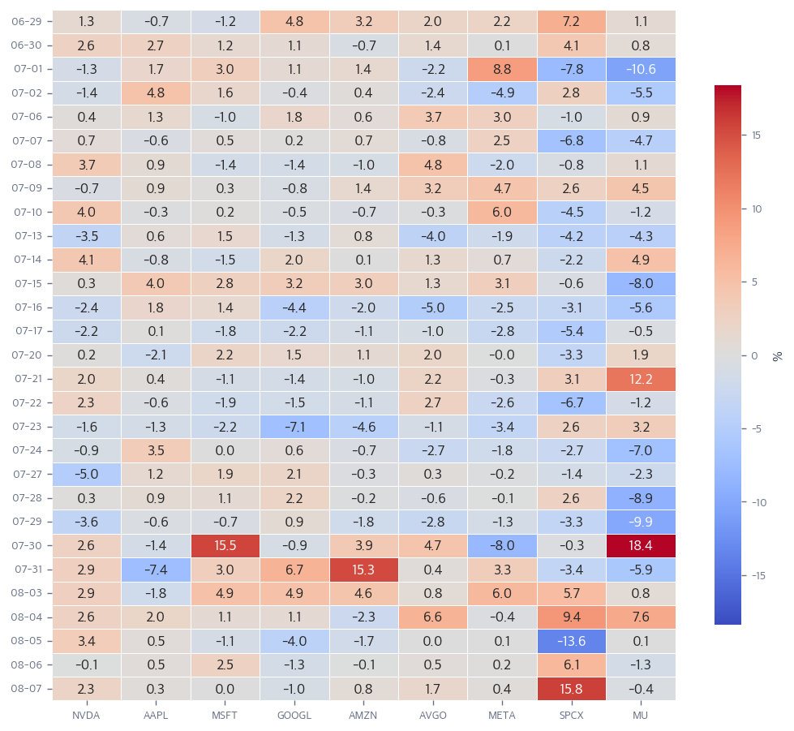
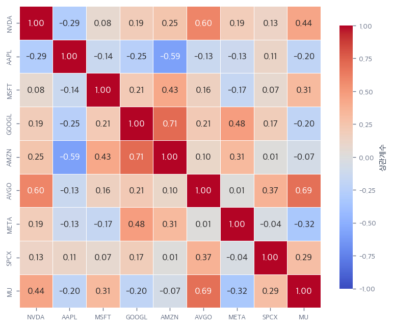
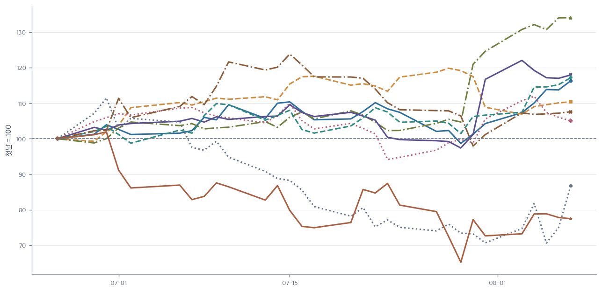
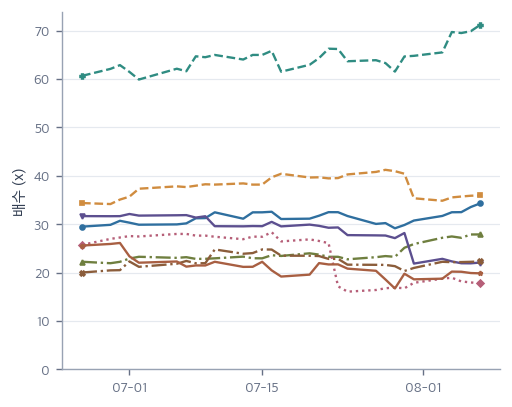
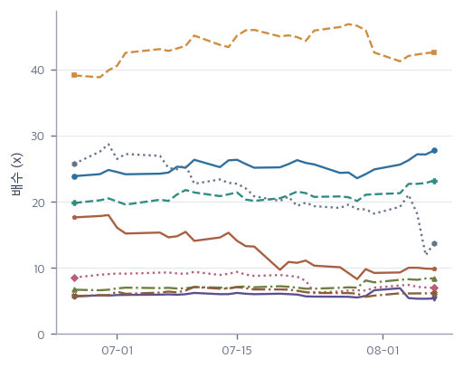
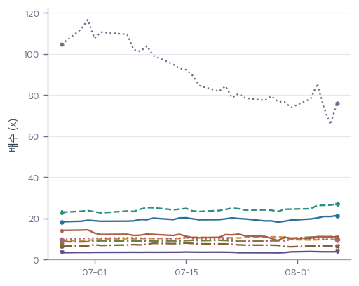

# 나스닥 일일 주가 리포트 - 2026-08-07

- 데이터 날짜: 2026-08-07
- 비교 기준일: 2026-08-06
- 생성 시각(UTC): 2026-08-08T00:01:23+00:00
- 3% 이상 변동 기준: abs(change_pct) >= 3.0%

## 전반적인 장 분위기

<!-- MARKET_SUMMARY:START -->
- **관찰 — 리스크온:** 2026-08-07 미국 정규장(09:30~16:00 ET)에서 QQQ는 714.65에서 723.03으로 **+1.17%** 올랐고, 나스닥 종합은 **+1.3%**, S&P 500은 **+0.6%** 상승했다. 성장주와 광범위 지수가 함께 오른 장세다. ([QQQ 가격 이력](https://www.nasdaq.com/market-activity/etf/qqq/historical), [AP 지수 마감](https://apnews.com/article/9d586bdbf1fb230dcf1f915dcaf50858))
- **관찰 — 상승 폭 확산:** 다우는 **+0.3%**, 러셀 2000은 **+1.1%** 올라 대형 기술주에만 국한되지 않았고, S&P 500은 7,757.64로 사상 최고 종가를 경신했다. ([AP](https://apnews.com/article/9d586bdbf1fb230dcf1f915dcaf50858))
- **관찰 — 당일 거시 재료:** 08:30 ET 발표된 7월 비농업 고용은 **-2.3만 명**, 실업률은 **4.1%**였으며 지방정부 교육 고용의 **-5만 명**이 헤드라인 약세에 크게 작용했다. ([미 노동통계국](https://www.bls.gov/news.release/empsit.nr0.htm), [Axios](https://www.axios.com/2026/08/07/july-jobs-report-employment-losses))
- **해석:** 약한 고용 뒤 10년물 미 국채금리가 **4.64%**로 내려가면서 연준의 추가 금리 인상이 늦춰질 수 있다는 기대가 주식 매수를 지지했다. 다만 고용 감소는 성장 둔화 위험도 함께 보여 준다. ([AP 시장 종합](https://apnews.com/article/9636095906bbb689a1f612bce9a07343))
<!-- MARKET_SUMMARY:END -->

## 전체 종목 변화율

### 당일 종목별 등락률

| 종목 | 종가 | 등락률 |
| --- | --- | --- |
| SPCX | 133.11 | +15.83% |
| NVDA | 223.96 | +2.27% |
| AVGO | 427.76 | +1.71% |
| AMZN | 274.48 | +0.82% |
| META | 592.10 | +0.37% |
| AAPL | 313.33 | +0.29% |
| MSFT | 499.99 | +0.03% |
| MU | 877.57 | -0.44% |
| GOOGL | 354.30 | -0.96% |

## 시장 흐름 히트맵

### 날짜별 등락률 히트맵

### 종목 간 수익률 상관 히트맵

## 종목별 변화 추이

### 기준일 대비 정규화 종가

## PER·PBR·PSR 변화 추이

### PER 변화 추이

### PBR 변화 추이

### PSR 변화 추이

## 3% 이상 변동 종목

| 종목 | 종가 | 등락률 |
| --- | --- | --- |
| SPCX | 133.11 | +15.83% |

## 원인 메모

### SPCX (+15.83%)
<!-- CAUSE:SPCX:START -->
- **관찰:** SPCX는 2026-08-07 정규장에서 $114.92에서 $133.11로 **+15.83%** 올랐지만, 이 상승을 직접 설명할 강한 당일 신규 회사 공시나 단일 뉴스는 확인되지 않았다.
- **가능성이 높은 맥락:** 전날 첫 락업 해제로 직원·초기 투자자의 매도가 가능해졌는데도 주가가 상승하자, 예상했던 대규모 공급 충격이 즉시 나타나지 않았다는 안도와 재매수가 이어진 것으로 해석된다. 다만 향후 추가 락업 해제로 유통 가능 주식 수가 늘어날 위험은 남아 있다. ([AP](https://apnews.com/article/c75721ec2e43e5304a2184a9e6abae5e), [Axios](https://www.axios.com/2026/08/07/spacex-stocks-unlock-musk))
- **시장 배경:** 같은 정규장에서 나스닥 종합이 **+1.3%** 오르는 리스크온 환경도 고변동 성장주인 SPCX의 반등을 보조했을 가능성이 있다. 이는 시장 맥락이며 단독 원인으로 단정하지 않는다. ([AP](https://apnews.com/article/9d586bdbf1fb230dcf1f915dcaf50858))
<!-- CAUSE:SPCX:END -->
