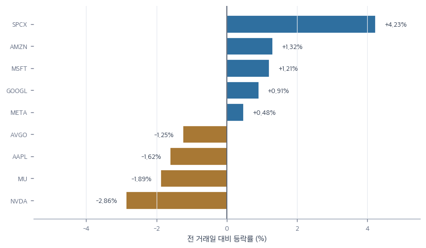
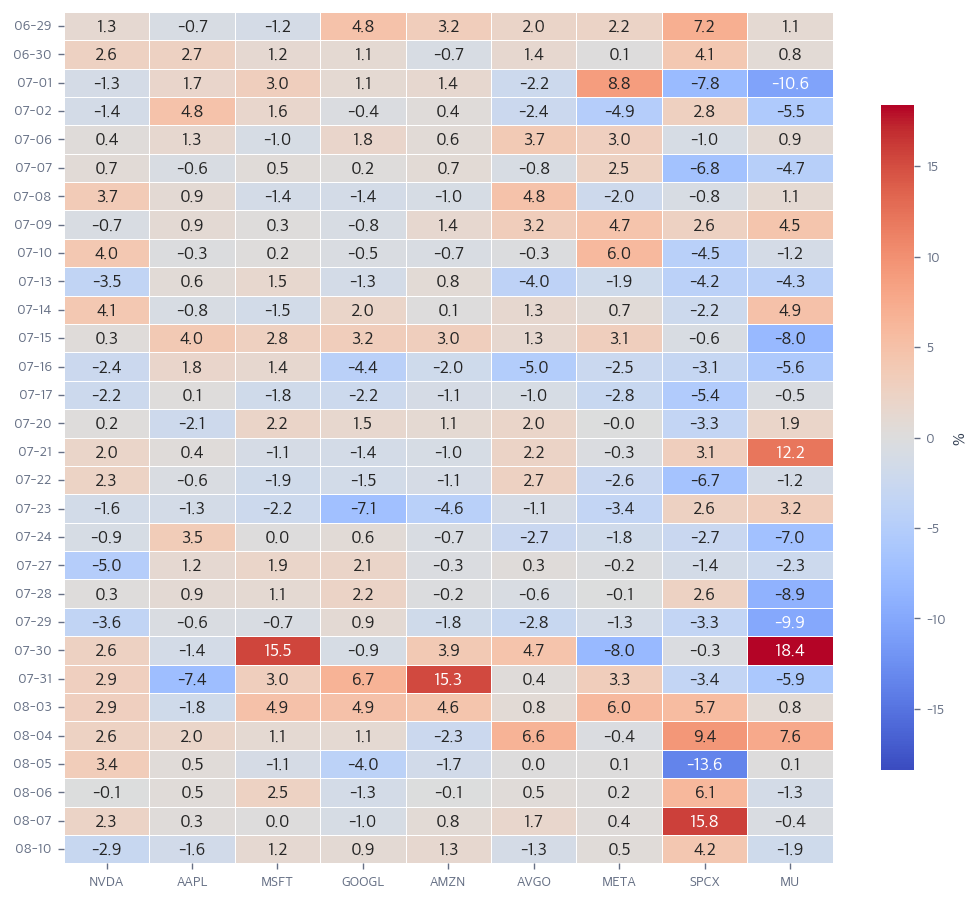
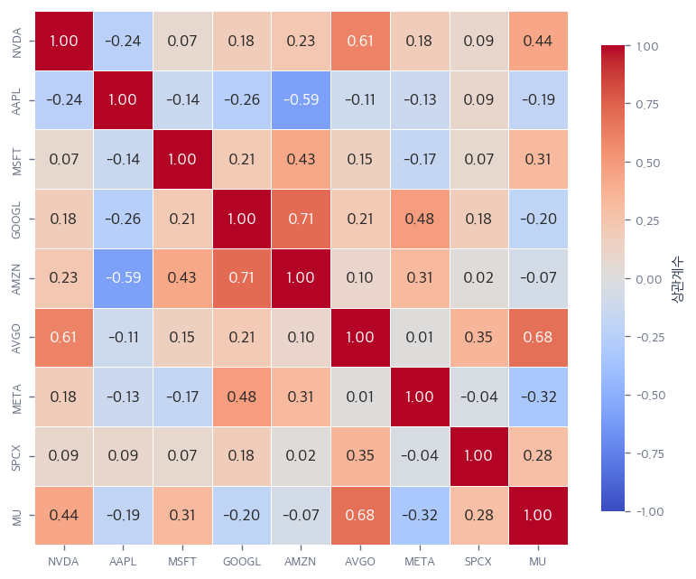
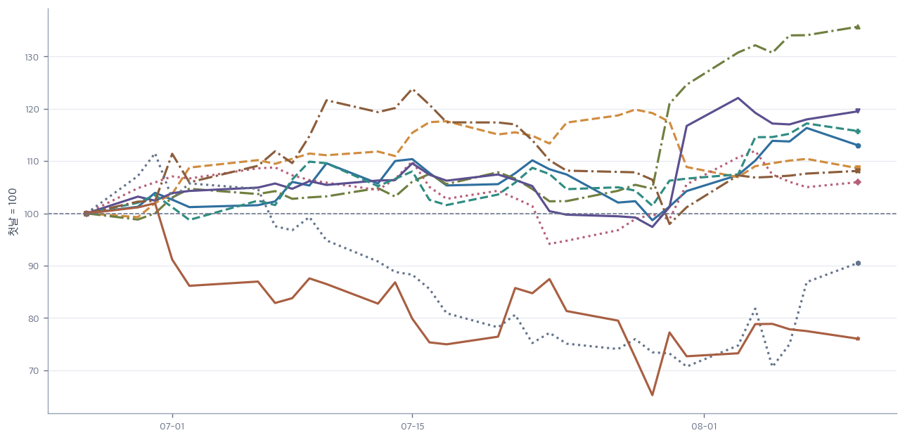
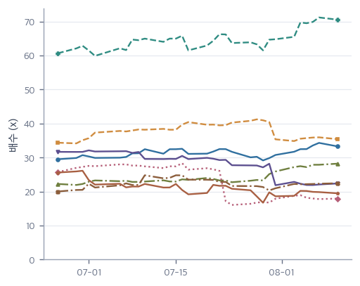
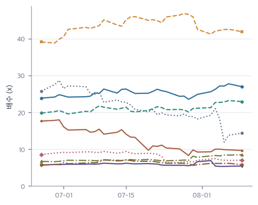
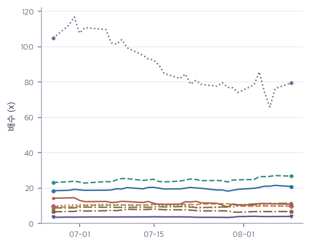

# 나스닥 일일 주가 리포트 - 2026-08-10

- 데이터 날짜: 2026-08-10
- 비교 기준일: 2026-08-07
- 생성 시각(UTC): 2026-08-11T00:26:02+00:00
- 3% 이상 변동 기준: abs(change_pct) >= 3.0%

## 전반적인 장 분위기

<!-- MARKET_SUMMARY:START -->
- **약한 리스크오프·기술주 중심 약세:** 2026-08-10 미국 정규장(09:30~16:00 ET)에서 QQQ는 $720.87(-0.30%), SPY는 $773.03(-0.03%), Nasdaq Composite는 26,605.36(-85.26포인트, -0.32%)로 마감했다. 기술주 민감도가 높은 QQQ가 SPY보다 더 약해 전면적 투매보다는 기술주 중심의 완만한 위험회피로 해석된다. [QQQ](https://stockanalysis.com/etf/qqq/history/) · [SPY](https://stockanalysis.com/etf/spy/history/) · [AP](https://apnews.com/article/wall-street-stocks-dow-nasdaq-37588f23787295860e468d19399b56ca)
- **관찰:** S&P 500(-4.53포인트, -0.06%), Dow(-60.95포인트, -0.11%), Nasdaq(-0.32%), Russell 2000(-17.10포인트, -0.56%)이 모두 하락했고 소형주가 가장 약했다. 신뢰할 만한 당일 종목 상승·하락 수는 확인되지 않아 지수군 근거만 사용했다. [AP](https://apnews.com/article/wall-street-stocks-dow-nasdaq-37588f23787295860e468d19399b56ca)
- **관찰과 해석:** 호르무즈 해협 재개 시점의 불확실성 속에 Brent가 5.0% 오른 $87.72, 미 10년물 금리는 4.65%에서 4.70%로 상승했다. 유가·금리의 동반 상승이 인플레이션·할인율 부담을 재부각해 위험자산 상단을 제한한 것으로 해석된다. [AP](https://apnews.com/article/stocks-markets-rates-iran-ai-adb7b918b15206e38d7899d482422308)
- **관찰:** Intel(INTC)은 AI 투자 재원 마련을 위해 최대 $15B 규모의 주식 매각 가능성을 밝힌 뒤 정규장에서 4.1% 하락했고 기술주에 부담을 줬다. 잠재적 희석 우려는 보조 재료이며 QQQ 하락의 단일 원인으로 단정하지 않는다. [AP](https://apnews.com/article/stocks-markets-rates-iran-ai-adb7b918b15206e38d7899d482422308)
<!-- MARKET_SUMMARY:END -->

## 전체 종목 변화율

### 당일 종목별 등락률

| 종목 | 종가 | 등락률 |
| --- | --- | --- |
| SPCX | 138.74 | +4.23% |
| AMZN | 278.09 | +1.32% |
| MSFT | 506.06 | +1.21% |
| GOOGL | 357.52 | +0.91% |
| META | 594.92 | +0.48% |
| AVGO | 422.40 | -1.25% |
| AAPL | 308.26 | -1.62% |
| MU | 861.00 | -1.89% |
| NVDA | 217.55 | -2.86% |

## 시장 흐름 히트맵

### 날짜별 등락률 히트맵

### 종목 간 수익률 상관 히트맵

## 종목별 변화 추이

### 기준일 대비 정규화 종가

## PER·PBR·PSR 변화 추이

### PER 변화 추이

### PBR 변화 추이

### PSR 변화 추이

## 3% 이상 변동 종목

| 종목 | 종가 | 등락률 |
| --- | --- | --- |
| SPCX | 138.74 | +4.23% |

## 원인 메모

### SPCX (+4.23%)
<!-- CAUSE:SPCX:START -->
- **사실:** 2026-08-10 정규장(09:30~16:00 ET) SPCX는 $138.74에 마감해 +4.23% 올랐고, Nasdaq Composite(-0.32%)를 크게 웃돌았다. [SPCX 가격](https://stockanalysis.com/stocks/spcx/history/) · [AP 시장 마감](https://apnews.com/article/wall-street-stocks-dow-nasdaq-37588f23787295860e468d19399b56ca)
- **사실:** 당일 주요 마감 보도에서는 신규 계약·공시 등 확정된 회사 고유 촉매가 확인되지 않았고, 주가가 IPO 가격 $135를 회복한 반등의 연장으로 설명됐다. [Investopedia](https://www.investopedia.com/market-update-spacex-stock-touches-ipo-price-spcx-12037573)
- **해석:** 8월 6일 약 9억 주의 첫 락업 해제에도 주가가 6.1% 상승한 뒤 공급 충격 우려 완화와 반등 모멘텀이 이어진 것으로 보는 편이 타당하다. 이는 8월 10일 상승의 단일 원인으로 확정할 수 없다. [AP](https://apnews.com/article/spacex-musk-shares-lockup-insiders-c75721ec2e43e5304a2184a9e6abae5e)
<!-- CAUSE:SPCX:END -->
