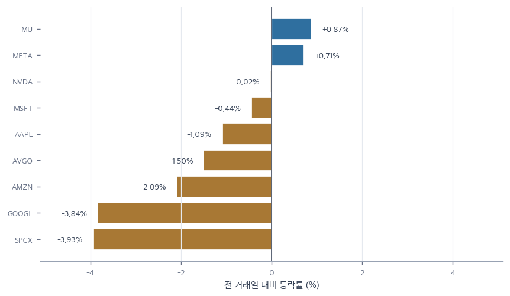
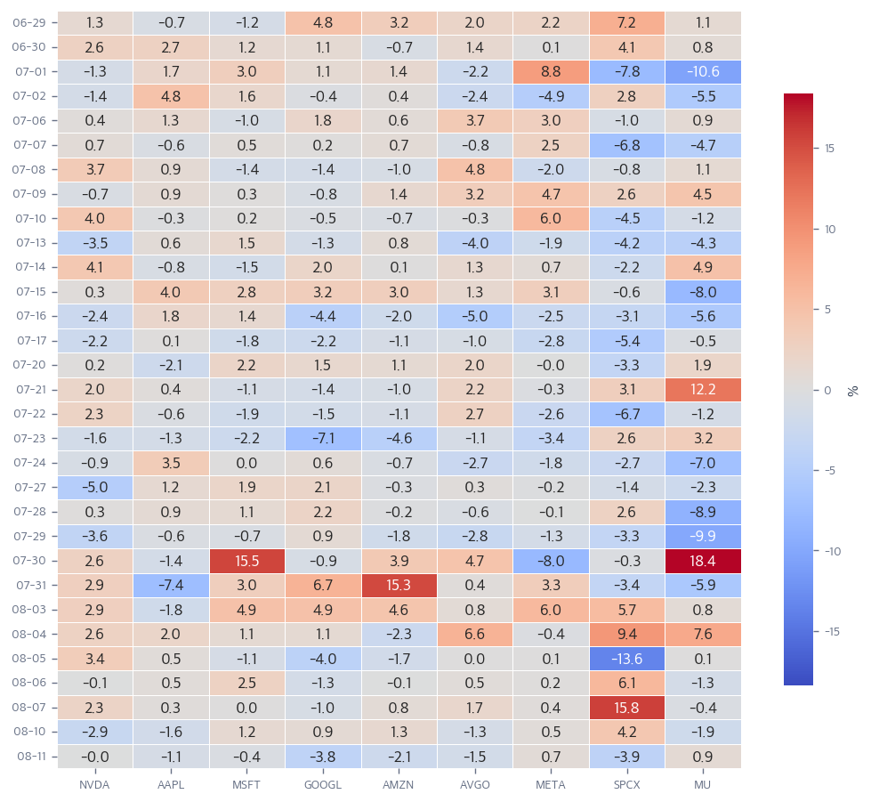
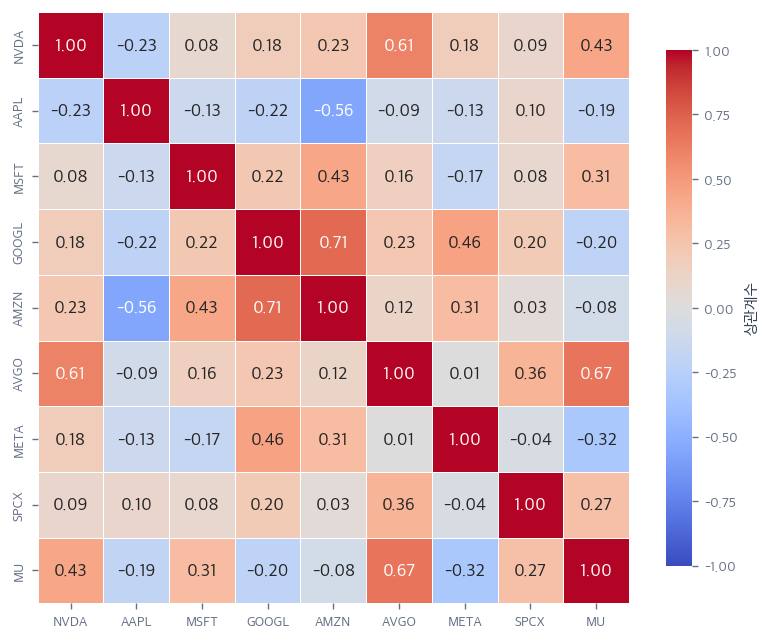
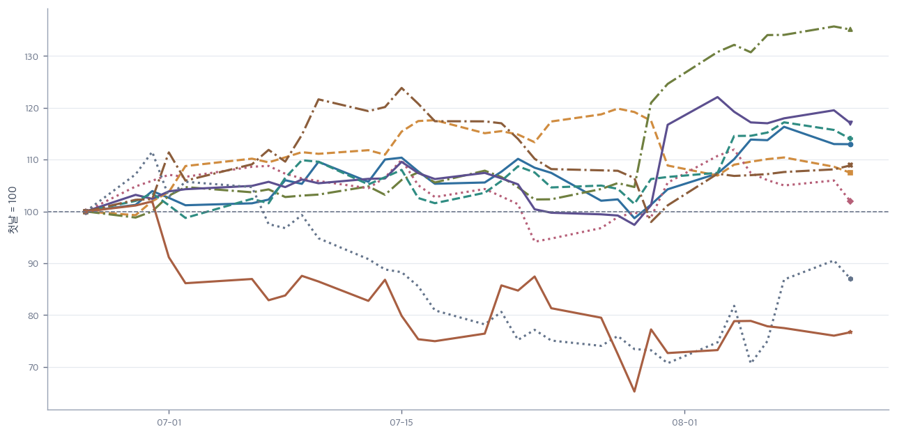
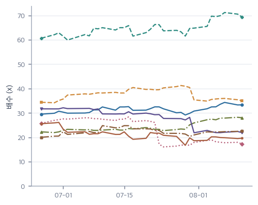
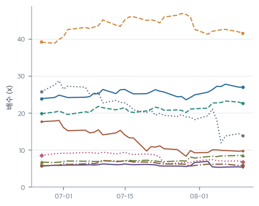
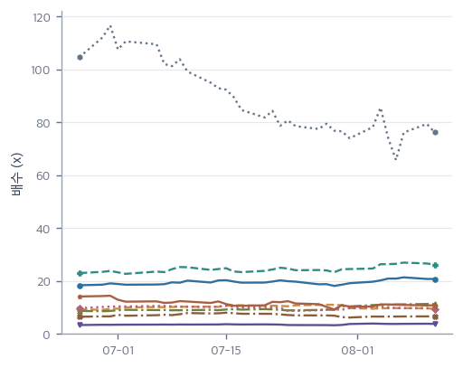

# 나스닥 일일 주가 리포트 - 2026-08-11

- 데이터 날짜: 2026-08-11
- 비교 기준일: 2026-08-10
- 생성 시각(UTC): 2026-08-12T00:14:59+00:00
- 3% 이상 변동 기준: abs(change_pct) >= 3.0%

## 전반적인 장 분위기

<!-- MARKET_SUMMARY:START -->
- **완만한 위험회피:** 2026-08-11 미국 정규장(09:30~16:00 ET)에서 QQQ는 720.87달러에서 718.45달러로 **-0.34%**, SPY는 773.03달러에서 770.56달러로 **-0.32%** 하락했고, 나스닥 종합지수는 **-0.60%**, S&P 500은 **-0.32%**로 마감했다. ([QQQ](https://finance.yahoo.com/quote/QQQ/history/), [SPY](https://finance.yahoo.com/quote/SPY/history/), [AP](https://apnews.com/article/stocks-markets-rates-iran-futures-3f3f2f2d49e4aa8744d21ecd0ce55a9c))
- **관찰된 재료:** 브렌트유는 장중 90달러를 웃돈 뒤 88.91달러에 결제돼 전일 대비 **+1.4%**였고, 이란 전쟁과 호르무즈 해협 폐쇄를 둘러싼 공급 불확실성이 유가 변동성을 키웠다. ([AP](https://apnews.com/article/stocks-markets-rates-iran-futures-3f3f2f2d49e4aa8744d21ecd0ce55a9c))
- **금리·물가 경계:** 다음 날(8월 12일) 7월 CPI 발표를 앞두고 인플레이션 불확실성이 남았으며, 10년물 미 국채 금리는 4.72%에서 **4.69%**로 소폭 낮아졌지만 전쟁 전 3.97%보다 높은 수준이었다. ([AP](https://apnews.com/article/stocks-markets-rates-iran-futures-3f3f2f2d49e4aa8744d21ecd0ce55a9c), [BLS 일정](https://www.bls.gov/cpi/))
- **해석:** 금리 하락만으로 위험선호가 회복되지 못한 가운데 유가·CPI 경계와 기술주 약세가 겹친 장세로 보는 것이 타당하며, 단일 촉매보다는 복합적인 매크로 부담이 우세했다.
<!-- MARKET_SUMMARY:END -->

## 전체 종목 변화율

### 당일 종목별 등락률

| 종목 | 종가 | 등락률 |
| --- | --- | --- |
| MU | 868.52 | +0.87% |
| META | 599.12 | +0.71% |
| NVDA | 217.50 | -0.02% |
| MSFT | 503.81 | -0.44% |
| AAPL | 304.91 | -1.09% |
| AVGO | 416.08 | -1.50% |
| AMZN | 272.27 | -2.09% |
| GOOGL | 343.80 | -3.84% |
| SPCX | 133.29 | -3.93% |

## 시장 흐름 히트맵

### 날짜별 등락률 히트맵

### 종목 간 수익률 상관 히트맵

## 종목별 변화 추이

### 기준일 대비 정규화 종가

## PER·PBR·PSR 변화 추이

### PER 변화 추이

### PBR 변화 추이

### PSR 변화 추이

## 3% 이상 변동 종목

| 종목 | 종가 | 등락률 |
| --- | --- | --- |
| GOOGL | 343.80 | -3.84% |
| SPCX | 133.29 | -3.93% |

## 원인 메모

### GOOGL (-3.84%)
<!-- CAUSE:GOOGL:START -->
- **관찰:** GOOGL은 2026-08-11 정규장에서 **-3.84%** 하락해, 같은 날 나스닥 종합지수(-0.60%)보다 낙폭이 컸다. ([GOOGL 가격 이력](https://finance.yahoo.com/quote/GOOGL/history/), [AP 시장 마감](https://apnews.com/article/stocks-markets-rates-iran-futures-3f3f2f2d49e4aa8744d21ecd0ce55a9c))
- 신뢰할 만한 당일 보도에서 새로운 단일 기업 촉매는 확인되지 않았다. 다만 8월 5일 공개된 DeepMind 수장 교체와 핵심 AI 인력 이탈은 당시 주가를 4% 넘게 끌어내렸고, AI 실행력 우려가 이어지는 배경이었다. ([Axios](https://www.axios.com/2026/08/05/google-deepmind-demis-hassabis-ai))
- **해석:** 이날 낙폭은 최근 AI 조직개편 우려가 남은 상태에서 기술주 중심 위험회피가 겹친 결과일 가능성이 있으나, 이를 확정적인 당일 원인으로 단정할 근거는 부족하다.
<!-- CAUSE:GOOGL:END -->

### SPCX (-3.93%)
<!-- CAUSE:SPCX:START -->
- **관찰:** SPCX는 2026-08-11 정규장에서 **-3.93%** 하락했으며, 신뢰할 만한 당일 보도에서 새로운 단일 기업 촉매는 확인되지 않았다. ([SPCX 가격 이력](https://finance.yahoo.com/quote/SPCX/history/))
- 최근 배경으로는 8월 4일 첫 실적 발표 뒤 지출 확대 우려로 8월 5일 10% 넘게 낮게 출발했고, 8월 6일부터 IPO 물량보다 많은 약 **9억1,100만 주**가 거래 가능해진 락업 해제가 있었다. ([MoneyWeek](https://moneyweek.com/investments/tech-stocks/spacex-earnings-results-share-price))
- **해석:** 실적 이후의 높은 변동성과 유통 가능 물량 확대가 계속 부담으로 작용했을 수 있으나, 8월 11일 하락을 직접 설명하는 새 사건으로 확인된 것은 아니다.
<!-- CAUSE:SPCX:END -->
