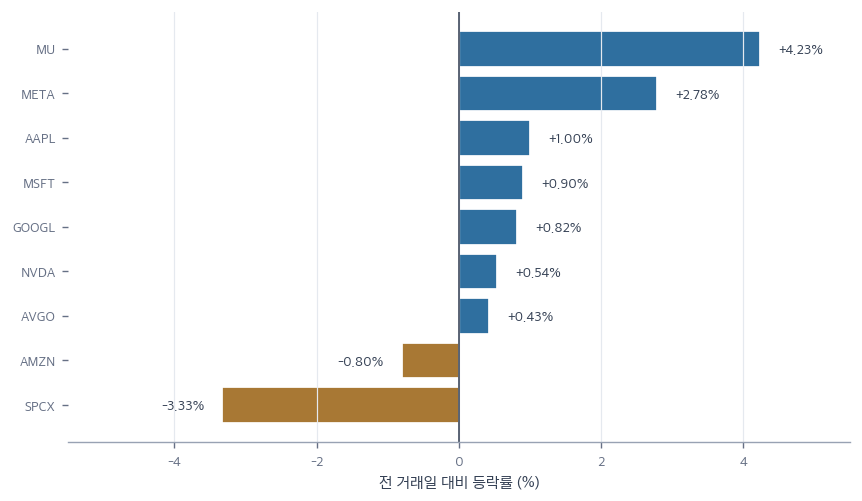
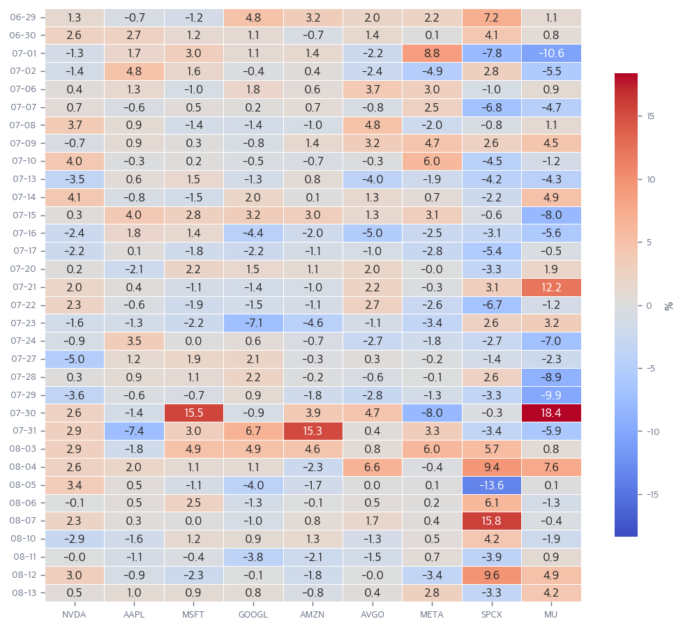
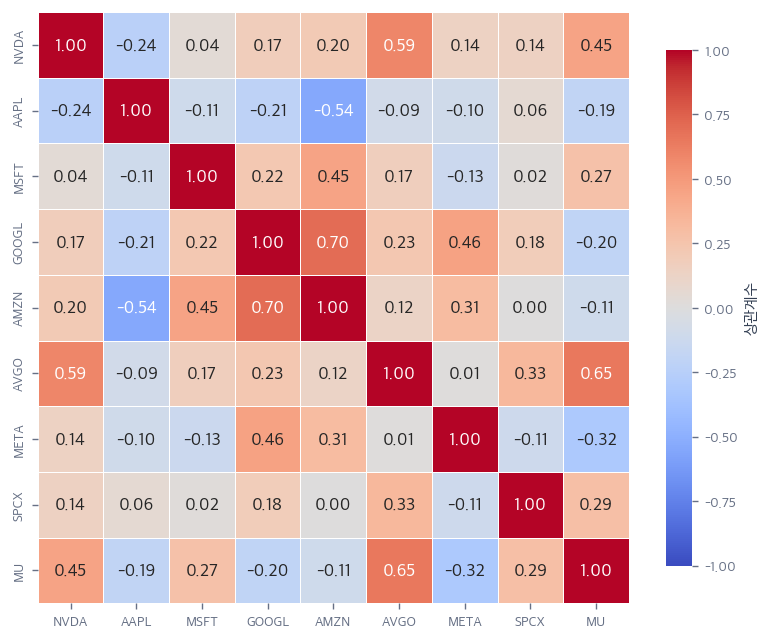
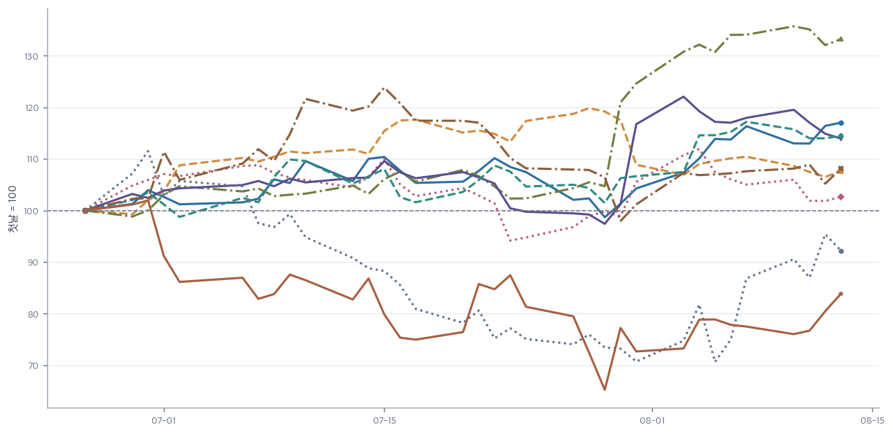
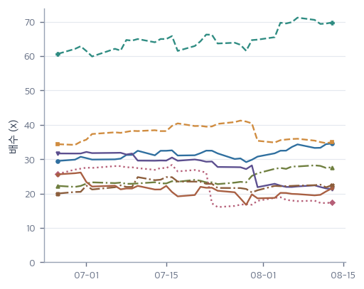
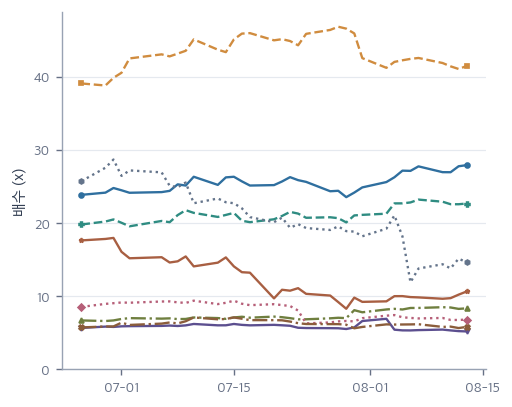
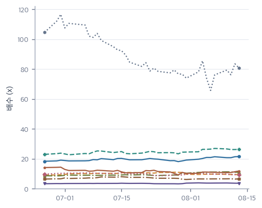

# 나스닥 일일 주가 리포트 - 2026-08-13

- 데이터 날짜: 2026-08-13
- 비교 기준일: 2026-08-12
- 생성 시각(UTC): 2026-08-14T00:02:44+00:00
- 3% 이상 변동 기준: abs(change_pct) >= 3.0%

## 전반적인 장 분위기

<!-- MARKET_SUMMARY:START -->
- **분류(해석): 위험선호(risk-on).** 2026-08-13 미국 정규장(09:30~16:00 ET)에서 QQQ는 723.70에서 732.07로 **+1.16%**, 나스닥 종합은 **+0.81%**, S&P 500은 **+0.65%** 올라 성장주와 광범위 지수가 함께 상승했다. ([QQQ 일별 시세](https://finance.yahoo.com/quote/QQQ/history/?period1=1786492800&period2=1786665600), [AP 지수 마감](https://apnews.com/article/892c5409d8ed26bfd5965eb2a89d9005))
- **관측 사실:** 나스닥 종합은 214.54포인트 오른 26,803.03, S&P 500은 50.49포인트 오른 사상 최고 7,798.99에 마감했고, 다우와 러셀 2000도 각각 +0.1%, +0.2%로 주요 지수가 모두 플러스였다. ([AP 정규장 마감](https://apnews.com/article/3a23f22469cd0e0062f711096906525c))
- **당일 거시 재료:** 미국 7월 최종수요 PPI는 전월 대비 보합, 전년 대비 +4.7%로 6월의 +5.5%보다 둔화했다. 발표는 08:30 ET였으며 시장 개장 전 확인된 수치다. ([미 노동통계국 PPI](https://www.bls.gov/news.release/ppi.nr0.htm))
- **해석:** 예상보다 온건한 PPI와 함께 10년물 금리가 4.68%에서 4.65%로, 브렌트유가 2.1% 내려 인플레이션·금리 부담이 완화된 점이 정규장 위험자산 상승을 뒷받침한 것으로 관측됐다. ([AP 시장 보도](https://apnews.com/article/3a23f22469cd0e0062f711096906525c))
<!-- MARKET_SUMMARY:END -->

## 전체 종목 변화율

### 당일 종목별 등락률

| 종목 | 종가 | 등락률 |
| --- | --- | --- |
| MU | 949.83 | +4.23% |
| META | 594.97 | +2.78% |
| AAPL | 305.26 | +1.00% |
| MSFT | 496.88 | +0.90% |
| GOOGL | 346.36 | +0.82% |
| NVDA | 225.30 | +0.54% |
| AVGO | 417.82 | +0.43% |
| AMZN | 265.13 | -0.80% |
| SPCX | 141.29 | -3.33% |

## 시장 흐름 히트맵

### 날짜별 등락률 히트맵

### 종목 간 수익률 상관 히트맵

## 종목별 변화 추이

### 기준일 대비 정규화 종가

## PER·PBR·PSR 변화 추이

### PER 변화 추이

### PBR 변화 추이

### PSR 변화 추이

## 3% 이상 변동 종목

| 종목 | 종가 | 등락률 |
| --- | --- | --- |
| MU | 949.83 | +4.23% |
| SPCX | 141.29 | -3.33% |

## 원인 메모

### MU (+4.23%)
<!-- CAUSE:MU:START -->
- **관측:** MU는 2026-08-13 정규장에서 **+4.23%** 상승했지만, 당일 주가를 단독으로 설명할 만한 Micron의 신규 공시·보도자료는 확인되지 않았다. ([Micron 최신 뉴스](https://investors.micron.com/latest-news-english))
- **업종 맥락:** 같은 날 09:00 ET 열린 Sandisk 투자자의 날은 메모리 업종의 사업 전망을 다룬 공식 일정으로, MU 강세와 같은 시간대에 메모리 업종 관심이 높아진 배경이다. 다만 이를 MU 상승의 단일 원인으로 단정하지 않는다. ([Sandisk 공식 행사](https://investor.sandisk.com/events/event-details/2026-sandisk-investor-day))
- **기존 펀더멘털 맥락:** 8월 10일 Micron 경영진은 AI용 HBM 수요가 다른 메모리 공급을 압박하고 신규 웨이퍼 증설에는 시간이 걸린다고 설명했다. 이는 강한 수급 기대를 뒷받침하지만 8월 13일의 새 재료는 아니다. ([관련 보도](https://www.pcgamer.com/hardware/memory/microns-top-brass-wins-the-memory-crisis-corpo-double-speak-award-we-do-not-have-line-of-sight-as-to-when-that-supply-vector-will-intersect-the-demand-vector/))
<!-- CAUSE:MU:END -->

### SPCX (-3.33%)
<!-- CAUSE:SPCX:START -->
- **관측:** SPCX는 2026-08-13 정규장에서 **-3.33%** 하락했다. 같은 날 나스닥 종합이 +0.81% 오른 것과 반대 방향이었지만, 당일 신규 회사 공시나 강한 단일 기업 촉매는 확인되지 않았다. ([AP 지수 마감](https://apnews.com/article/892c5409d8ed26bfd5965eb2a89d9005), [SpaceX 투자자 공지](https://ir.spacex.com/updates/default.aspx))
- **수급 맥락:** 8월 6일 약 9억1,200만 주가 매도 가능해진 뒤 거래 가능 물량이 크게 늘었고, 8월 20일에도 추가 물량 해제가 예정돼 있어 IPO 이후 공급 부담과 변동성이 이어지는 구간이다. ([Axios 락업 보도](https://www.axios.com/2026/08/07/spacex-stocks-unlock-musk))
- **해석:** 시장 전반의 위험선호 속에서도 하락했다는 점에서 최근 락업 해제 이후의 개별 수급 부담이 상대적 약세의 가장 뚜렷한 지원 맥락이지만, 확인되지 않은 당일 매도 주체나 사건을 원인으로 단정할 수는 없다. ([AP 락업 후 거래 보도](https://apnews.com/article/c75721ec2e43e5304a2184a9e6abae5e))
<!-- CAUSE:SPCX:END -->
