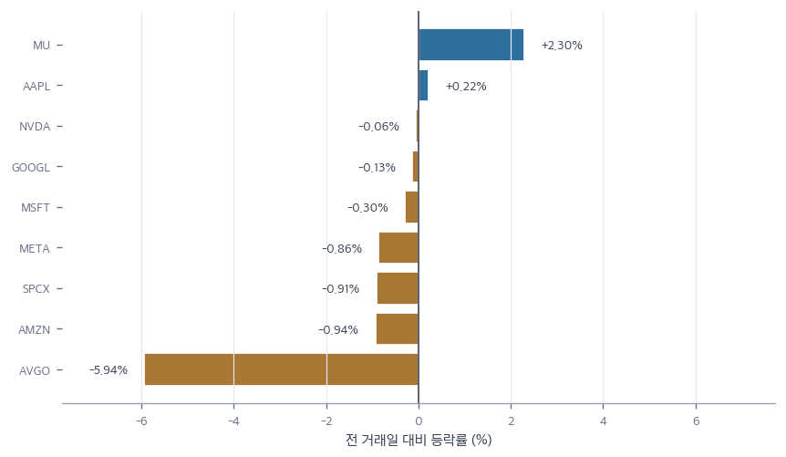
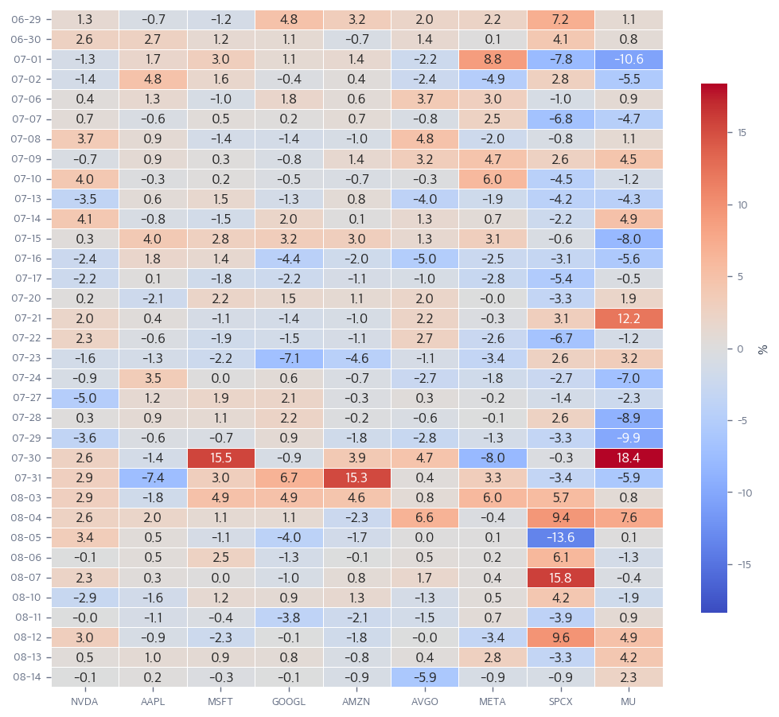
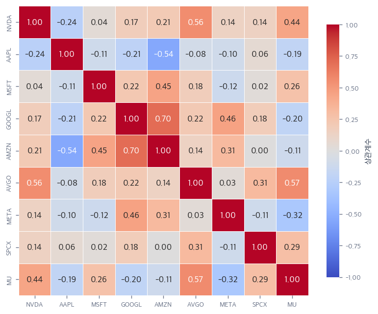
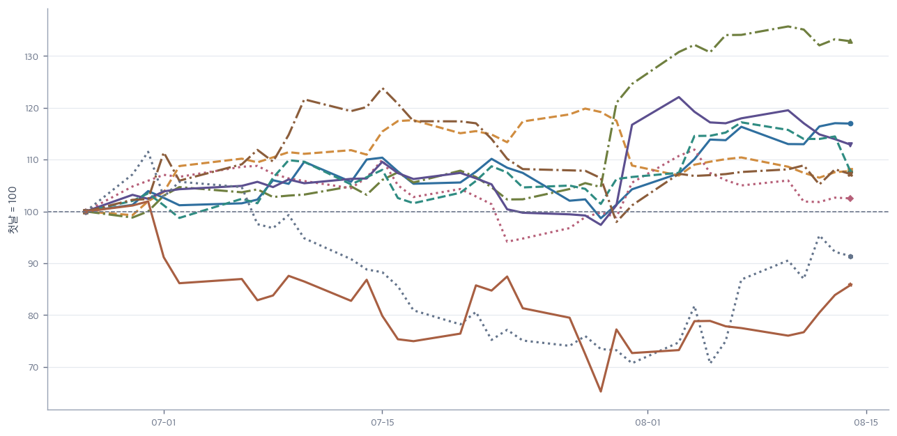
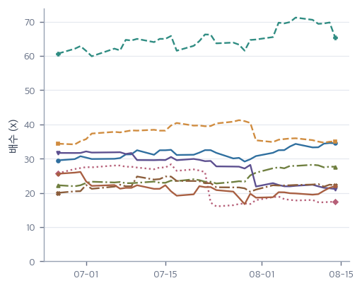
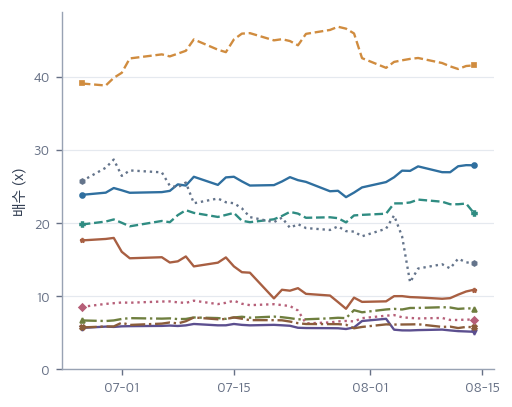
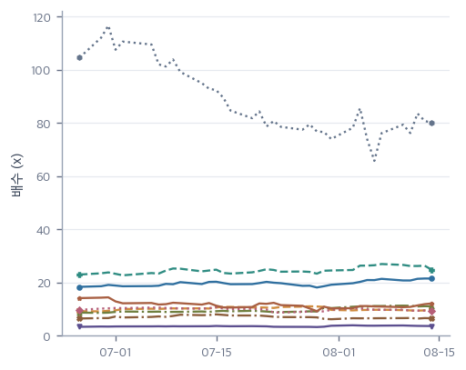

# 나스닥 일일 주가 리포트 - 2026-08-14

- 데이터 날짜: 2026-08-14
- 비교 기준일: 2026-08-13
- 생성 시각(UTC): 2026-08-15T00:03:14+00:00
- 3% 이상 변동 기준: abs(change_pct) >= 3.0%

## 전반적인 장 분위기

<!-- MARKET_SUMMARY:START -->
- **혼조·중소형주 순환:** 2026-08-14 미국 정규장(09:30~16:00 ET)에서 QQQ는 **-0.14%**, 나스닥 종합지수는 **-0.28%**, S&P 500은 **-0.17%**였지만 러셀 2000은 **+0.51%**로 올라, 전면적 위험회피보다 대형 기술주 약세와 중소형주 강세가 엇갈린 장이었다. ([QQQ](https://stockanalysis.com/etf/qqq/history/), [주요 지수·시장 폭](https://apnews.com/article/stocks-markets-rates-oil-inflation-futures-5d9870d6c5ae735f9b74bf4ceefaa3ec))
- **관측 사실:** 7월 미국 소매판매가 전월 대비 **0.6% 감소**해 시장 예상(+0.1%)을 밑돌았고, 소비심리도 예상보다 약해져 성장 둔화 우려가 커졌다. ([소매판매](https://apnews.com/article/retail-inflation-consumer-sentiment-economy-3e2bc5807d7396b8e6c5f599941cb2a9))
- **관측 사실:** 브렌트유는 **1.7% 오른 배럴당 88.52달러**, 미 10년물 국채금리는 전일 4.63%에서 **4.69%**로 상승해 오전의 주가 상승분을 되돌리는 부담으로 작용했다. ([정규장 마감 보도](https://apnews.com/article/stocks-markets-rates-oil-inflation-futures-5d9870d6c5eae735f9b74bf4ceefaa3ec))
- **해석:** 약한 소비지표는 금리 인상 압력을 낮출 수 있다는 긍정과 성장 둔화라는 부정 신호를 동시에 줬고, 유가·장기금리 상승이 대형 성장주에 상대적으로 불리하게 작용한 **혼조·순환 장세**로 보는 편이 타당하다.
<!-- MARKET_SUMMARY:END -->

## 전체 종목 변화율

### 당일 종목별 등락률

| 종목 | 종가 | 등락률 |
| --- | --- | --- |
| MU | 971.66 | +2.30% |
| AAPL | 305.93 | +0.22% |
| NVDA | 225.16 | -0.06% |
| GOOGL | 345.90 | -0.13% |
| MSFT | 495.40 | -0.30% |
| META | 589.85 | -0.86% |
| SPCX | 140.00 | -0.91% |
| AMZN | 262.65 | -0.94% |
| AVGO | 392.99 | -5.94% |

## 시장 흐름 히트맵

### 날짜별 등락률 히트맵

### 종목 간 수익률 상관 히트맵

## 종목별 변화 추이

### 기준일 대비 정규화 종가

## PER·PBR·PSR 변화 추이

### PER 변화 추이

### PBR 변화 추이

### PSR 변화 추이

## 3% 이상 변동 종목

| 종목 | 종가 | 등락률 |
| --- | --- | --- |
| AVGO | 392.99 | -5.94% |

## 원인 메모

### AVGO (-5.94%)
<!-- CAUSE:AVGO:START -->
- **관측 사실:** AVGO는 정규장에 **-5.94%** 급락한 반면 반도체 ETF SOXX는 **-0.06%**에 그쳐, 업종 전반보다 종목 고유 재료의 영향이 컸다. ([AVGO](https://stockanalysis.com/stocks/avgo/history/), [SOXX](https://stockanalysis.com/etf/soxx/history/))
- **가능성 높은 당일 재료:** BofA 분석이 Broadcom의 AI XPV 금융 플랫폼이 20GW 규모로 확대될 경우 선순위 부채가 2029년 중반 **3,700억달러**에 이를 수 있다고 지적했고, 초기 거래에서 Broadcom의 임대료 보증 최대 노출이 **290억달러**라는 점이 재부각되며 금융구조 위험 재평가를 촉발했다. 플랫폼의 공식 초기 규모는 350억달러, 목표 용량은 2028년까지 20GW 이상이다. ([당일 보도](https://finance.yahoo.com/markets/stocks/articles/broadcom-sinks-6-bofa-flags-180738180.html), [Apollo 발표](https://www.nasdaq.com/press-release/apollo-leads-35-billion-capital-solution-broadcom-ai-xpv-platform-partnership))
- **추가 부담:** VMware vCenter의 중대 취약점 CVE-2026-59310이 실제 공격에 악용되고 있다는 보고도 같은 날 Broadcom에 부담으로 거론됐다. 두 재료의 개별 기여도는 확인되지 않았으므로 단일 원인으로 단정하지 않는다. ([보안 이슈 보도](https://www.tipranks.com/news/why-broadcom-avgo-stock-is-sinking-today-august-14-2026))
<!-- CAUSE:AVGO:END -->
