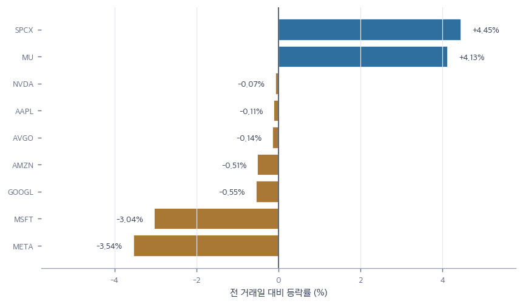
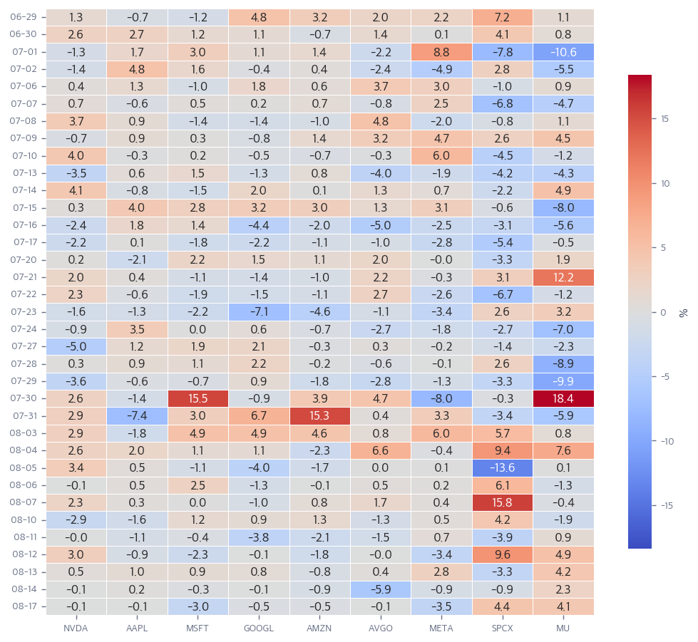
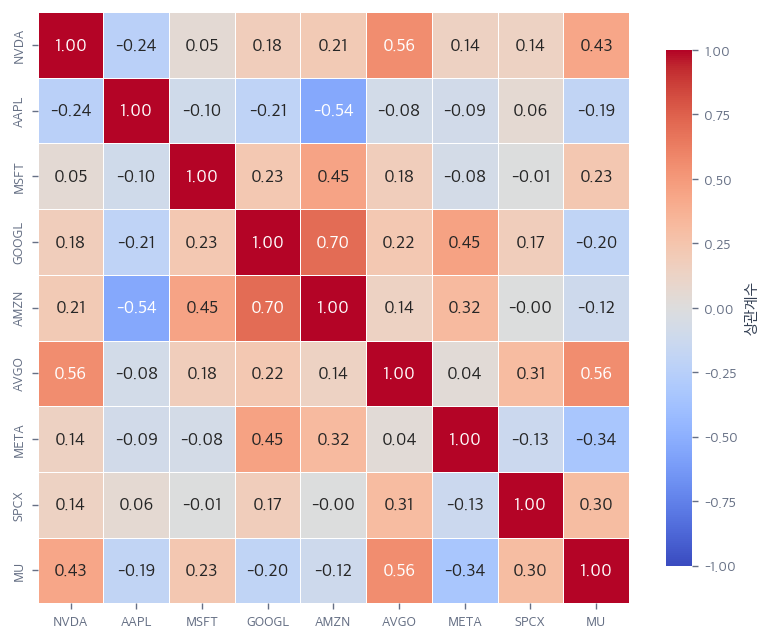
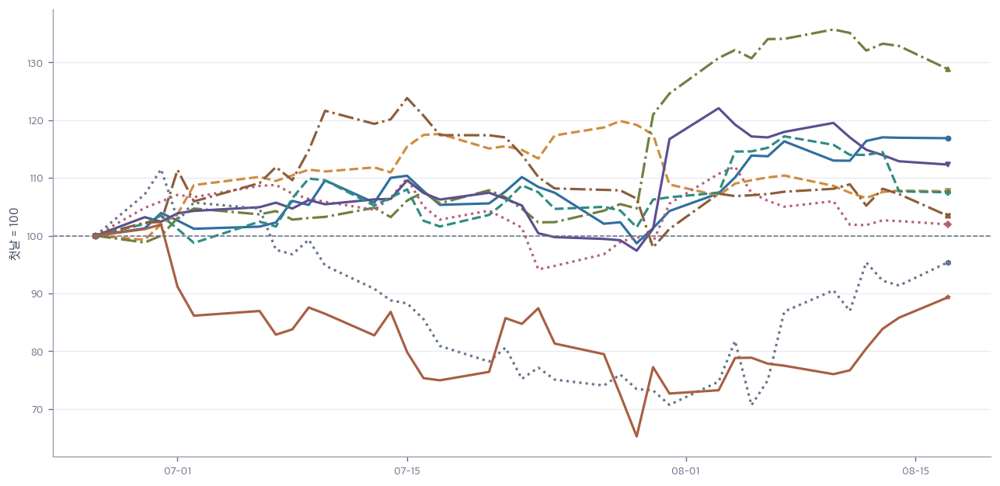
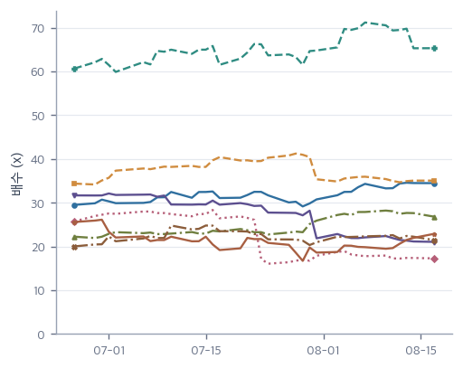
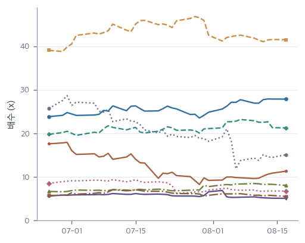
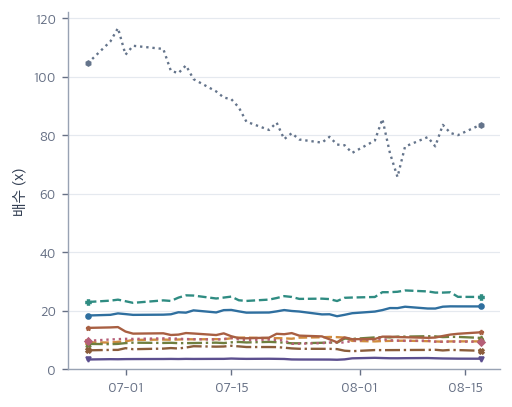

# 나스닥 일일 주가 리포트 - 2026-08-17

- 데이터 날짜: 2026-08-17
- 비교 기준일: 2026-08-14
- 생성 시각(UTC): 2026-08-18T00:01:30+00:00
- 3% 이상 변동 기준: abs(change_pct) >= 3.0%

## 전반적인 장 분위기

<!-- MARKET_SUMMARY:START -->
- **리스크오프:** 2026-08-17 미국 정규장(09:30~16:00 ET)에서 QQQ는 전일 대비 0.16% 하락했고, 나스닥 종합지수(-0.3%)와 S&P 500(-0.5%)도 함께 밀려 위험자산 선호가 약해졌다. ([QQQ 가격 이력](https://finance.yahoo.com/quote/QQQ/history/?period1=1786665600&period2=1787011200), [AP 지수 마감](https://apnews.com/article/wall-street-stocks-dow-nasdaq-b20808a2f37a7c505013c9b301c8ebe0))
- **관찰 사실:** 브렌트유가 정규장 중 상승 폭을 키워 2.7% 오른 배럴당 90.87달러에 마감했고, 미 10년물 국채금리는 전일 4.68%에서 4.72%로 올랐다. ([AP 시장 마감](https://apnews.com/article/stocks-markets-futures-rates-oil-japan-bf398d5a01f611921c0b48a8bfc884d9))
- **해석:** AP는 유가 상승이 인플레이션 부담과 금리 상승을 통해 주식 밸류에이션에 압력을 줬다고 설명했다. 다만 S&P 500의 하락 폭이 0.5%에 그쳐 전면적 투매보다는 고유가·고금리 경계가 우세한 완만한 위험회피 장세로 판단한다. ([AP 시장 마감](https://apnews.com/article/stocks-markets-futures-rates-oil-japan-bf398d5a01f611921c0b48a8bfc884d9))
- **기업·섹터 재료:** META는 아동·청소년 피해 관련 다주(多州) 소송의 연방 재판 개시를 앞두고 이론상 최대 1.4조달러 규모의 손해배상 위험이 보도돼 대형 기술주 내 개별 부담으로 작용했을 가능성이 있다. ([AP Meta 재판 보도](https://apnews.com/article/meta-facebook-social-media-trial-oakland-32e8f19738eb77ab832e0f084dd677af))
<!-- MARKET_SUMMARY:END -->

## 전체 종목 변화율

### 당일 종목별 등락률

| 종목 | 종가 | 등락률 |
| --- | --- | --- |
| SPCX | 146.23 | +4.45% |
| MU | 1011.75 | +4.13% |
| NVDA | 225.01 | -0.07% |
| AAPL | 305.59 | -0.11% |
| AVGO | 392.43 | -0.14% |
| AMZN | 261.31 | -0.51% |
| GOOGL | 344.00 | -0.55% |
| MSFT | 480.35 | -3.04% |
| META | 568.97 | -3.54% |

## 시장 흐름 히트맵

### 날짜별 등락률 히트맵

### 종목 간 수익률 상관 히트맵

## 종목별 변화 추이

### 기준일 대비 정규화 종가

## PER·PBR·PSR 변화 추이

### PER 변화 추이

### PBR 변화 추이

### PSR 변화 추이

## 3% 이상 변동 종목

| 종목 | 종가 | 등락률 |
| --- | --- | --- |
| SPCX | 146.23 | +4.45% |
| MU | 1011.75 | +4.13% |
| MSFT | 480.35 | -3.04% |
| META | 568.97 | -3.54% |

## 원인 메모

### SPCX (+4.45%)
<!-- CAUSE:SPCX:START -->
- 당일 +4.45% 상승했지만, 정규장 움직임을 직접 설명할 만한 강한 회사 고유 공시·보도는 확인되지 않았다. 따라서 특정 사건을 상승 원인으로 단정하지 않는다. ([SpaceX 투자자 업데이트](https://ir.spacex.com/updates/default.aspx))
- S&P 500(-0.5%)·나스닥(-0.3%)이 하락한 날의 역행 상승이라는 관찰까지만 가능하며, 수급·기술적 반등 등 확인되지 않은 설명은 배제했다. ([AP 지수 마감](https://apnews.com/article/wall-street-stocks-dow-nasdaq-b20808a2f37a7c505013c9b301c8ebe0))
<!-- CAUSE:SPCX:END -->

### MU (+4.13%)
<!-- CAUSE:MU:START -->
- 당일 +4.13% 상승을 직접 설명할 신규 회사 공시는 확인되지 않았다. Micron의 공개 뉴스 목록상 최근 공식 일정은 8월 10일 KeyBanc 기술 포럼 참가였으므로, 이를 8월 17일의 단일 촉매로 보기는 어렵다. ([Micron 공식 뉴스](https://investors.micron.com/latest-news-english))
- 같은 날 Micron·SanDisk·SK hynix가 함께 오른 것으로 관찰돼 개별 뉴스보다는 메모리 업종의 반등 연장이 더 일관된 맥락이다. 다만 이 자료는 동시 움직임을 보여줄 뿐 인과를 확정하지 않는다. ([당일 메모리 종목 동향](https://www.reddit.com/r/iOCharts/comments/1vqrojn/memory_stocks_are_rallying_together_again_the/))
- 유가·금리 상승으로 주요 지수가 하락한 가운데 나온 상대 강세였다는 점에서 광범위한 위험선호보다는 업종별 차별화로 해석한다. ([AP 시장 마감](https://apnews.com/article/stocks-markets-futures-rates-oil-japan-bf398d5a01f611921c0b48a8bfc884d9))
<!-- CAUSE:MU:END -->

### MSFT (-3.04%)
<!-- CAUSE:MSFT:START -->
- 당일 -3.04% 하락을 직접 설명할 강한 회사 고유 발표는 확인되지 않아 특정 기업 사건을 원인으로 단정하지 않는다.
- 관찰된 시장 재료는 브렌트유 +2.7%와 미 10년물 금리 4.72%(전일 4.68%)였다. AP는 이 금리 상승이 주식 가격 전반에 압력을 높였다고 보도했다. ([AP 시장 마감](https://apnews.com/article/stocks-markets-futures-rates-oil-japan-bf398d5a01f611921c0b48a8bfc884d9))
- 따라서 장기 성장 기대의 현재가치에 민감한 대형 기술주의 밸류에이션 부담이 하락을 증폭했을 가능성은 있으나, MSFT 고유 기여도는 분리할 수 없다.
<!-- CAUSE:MSFT:END -->

### META (-3.54%)
<!-- CAUSE:META:START -->
- 같은 날 여러 주 정부가 제기한 아동·청소년 피해 관련 연방 재판이 본격화된다는 보도가 나왔다. 청구 측이 주장한 이론상 손해배상 규모는 최대 1.4조달러이며 운영 방식 변경도 요구 대상이다. ([AP Meta 재판 보도](https://apnews.com/article/meta-facebook-social-media-trial-oakland-32e8f19738eb77ab832e0f084dd677af))
- 이 법적 불확실성은 -3.54% 하락의 개별 부담 요인으로 볼 수 있지만, 실제 배상액이나 판결은 확정되지 않았고 당일 주가 하락에서의 기여도도 분리할 수 없다.
- 동시에 유가 상승과 10년물 금리 상승으로 나스닥이 0.3% 하락해 대형 기술주 전반의 시장 압력도 겹쳤다. ([AP 시장 마감](https://apnews.com/article/stocks-markets-futures-rates-oil-japan-bf398d5a01f611921c0b48a8bfc884d9))
<!-- CAUSE:META:END -->
