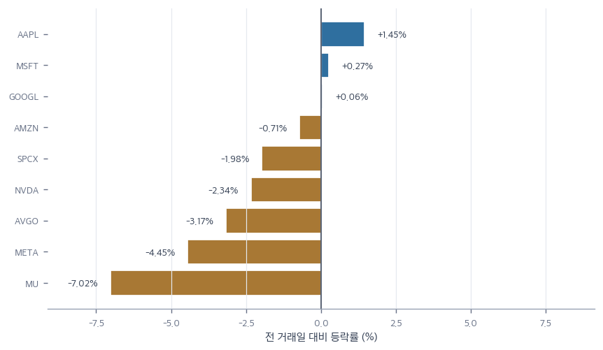
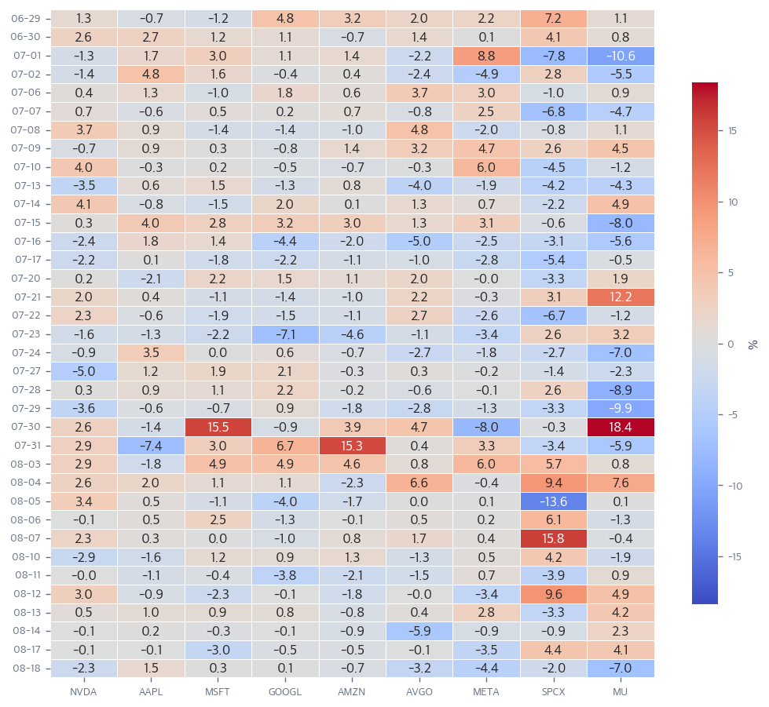
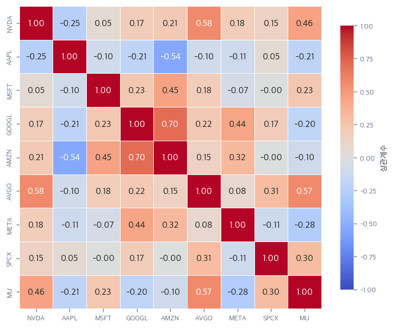
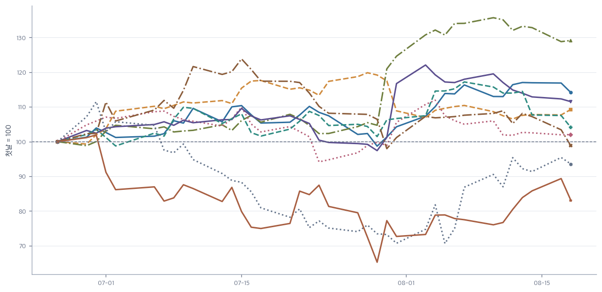
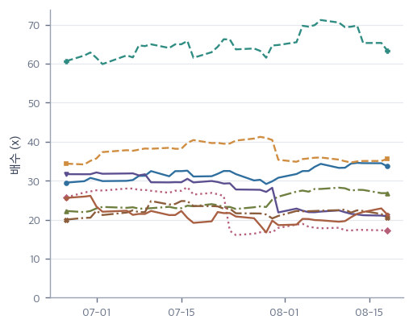
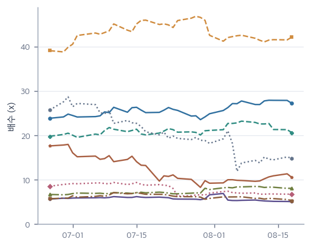
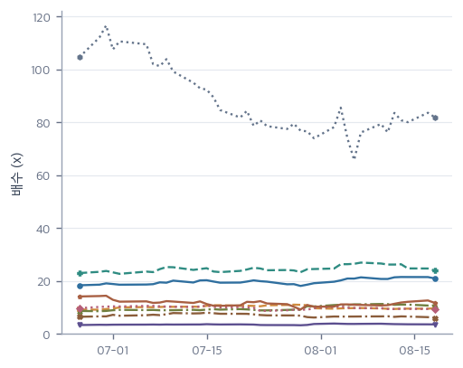

# 나스닥 일일 주가 리포트 - 2026-08-18

- 데이터 날짜: 2026-08-18
- 비교 기준일: 2026-08-17
- 생성 시각(UTC): 2026-08-19T00:02:10+00:00
- 3% 이상 변동 기준: abs(change_pct) >= 3.0%

## 전반적인 장 분위기

<!-- MARKET_SUMMARY:START -->
- **분류(해석): 위험회피·AI 성장주 중심 약세.** 2026-08-18 미국 정규장(ET 09:30–16:00)에서 QQQ는 729.87에서 717.51로 **-1.69%**, 나스닥 종합은 **-1.3%** 하락해 기술주 매도가 시장보다 강했다. ([QQQ 가격 이력](https://finance.yahoo.com/quote/QQQ/history/), [AP 지수 마감](https://apnews.com/article/63300d6f51d4d27ce881cc6c11719171))
- **관측 사실:** S&P 500은 53.30포인트(-0.7%) 내린 7,691.76, 다우는 116.38포인트(-0.2%) 내린 53,343.40으로 마감해 대형 기술주 쏠림 약세가 확인됐다. ([AP](https://apnews.com/article/63300d6f51d4d27ce881cc6c11719171))
- **당일 재료:** MU(-7.0%), NVDA(-2.3%), AVGO(-3.2%) 등 AI 반도체가 하락을 주도했으며, 보도는 AI 관련 주가의 과도한 상승과 데이터센터 수요·AI 수익성 지속성 우려를 배경으로 지목했다. ([AP](https://apnews.com/article/a805333e767251279e68e0686b28a8c9))
- **해석:** 미 국채금리가 대체로 안정적이었다는 마감 보도상 뚜렷한 단일 거시 충격보다는 AI/반도체 밸류에이션 재평가와 섹터 로테이션 성격이 강한 세션으로 판단한다. ([AP](https://apnews.com/article/63300d6f51d4d27ce881cc6c11719171))
<!-- MARKET_SUMMARY:END -->

## 전체 종목 변화율

### 당일 종목별 등락률

| 종목 | 종가 | 등락률 |
| --- | --- | --- |
| AAPL | 310.03 | +1.45% |
| MSFT | 481.63 | +0.27% |
| GOOGL | 344.20 | +0.06% |
| AMZN | 259.45 | -0.71% |
| SPCX | 143.34 | -1.98% |
| NVDA | 219.74 | -2.34% |
| AVGO | 380.00 | -3.17% |
| META | 543.67 | -4.45% |
| MU | 940.76 | -7.02% |

## 시장 흐름 히트맵

### 날짜별 등락률 히트맵

### 종목 간 수익률 상관 히트맵

## 종목별 변화 추이

### 기준일 대비 정규화 종가

## PER·PBR·PSR 변화 추이

### PER 변화 추이

### PBR 변화 추이

### PSR 변화 추이

## 3% 이상 변동 종목

| 종목 | 종가 | 등락률 |
| --- | --- | --- |
| AVGO | 380.00 | -3.17% |
| META | 543.67 | -4.45% |
| MU | 940.76 | -7.02% |

## 원인 메모

### AVGO (-3.17%)
<!-- CAUSE:AVGO:START -->
- **관측:** AVGO는 2026-08-18 정규장에서 **-3.17%** 마감했고, 같은 날 NVDA(-2.3%)와 MU(-7.0%)도 함께 하락했다. ([AP](https://apnews.com/article/a805333e767251279e68e0686b28a8c9))
- **가능성이 높은 배경:** 당일 보도는 AI 주식의 높은 밸류에이션과 데이터센터 수요·AI 수익성 지속성 우려에 따른 반도체 전반의 매도를 지목했다. ([AP](https://apnews.com/article/a805333e767251279e68e0686b28a8c9))
- 별도의 강한 AVGO 단일기업 촉매는 확인되지 않아, 기업 고유 악재로 단정하지 않고 AI 반도체 섹터 재평가로 해석한다.
<!-- CAUSE:AVGO:END -->

### META (-4.45%)
<!-- CAUSE:META:START -->
- **관측:** META는 2026-08-18 정규장에서 **-4.45%**로, QQQ(-1.69%)와 나스닥 종합(-1.3%)보다 더 크게 하락했다. ([QQQ 가격 이력](https://finance.yahoo.com/quote/QQQ/history/), [AP](https://apnews.com/article/63300d6f51d4d27ce881cc6c11719171))
- **같은 날 기업 뉴스:** 미국 연방법원에서 Facebook·Instagram이 아동에게 해를 끼치도록 설계됐다는 주장을 다루는 재판의 모두진술이 시작됐다. Meta는 혐의에 강하게 반박했다. ([Axios](https://www.axios.com/newsletters/axios-closer-56c12e21-80a9-4073-a1ab-a068bc2b20a9))
- 재판 개시가 주가 하락의 주원인이라고 입증할 자료는 부족하므로, 광범위한 성장주 위험회피와 함께 작용했을 가능성이 있는 법적 오버행으로만 기록한다.
<!-- CAUSE:META:END -->

### MU (-7.02%)
<!-- CAUSE:MU:START -->
- **관측:** MU는 2026-08-18 정규장에서 **-7.02%**로 하락해 S&P 500의 주요 하락 기여 종목 중 하나였다. ([AP](https://apnews.com/article/a805333e767251279e68e0686b28a8c9))
- **가능성이 높은 배경:** NVDA(-2.3%), AVGO(-3.2%)도 동반 하락했고, 당일 보도는 AI 메모리·프로세서 수요가 지속될지와 AI 투자 수익성에 대한 우려를 반도체 매도의 배경으로 제시했다. ([AP](https://apnews.com/article/a805333e767251279e68e0686b28a8c9))
- 별도의 강한 MU 단일기업 촉매는 확인되지 않아, 개별 악재보다는 변동성이 큰 AI 메모리/반도체 섹터의 밸류에이션 재평가로 해석한다.
<!-- CAUSE:MU:END -->
