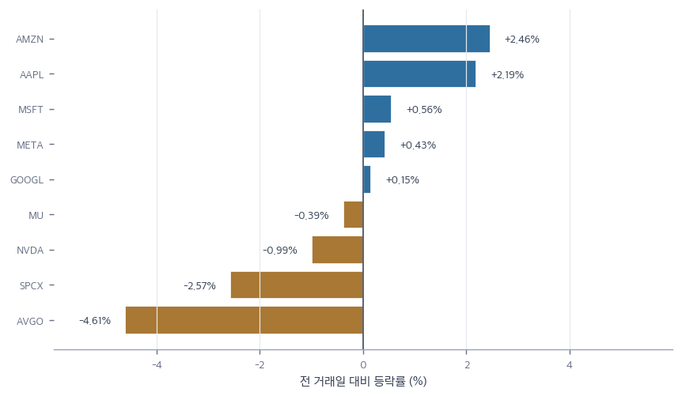
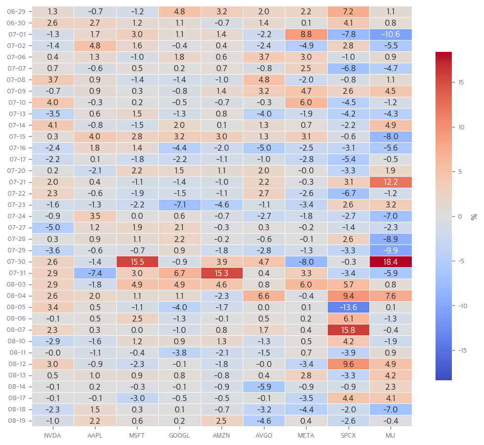
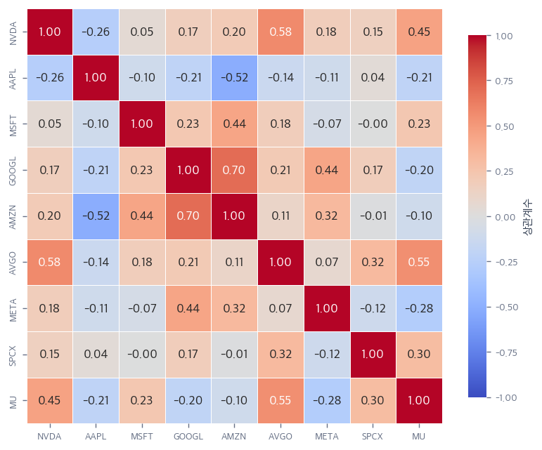
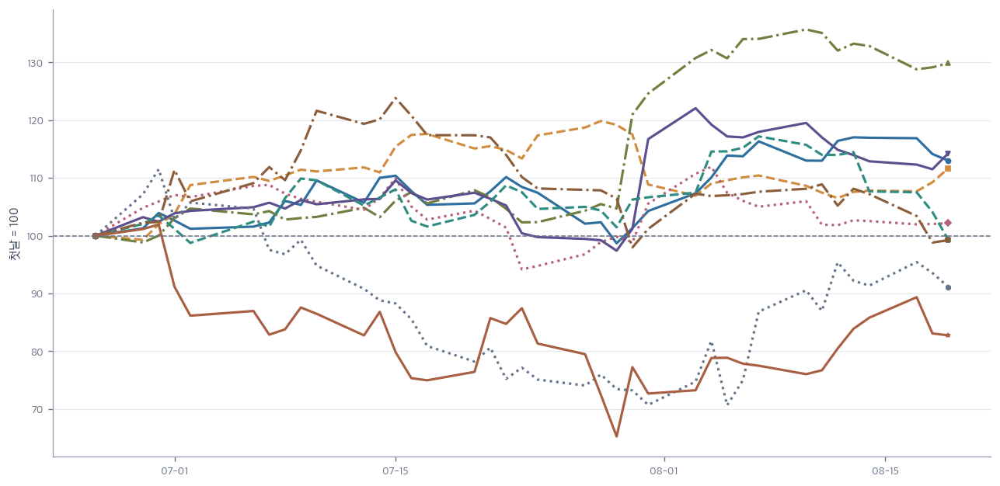
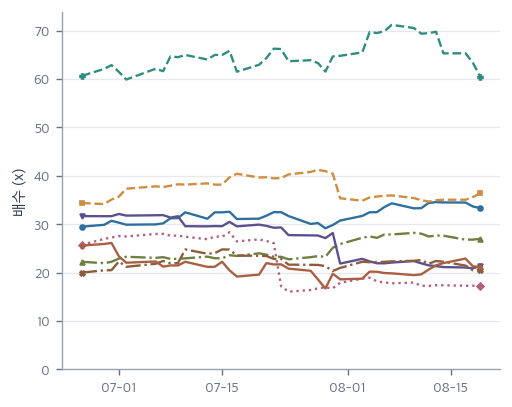
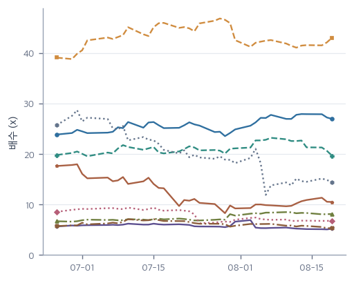
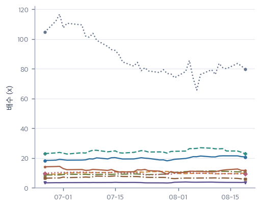

# 나스닥 일일 주가 리포트 - 2026-08-19

- 데이터 날짜: 2026-08-19
- 비교 기준일: 2026-08-18
- 생성 시각(UTC): 2026-08-20T00:01:39+00:00
- 3% 이상 변동 기준: abs(change_pct) >= 3.0%

## 전반적인 장 분위기

<!-- MARKET_SUMMARY:START -->
- **관측 — 혼조·업종 순환:** 2026-08-19 미국 정규장(09:30~16:00 ET)에서 QQQ는 717.51에서 716.08로 **-0.20%**였지만, 나스닥 종합은 **+0.16%**, S&P 500은 **+0.21%**, 러셀 2000은 **+0.50%**로 마감해 대형 기술주 밖의 상승 폭이 더 컸다. ([QQQ 일별 시세](https://finance.yahoo.com/quote/QQQ/history/?period1=1787011200&period2=1787270400), [AP 지수 마감](https://apnews.com/article/wall-street-stocks-dow-nasdaq-cb67d83b0638d31e5fe3c80c8de5934c))
- **관측 — 금리 완화 재료:** 미 재무부가 9월 9일~11월 4일 장기 국채 매입 예정 규모를 최소 두 배로 늘리겠다고 밝힌 뒤 10년물 금리는 전일 4.71%에서 4.64%로 낮아졌다. ([AP 장 마감 해설](https://apnews.com/article/stocks-futures-bonds-oil-inflation-trump-ai-9e355be634e4a21059fc1d1f20a1239e))
- **관측 — 종목별 분화:** Target·Estée Lauder 등 실적 호조 종목이 광범위 지수를 지지한 반면, AVGO는 **-4.61%**로 S&P 500의 가장 큰 하락 기여 종목이었다. ([AP 장 마감 해설](https://apnews.com/article/stocks-futures-bonds-oil-inflation-trump-ai-9e355be634e4a21059fc1d1f20a1239e))
- **해석:** 장기금리 하락은 위험자산 전반에 완충재로 작용했지만, AI 대형주의 밸류에이션·수익화 우려가 QQQ를 눌러 지수 상승이 뚜렷한 전면적 위험선호보다는 **순환매 성격**에 가까웠다.
<!-- MARKET_SUMMARY:END -->

## 전체 종목 변화율

### 당일 종목별 등락률

| 종목 | 종가 | 등락률 |
| --- | --- | --- |
| AMZN | 265.84 | +2.46% |
| AAPL | 316.83 | +2.19% |
| MSFT | 484.31 | +0.56% |
| META | 546.03 | +0.43% |
| GOOGL | 344.72 | +0.15% |
| MU | 937.10 | -0.39% |
| NVDA | 217.56 | -0.99% |
| SPCX | 139.65 | -2.57% |
| AVGO | 362.48 | -4.61% |

## 시장 흐름 히트맵

### 날짜별 등락률 히트맵

### 종목 간 수익률 상관 히트맵

## 종목별 변화 추이

### 기준일 대비 정규화 종가

## PER·PBR·PSR 변화 추이

### PER 변화 추이

### PBR 변화 추이

### PSR 변화 추이

## 3% 이상 변동 종목

| 종목 | 종가 | 등락률 |
| --- | --- | --- |
| AVGO | 362.48 | -4.61% |

## 원인 메모

### AVGO (-4.61%)
<!-- CAUSE:AVGO:START -->
- **관측:** AVGO는 2026-08-19 정규장에서 362.48달러로 **-4.61%** 마감했고, 당일 S&P 500에서 가장 큰 하락 기여 종목으로 집계됐다. ([Yahoo Finance 일별 시세](https://finance.yahoo.com/quote/AVGO/history/?period1=1787011200&period2=1787270400), [AP 장 마감 해설](https://apnews.com/article/stocks-futures-bonds-oil-inflation-trump-ai-9e355be634e4a21059fc1d1f20a1239e))
- **원인 확인:** 당일 하락을 설명할 강한 단일 회사 공시는 확인되지 않았다. AP는 Broadcom을 포함한 AI 수혜주의 여름철 급등락 배경으로 높은 주가와 AI 투자의 수익화 지속성 우려를 지목했다. ([AP 장 마감 해설](https://apnews.com/article/stocks-futures-bonds-oil-inflation-trump-ai-9e355be634e4a21059fc1d1f20a1239e))
- **해석:** S&P 500(+0.21%)과 러셀 2000(+0.50%)이 오른 반면 QQQ(-0.20%)가 밀린 점을 함께 보면, 확인되지 않은 개별 악재보다는 대형 AI·반도체주에서 다른 업종으로의 순환매가 AVGO의 상대적 약세를 키운 것으로 보는 편이 타당하다. ([AP 지수 마감](https://apnews.com/article/wall-street-stocks-dow-nasdaq-cb67d83b0638d31e5fe3c80c8de5934c), [QQQ 일별 시세](https://finance.yahoo.com/quote/QQQ/history/?period1=1787011200&period2=1787270400))
<!-- CAUSE:AVGO:END -->
