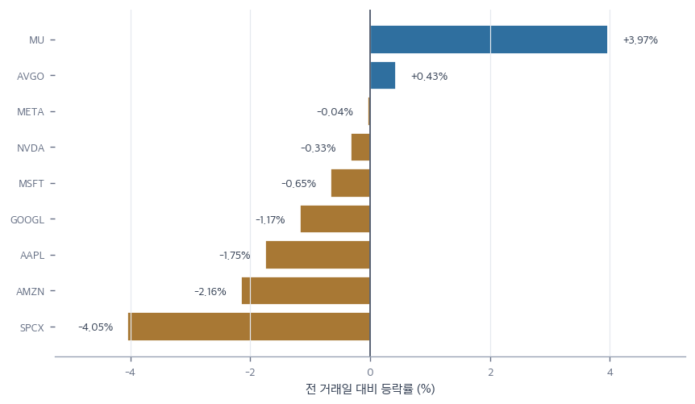
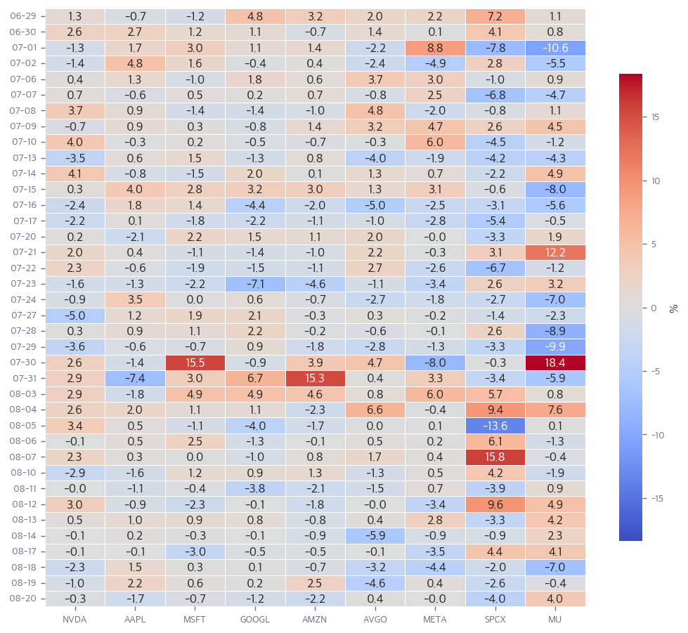
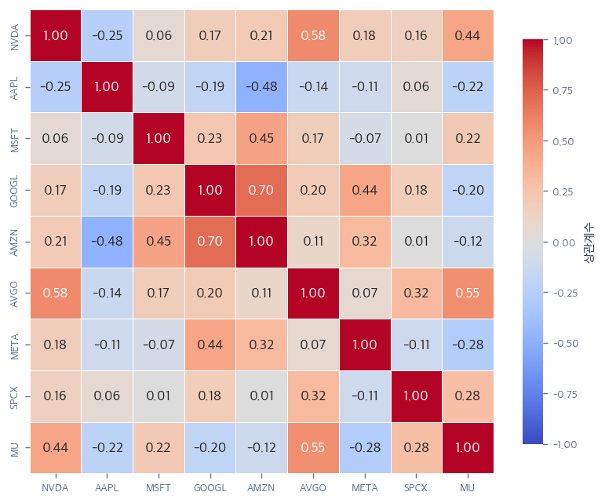
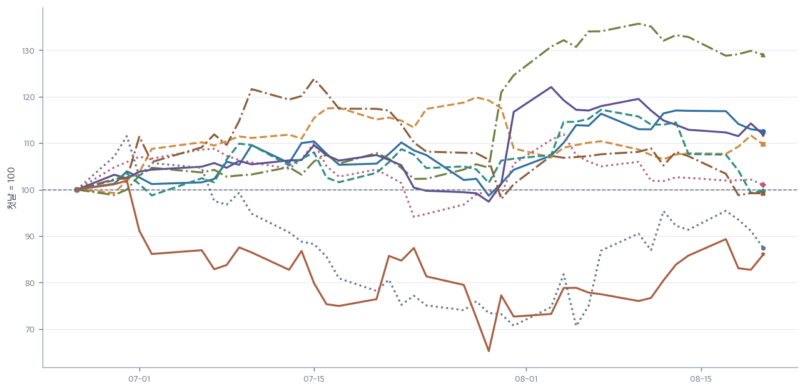
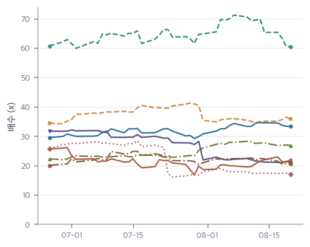
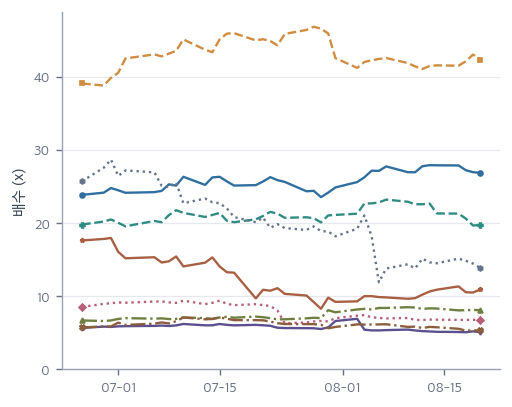
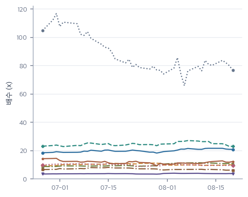

# 나스닥 일일 주가 리포트 - 2026-08-20

- 데이터 날짜: 2026-08-20
- 비교 기준일: 2026-08-19
- 생성 시각(UTC): 2026-08-21T00:11:23+00:00
- 3% 이상 변동 기준: abs(change_pct) >= 3.0%

## 전반적인 장 분위기

<!-- MARKET_SUMMARY:START -->
- **판단 — 광범위한 위험회피:** 2026-08-20 미국 정규장(09:30~16:00 ET)에서 QQQ는 -0.72%, 나스닥 종합은 -1.00%, S&P 500은 -0.87%로 마감해 대형 기술주와 광범위 시장이 함께 약세였다. ([QQQ 가격 이력](https://finance.yahoo.com/quote/QQQ/history/), [AP 지수 마감](https://apnews.com/article/b595de56eb56950bf87e77e1f812cfba))
- **관찰 사실 — 금리·유가:** 미 10년물 국채금리는 전일 4.65%에서 4.70%로 올랐고, 브렌트유는 트럼프 대통령의 대이란 위협 이후 2.4% 상승했다. 이는 인플레이션과 정부부채 우려를 다시 자극했다. ([AP 장중·마감 해설](https://apnews.com/article/1dcf7c9c3cc490b82b2632302628c46b))
- **관찰 사실 — 소비주 충격:** 월마트(WMT)는 실적 발표 뒤 향후 이익 우려로 9.2% 하락해 S&P 500의 가장 큰 하방 기여 종목이 됐고, 소비 둔화 우려를 넓혔다. ([AP 장중·마감 해설](https://apnews.com/article/1dcf7c9c3cc490b82b2632302628c46b))
- **해석:** 상승한 장기금리와 유가, 대형 소비주의 급락이 동시에 나타난 점을 감안하면 이날 약세는 특정 기술주 한 종목보다 거시·소비 우려가 겹친 전반적 디리스킹으로 보는 것이 타당하다.
<!-- MARKET_SUMMARY:END -->

## 전체 종목 변화율

### 당일 종목별 등락률

| 종목 | 종가 | 등락률 |
| --- | --- | --- |
| MU | 974.33 | +3.97% |
| AVGO | 364.03 | +0.43% |
| META | 545.83 | -0.04% |
| NVDA | 216.85 | -0.33% |
| MSFT | 481.15 | -0.65% |
| GOOGL | 340.67 | -1.17% |
| AAPL | 311.30 | -1.75% |
| AMZN | 260.11 | -2.16% |
| SPCX | 134.00 | -4.05% |

## 시장 흐름 히트맵

### 날짜별 등락률 히트맵

### 종목 간 수익률 상관 히트맵

## 종목별 변화 추이

### 기준일 대비 정규화 종가

## PER·PBR·PSR 변화 추이

### PER 변화 추이

### PBR 변화 추이

### PSR 변화 추이

## 3% 이상 변동 종목

| 종목 | 종가 | 등락률 |
| --- | --- | --- |
| MU | 974.33 | +3.97% |
| SPCX | 134.00 | -4.05% |

## 원인 메모

### MU (+3.97%)
<!-- CAUSE:MU:START -->
- **관찰 사실:** MU는 정규장에서 +3.97%로 마감해 QQQ(-0.72%)와 나스닥 종합(-1.00%)이 하락한 날 뚜렷한 상대강도를 보였다. ([당일 MU 변동 요약](https://www.tradingkey.com/news/market-movers/262122310-market-movers-mu-20260820), [AP 지수 마감](https://apnews.com/article/b595de56eb56950bf87e77e1f812cfba))
- **확인된 배경:** 당일 변동 요약은 HBM 연구 투자와 첨단 메모리 공급 부족을 긍정적 배경으로 들었지만, 이날 새로 발표된 실적·공시·제품 뉴스는 제시하지 않았다. ([TradingKey](https://www.tradingkey.com/news/market-movers/262122310-market-movers-mu-20260820))
- **해석:** 강한 단일 기업 촉매는 확인되지 않았다. 따라서 상승은 기존 HBM 수요 기대 속 종목별 매수·반등으로 보는 것이 안전하며, 특정 뉴스가 직접 원인이라고 단정하기 어렵다.
<!-- CAUSE:MU:END -->

### SPCX (-4.05%)
<!-- CAUSE:SPCX:START -->
- **관찰 사실:** SPCX는 정규장에서 -4.05% 하락해 같은 날의 광범위한 위험회피 흐름보다 낙폭이 컸다. ([AP 지수 마감](https://apnews.com/article/b595de56eb56950bf87e77e1f812cfba))
- **당일 기업 요인:** 2026-08-20에는 일부 Class B 주식의 락업 제한이 해제되는 일정이 도래했다. 매도 가능 물량 확대에 대한 공급 부담이 주가 압박 요인으로 작용했을 가능성이 높다. ([락업 일정 요약](https://ae.marketscreener.com/news/certain-class-b-common-stock-of-space-exploration-technologies-corp-are-subject-to-a-lock-up-agreem-ce7859d2de8bf027), [SEC 최종 투자설명서](https://www.sec.gov/Archives/edgar/data/1181412/000162828026042639/spaceexplorationtechnologi.htm))
- **해석:** 해제 대상 보유자의 실제 당일 매도 규모는 확인되지 않았으므로 락업 해제를 확정적 매도 원인으로 단정할 수 없다. 다만 공급 우려와 QQQ·광범위 시장 약세가 낙폭을 키운 정황은 지지된다.
<!-- CAUSE:SPCX:END -->
