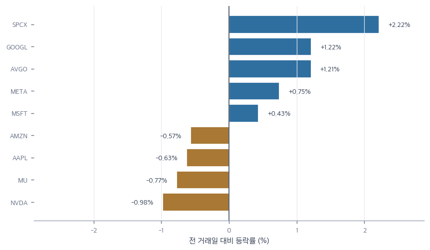
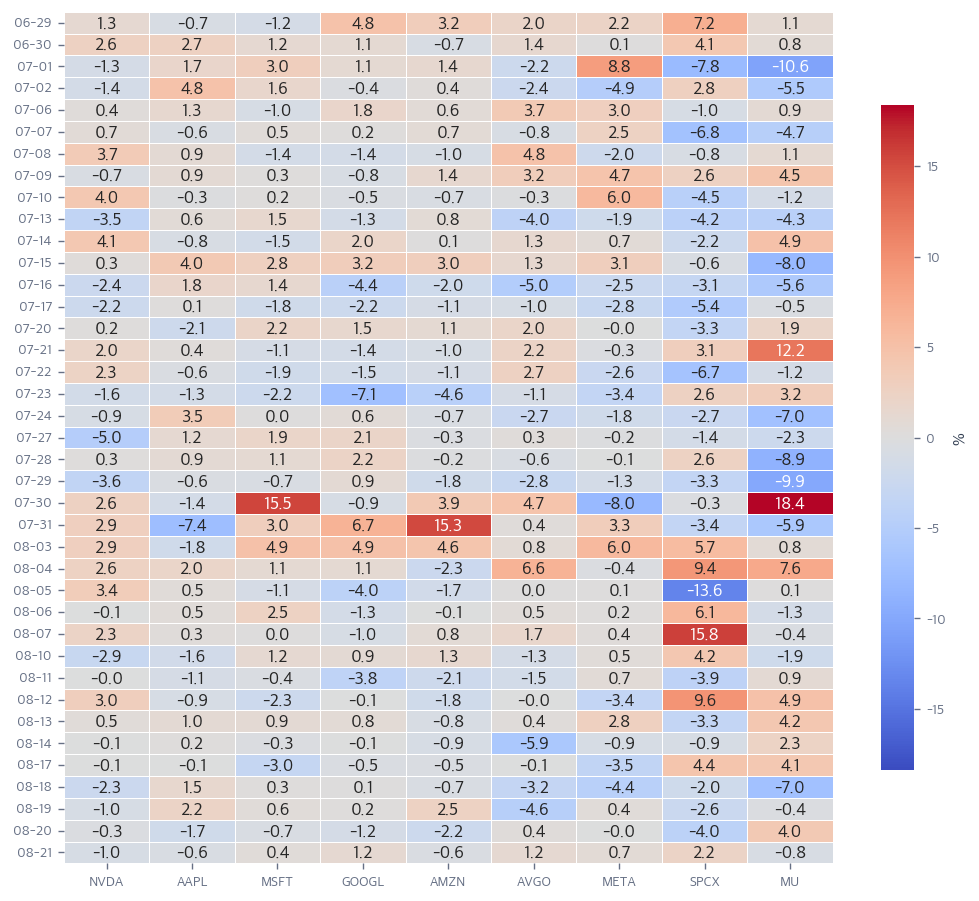
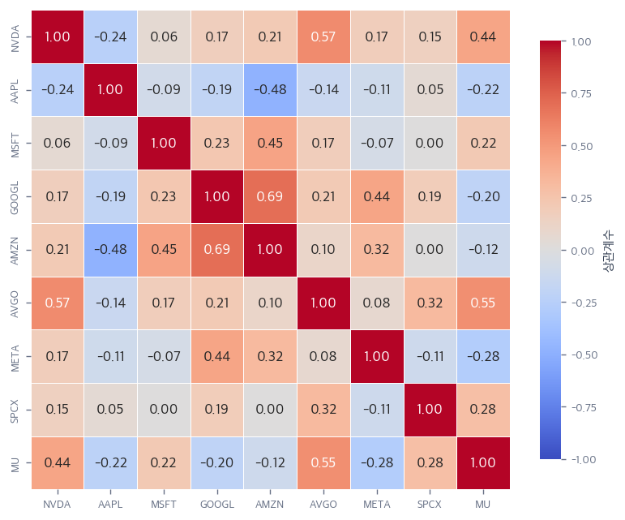
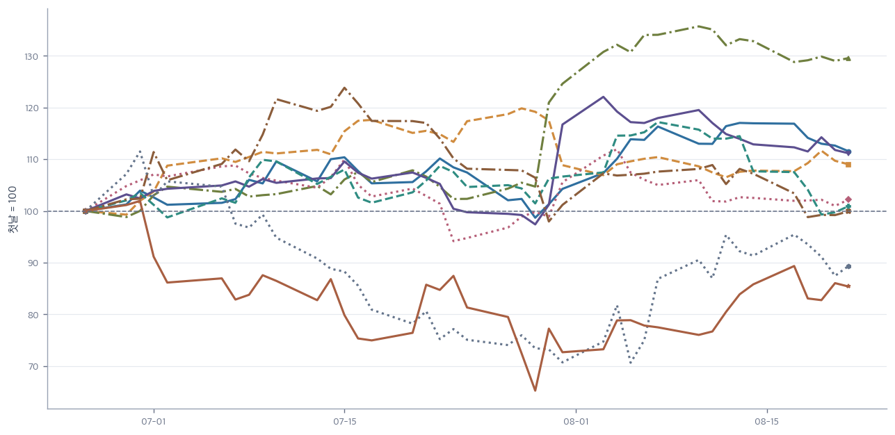
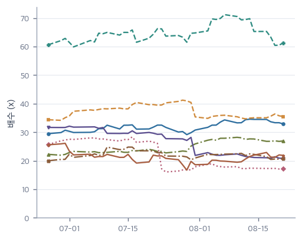
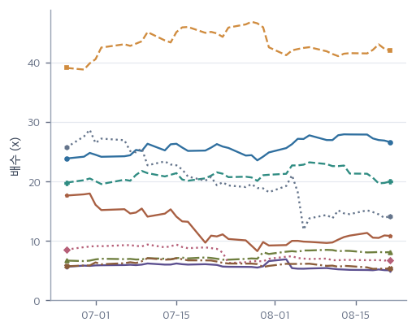
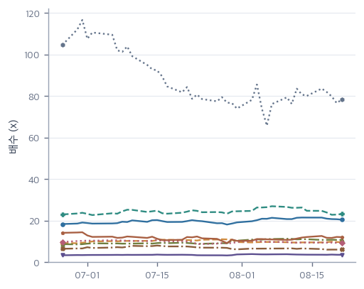

# 나스닥 일일 주가 리포트 - 2026-08-21

- 데이터 날짜: 2026-08-21
- 비교 기준일: 2026-08-20
- 생성 시각(UTC): 2026-08-22T00:02:23+00:00
- 3% 이상 변동 기준: abs(change_pct) >= 3.0%

## 전반적인 장 분위기

<!-- MARKET_SUMMARY:START -->
- **관찰 — 완만한 risk-on:** 2026-08-21 미국 정규장(09:30~16:00 ET)에서 [QQQ는 710.93달러에서 713.44달러로 0.35% 상승](https://finance.yahoo.com/quote/QQQ/history/)했고, [나스닥 종합지수와 S&P 500도 각각 0.43% 상승](https://apnews.com/article/09c079b43680c3e4564346892b5dc824)했다.
- **관찰 — 시장 폭:** 같은 정규장에서 [다우는 0.98%, 러셀 2000은 0.85% 상승](https://apnews.com/article/09c079b43680c3e4564346892b5dc824)해 QQQ보다 강했다. **해석:** 대형 기술주 집중 랠리보다는 중소형주와 전통 업종까지 참여한 폭넓은 반등에 가까웠다.
- **관찰 — 경기 재료:** 8월 미국 [S&P Global 종합 산출지수는 56.0으로 2022년 4월 이후 최고, 서비스 PMI는 56.8로 2024년 12월 이후 최고](https://finance.yahoo.com/economy/articles/us-sector-fuels-acceleration-business-134839593.html)를 기록했다. **해석:** 기업 이익 기대를 지지한 당일의 주요 상승 재료였다.
- **관찰 — 금리 부담:** 강한 경기 지표와 함께 [미 10년물 국채금리는 전일 4.69%에서 4.73%로 상승](https://apnews.com/article/96ef9586e1288e50843b4d2b1ccebc32)했다. **해석:** 주가 반등이 이어졌지만 성장주 상단을 제약한 상충 요인이었다.
<!-- MARKET_SUMMARY:END -->

## 전체 종목 변화율

### 당일 종목별 등락률

| 종목 | 종가 | 등락률 |
| --- | --- | --- |
| SPCX | 136.97 | +2.22% |
| GOOGL | 344.82 | +1.22% |
| AVGO | 368.45 | +1.21% |
| META | 549.90 | +0.75% |
| MSFT | 483.24 | +0.43% |
| AMZN | 258.63 | -0.57% |
| AAPL | 309.35 | -0.63% |
| MU | 966.78 | -0.77% |
| NVDA | 214.72 | -0.98% |

## 시장 흐름 히트맵

### 날짜별 등락률 히트맵

### 종목 간 수익률 상관 히트맵

## 종목별 변화 추이

### 기준일 대비 정규화 종가

## PER·PBR·PSR 변화 추이

### PER 변화 추이

### PBR 변화 추이

### PSR 변화 추이

## 3% 이상 변동 종목

데이터 없음.

## 원인 메모

3% 이상 변동 종목 없음.
