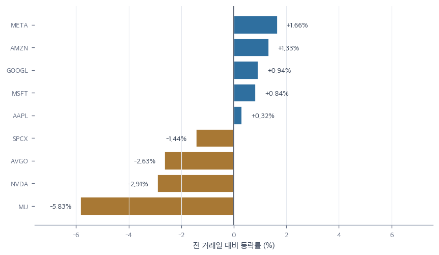
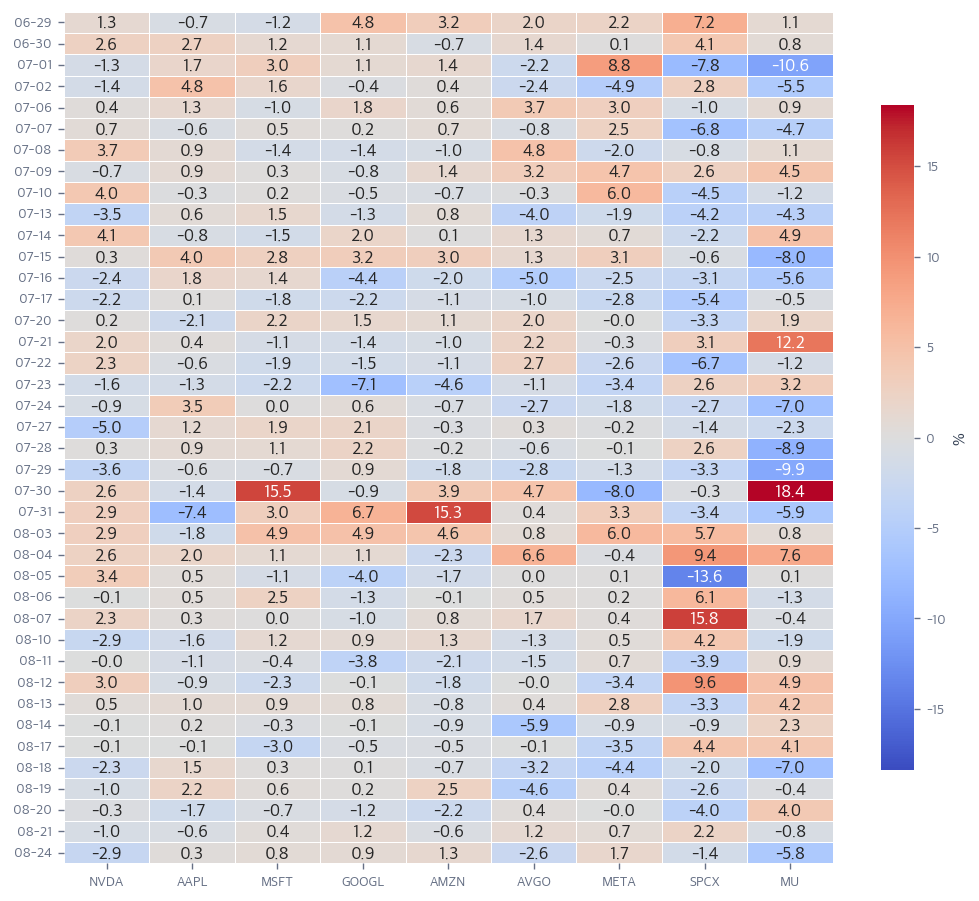
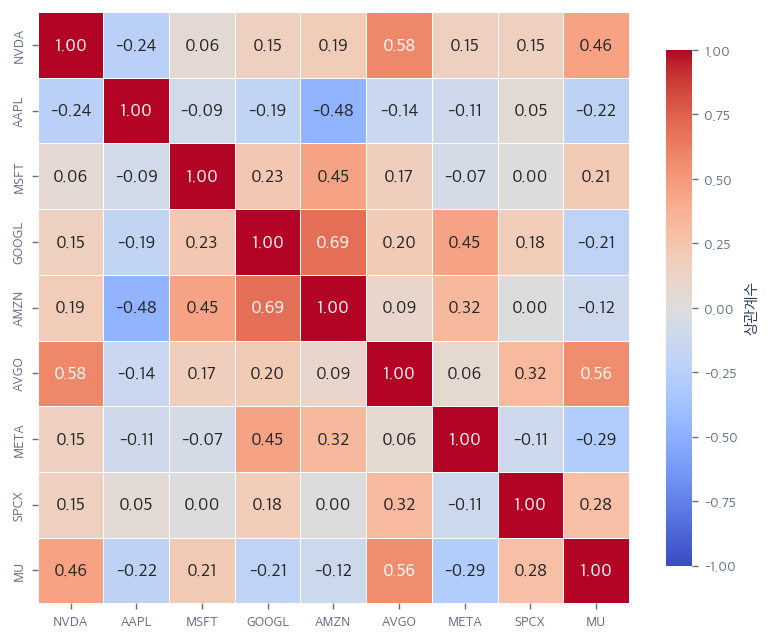
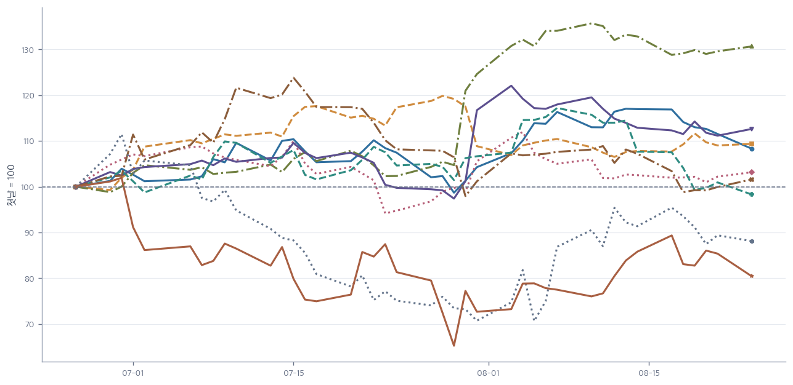
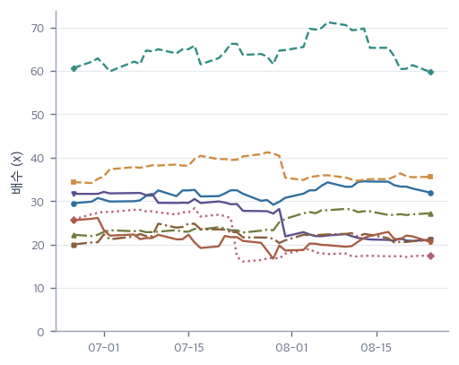
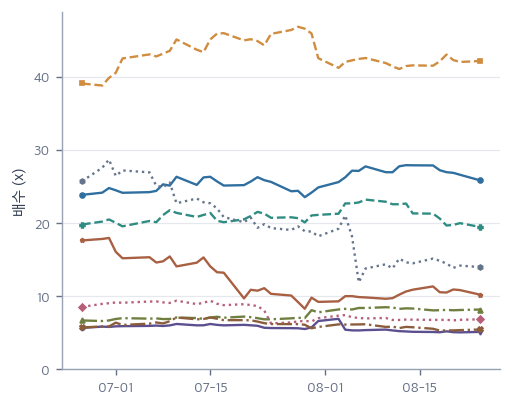
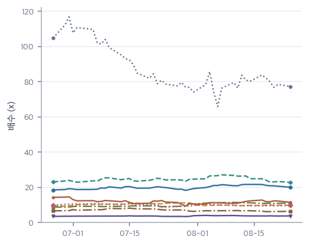

# 나스닥 일일 주가 리포트 - 2026-08-24

- 데이터 날짜: 2026-08-24
- 비교 기준일: 2026-08-21
- 생성 시각(UTC): 2026-08-25T00:02:08+00:00
- 3% 이상 변동 기준: abs(change_pct) >= 3.0%

## 전반적인 장 분위기

<!-- MARKET_SUMMARY:START -->
- **관찰 — 혼조·기술주/반도체 중심 risk-off:** 2026-08-24 미국 정규장(09:30~16:00 ET)에서 [QQQ는 713.44달러에서 706.32달러로 1.00% 하락](https://finance.yahoo.com/quote/QQQ/history/)했고, [나스닥 종합지수는 0.76%, S&P 500은 0.28% 하락한 반면 다우는 0.26% 상승](https://apnews.com/article/8313c751e57d70d1556f679eb0f2a8cb)했다.
- **관찰 — 업종 쏠림:** 같은 정규장에서 [SOXX는 520.05달러에서 506.18달러로 2.67% 하락](https://finance.yahoo.com/quote/SOXX/history/)했고 NVDA(-2.91%), AVGO(-2.63%), MU(-5.83%)가 동반 약세였다. **해석:** 다우가 상승한 가운데 QQQ와 반도체가 더 크게 내려 전면적 위험회피보다 기술주·AI 노출 축소와 업종 순환의 성격이 강했다.
- **관찰 — 주요 대기 재료:** [시장 참가자들은 8월 26일 예정된 NVIDIA 실적을 앞두고 AI 수요와 밸류에이션의 지속 가능성을 재점검](https://apnews.com/article/8ab800029c559c5e751058ac1a8ef932)했다. **해석:** 확정된 새 거시 충격보다 대형 이벤트 전 포지션 축소가 기술주 약세의 지배적 배경이었다.
- **관찰 — 상충 신호:** [유가 하락과 함께 채권금리는 완화됐지만](https://apnews.com/article/8313c751e57d70d1556f679eb0f2a8cb) 성장주 반등으로 이어지지 않았다. **해석:** 금리보다 반도체·AI 고유 리스크가 당일 지수 간 차이를 더 잘 설명한다.
<!-- MARKET_SUMMARY:END -->

## 전체 종목 변화율

### 당일 종목별 등락률

| 종목 | 종가 | 등락률 |
| --- | --- | --- |
| META | 559.02 | +1.66% |
| AMZN | 262.07 | +1.33% |
| GOOGL | 348.06 | +0.94% |
| MSFT | 487.31 | +0.84% |
| AAPL | 310.34 | +0.32% |
| SPCX | 135.00 | -1.44% |
| AVGO | 358.76 | -2.63% |
| NVDA | 208.48 | -2.91% |
| MU | 910.43 | -5.83% |

## 시장 흐름 히트맵

### 날짜별 등락률 히트맵

### 종목 간 수익률 상관 히트맵

## 종목별 변화 추이

### 기준일 대비 정규화 종가

## PER·PBR·PSR 변화 추이

### PER 변화 추이

### PBR 변화 추이

### PSR 변화 추이

## 3% 이상 변동 종목

| 종목 | 종가 | 등락률 |
| --- | --- | --- |
| MU | 910.43 | -5.83% |

## 원인 메모

### MU (-5.83%)
<!-- CAUSE:MU:START -->
- **관찰:** MU는 2026-08-24 정규장에서 5.83% 하락해 [반도체 ETF SOXX의 2.67% 하락](https://finance.yahoo.com/quote/SOXX/history/)보다 약했다. 당일 회사의 확정 공시나 실적 발표에서 단일 원인은 확인되지 않았다.
- **섹터 배경:** [삼성전자의 주주환원안이 기대에 못 미치며 서울장에서 8% 넘게 하락](https://finance.yahoo.com/markets/stocks/articles/samsung-electronics-shares-fall-shareholder-001849405.html)했고, [이 여파가 아시아 메모리주에서 MU의 미국 프리마켓·정규장 약세로 이어졌다는 당일 보도](https://ca.investing.com/news/stock-market-news/why-is-micron-technology-stock-sliding-today-93CH-4814268)가 있었다.
- **추가 압력·불확실성:** 같은 보도는 Apple이 중국 CXMT·YMTC 메모리를 조달할 수 있다는 주말 보도를 경쟁 심화 우려로 지목했고, 동시에 [NVIDIA 실적 전 반도체 전반의 노출 축소](https://apnews.com/article/8ab800029c559c5e751058ac1a8ef932)가 겹쳤다. 다만 중국산 메모리 허용은 확인된 정책 결정이 아니므로 MU 하락의 확정된 단일 원인으로 단정할 수 없다.
<!-- CAUSE:MU:END -->
