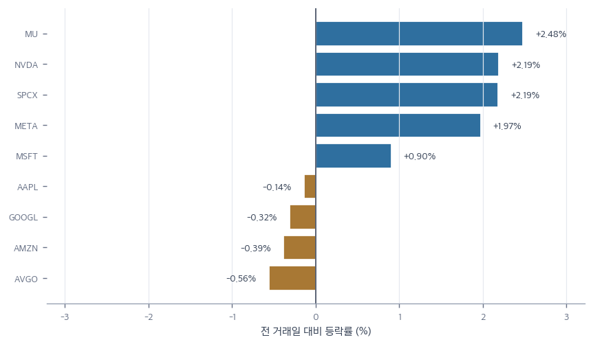
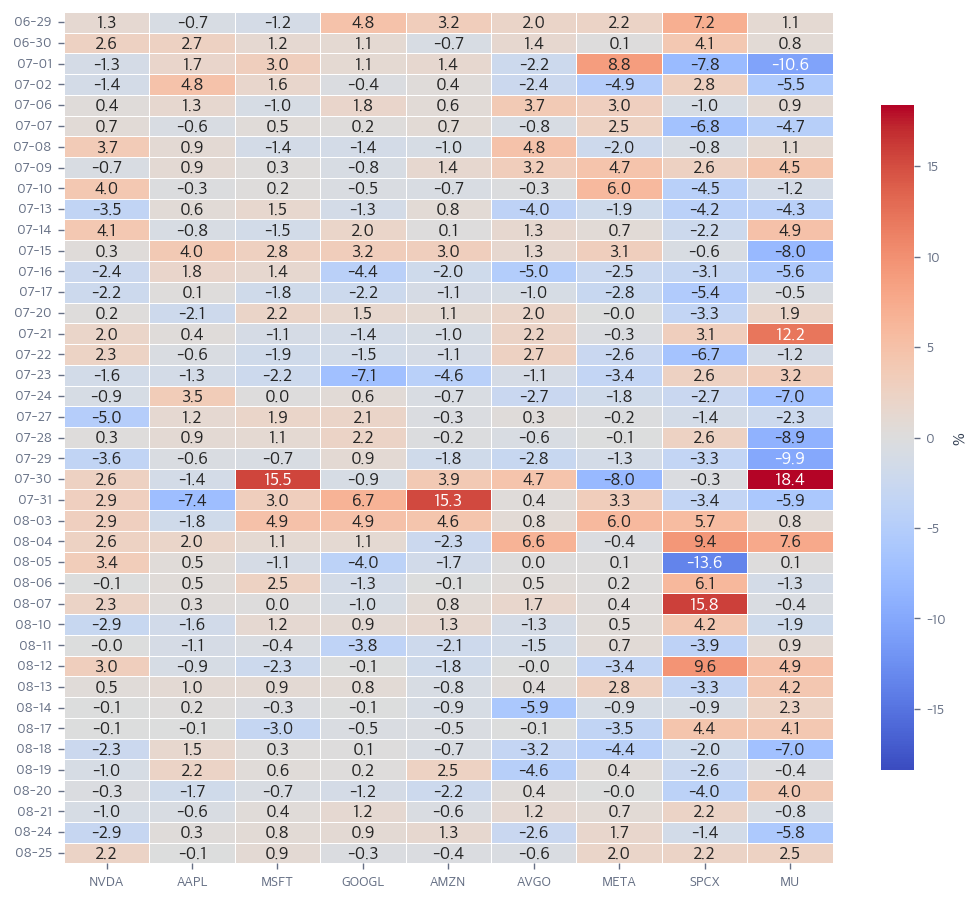
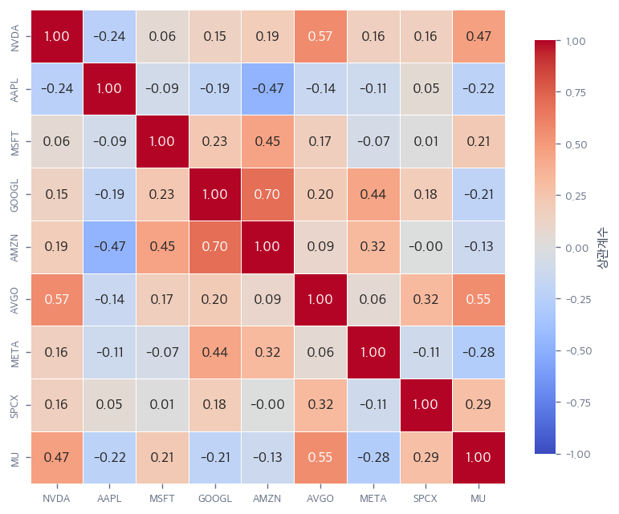
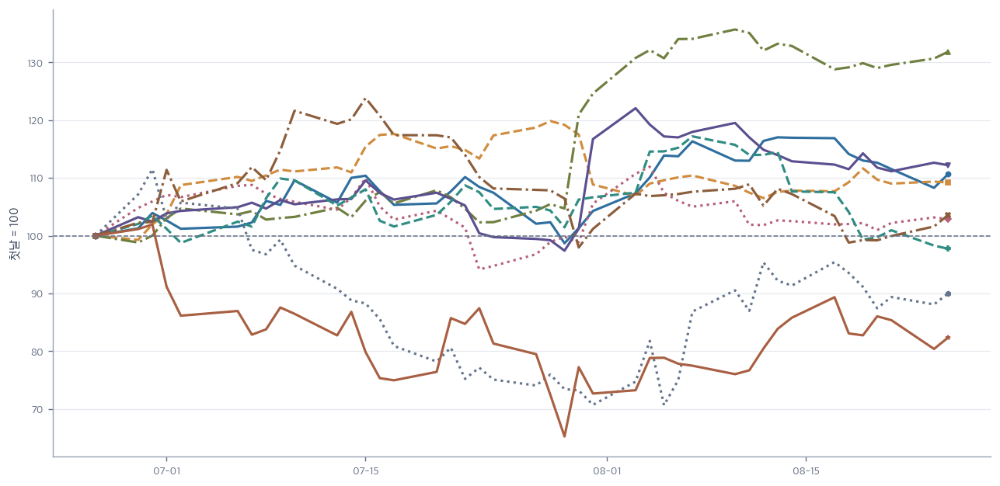
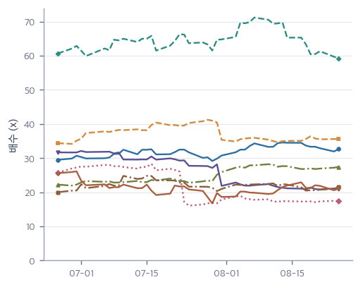
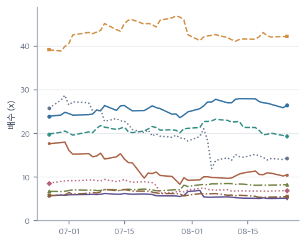
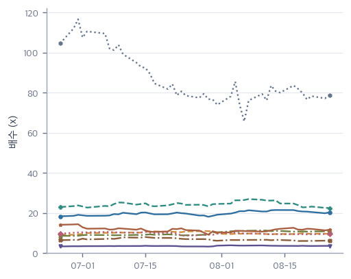

# 나스닥 일일 주가 리포트 - 2026-08-25

- 데이터 날짜: 2026-08-25
- 비교 기준일: 2026-08-24
- 생성 시각(UTC): 2026-08-26T00:02:32+00:00
- 3% 이상 변동 기준: abs(change_pct) >= 3.0%

## 전반적인 장 분위기

<!-- MARKET_SUMMARY:START -->
- **분류(관찰): 완만한 위험선호.** 미국 정규장 **2026-08-25 09:30~16:00 ET**에 [QQQ는 710.72달러로 +0.62%](https://stockanalysis.com/etf/qqq/), [나스닥 종합지수는 +0.66%, S&P 500은 +0.32%, 러셀 2000은 +0.50%](https://apnews.com/article/wall-street-stocks-dow-nasdaq-69aae9f2f61737936f126e7820833bbe) 올라 대형 기술주와 광범위 지수가 함께 상승했다.
- **관찰:** [브렌트유는 3.6% 하락한 배럴당 87.27달러, 미 10년물 국채금리는 전일 4.70%에서 4.63%로 하락](https://apnews.com/article/stocks-markets-futures-nvidia-bonds-oil-f17fc8cfc61f40114eb7246701b4695d)했다. **해석:** 유가·금리 동반 하락이 인플레이션 및 할인율 부담을 낮추며 주식 반등을 지지한 것으로 보인다.
- **관찰:** [엔비디아(NVDA)는 정규장에서 2.2% 상승했고 다른 AI 관련주도 강세를 보였으며, 다음 날 예정된 실적 발표가 AI·반도체주의 방향성 이벤트로 부각](https://apnews.com/article/stocks-markets-futures-nvidia-bonds-oil-f17fc8cfc61f40114eb7246701b4695d)됐다. 대형 지수 비중이 큰 NVDA의 반등이 나스닥과 QQQ 상승에 기여했다.
- **반대 신호(관찰):** [컨퍼런스보드 8월 소비자신뢰지수는 90.2에서 89.4로, 기대지수는 5.8포인트 내린 68.2로 하락](https://www.conference-board.org/topics/consumer-confidence/index.cfm?os=vbkn42___)했다. 따라서 이번 상승은 경기 낙관의 일방적 확산보다는 유가·금리 완화와 AI주 반등이 주도한 제한적 위험선호로 해석하는 편이 타당하다.
<!-- MARKET_SUMMARY:END -->

## 전체 종목 변화율

### 당일 종목별 등락률

| 종목 | 종가 | 등락률 |
| --- | --- | --- |
| MU | 932.97 | +2.48% |
| NVDA | 213.05 | +2.19% |
| SPCX | 137.95 | +2.19% |
| META | 570.05 | +1.97% |
| MSFT | 491.71 | +0.90% |
| AAPL | 309.90 | -0.14% |
| GOOGL | 346.96 | -0.32% |
| AMZN | 261.06 | -0.39% |
| AVGO | 356.74 | -0.56% |

## 시장 흐름 히트맵

### 날짜별 등락률 히트맵

### 종목 간 수익률 상관 히트맵

## 종목별 변화 추이

### 기준일 대비 정규화 종가

## PER·PBR·PSR 변화 추이

### PER 변화 추이

### PBR 변화 추이

### PSR 변화 추이

## 3% 이상 변동 종목

데이터 없음.

## 원인 메모

3% 이상 변동 종목 없음.
