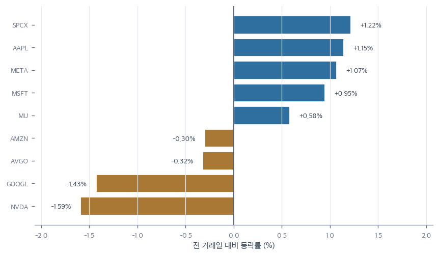
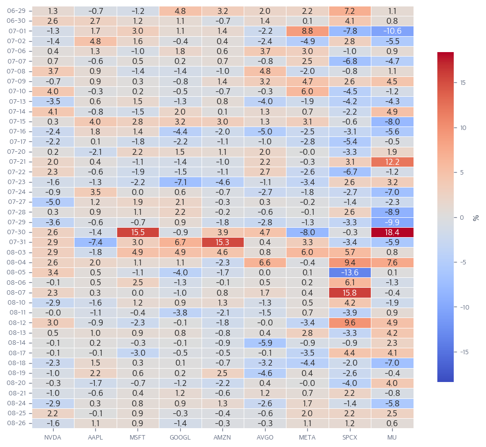
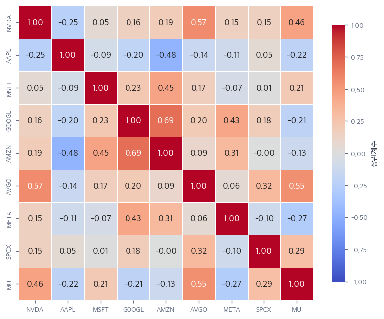
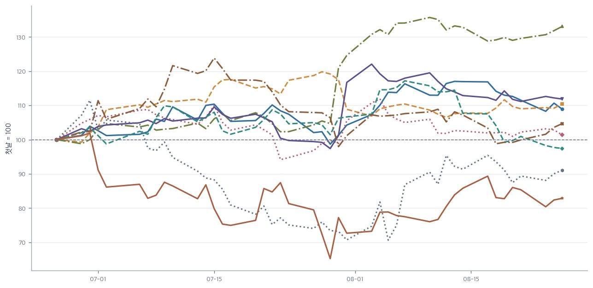
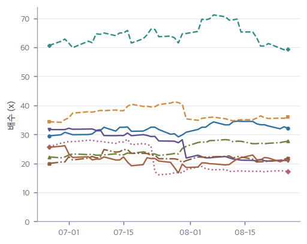
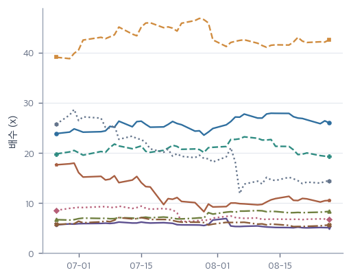
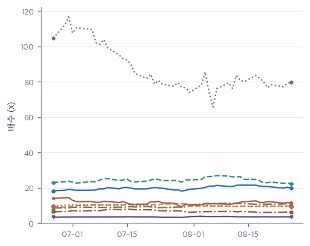

# 나스닥 일일 주가 리포트 - 2026-08-26

- 데이터 날짜: 2026-08-26
- 비교 기준일: 2026-08-25
- 생성 시각(UTC): 2026-08-27T00:13:35+00:00
- 3% 이상 변동 기준: abs(change_pct) >= 3.0%

## 전반적인 장 분위기

<!-- MARKET_SUMMARY:START -->
- **혼조·관망:** 2026-08-26 미국 정규장(미 동부시간 09:30~16:00)에서 QQQ는 **+0.09%**였지만 나스닥 종합지수는 **-0.08%**, S&P 500은 **-0.02%**로 마감해 뚜렷한 위험선호 방향 없이 거의 보합권에서 엇갈렸다. ([QQQ 일별 시세](https://finance.yahoo.com/quote/QQQ/history/), [AP 지수 마감](https://apnews.com/article/b1704f7dffb77bc3166f4485e8d89532))
- **관찰된 폭:** 다우는 **-0.21%**, 러셀 2000은 **-0.14%**였고, S&P 500도 1.58포인트 하락하는 데 그쳤다. 이는 광범위한 매도라기보다 대형주별 등락이 상쇄된 조용한 세션이었다는 해석에 가깝다. ([AP 장 마감 보도](https://apnews.com/article/stocks-markets-ai-oil-nvidia-7112fc458ebbf59dfa6172799e4e139d))
- **거시 재료(사실):** 7월 PCE 물가는 전월 대비 **+0.2%**, 전년 대비 **+3.7%**였고 근원 PCE는 각각 **+0.2%**, **+3.3%**였다. 예상보다 다소 높은 헤드라인 물가 뒤 미 10년물 금리는 전일 4.64%에서 **4.65%**로 올라 금리 민감 자산의 상단을 제한했다는 해석이 가능하다. ([미 상무부 BEA](https://www.bea.gov/news/2026/personal-income-and-outlays-july-2026), [AP 채권시장 설명](https://apnews.com/article/stocks-markets-ai-oil-nvidia-7112fc458ebbf59dfa6172799e4e139d))
- **이벤트 대기:** 시장 영향력이 큰 엔비디아(NVDA)의 실적 발표가 정규장 종료 뒤 예정돼 있어 장중 큰 방향성 베팅이 제한됐다는 관측이 보도됐다. 이 문장은 정규장 움직임의 배경이며, 장 마감 뒤 실적 반응은 수익률에 섞지 않았다. ([AP](https://apnews.com/article/stocks-markets-ai-oil-nvidia-7112fc458ebbf59dfa6172799e4e139d))
<!-- MARKET_SUMMARY:END -->

## 전체 종목 변화율

### 당일 종목별 등락률

| 종목 | 종가 | 등락률 |
| --- | --- | --- |
| SPCX | 139.63 | +1.22% |
| AAPL | 313.45 | +1.15% |
| META | 576.14 | +1.07% |
| MSFT | 496.37 | +0.95% |
| MU | 938.40 | +0.58% |
| AMZN | 260.28 | -0.30% |
| AVGO | 355.59 | -0.32% |
| GOOGL | 342.00 | -1.43% |
| NVDA | 209.66 | -1.59% |

## 시장 흐름 히트맵

### 날짜별 등락률 히트맵

### 종목 간 수익률 상관 히트맵

## 종목별 변화 추이

### 기준일 대비 정규화 종가

## PER·PBR·PSR 변화 추이

### PER 변화 추이

### PBR 변화 추이

### PSR 변화 추이

## 3% 이상 변동 종목

데이터 없음.

## 원인 메모

3% 이상 변동 종목 없음.
