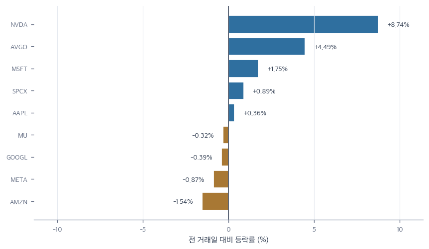
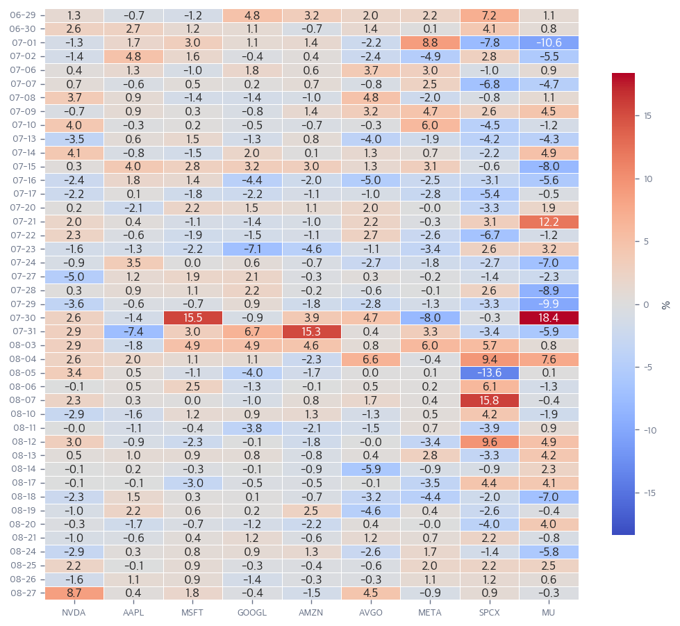
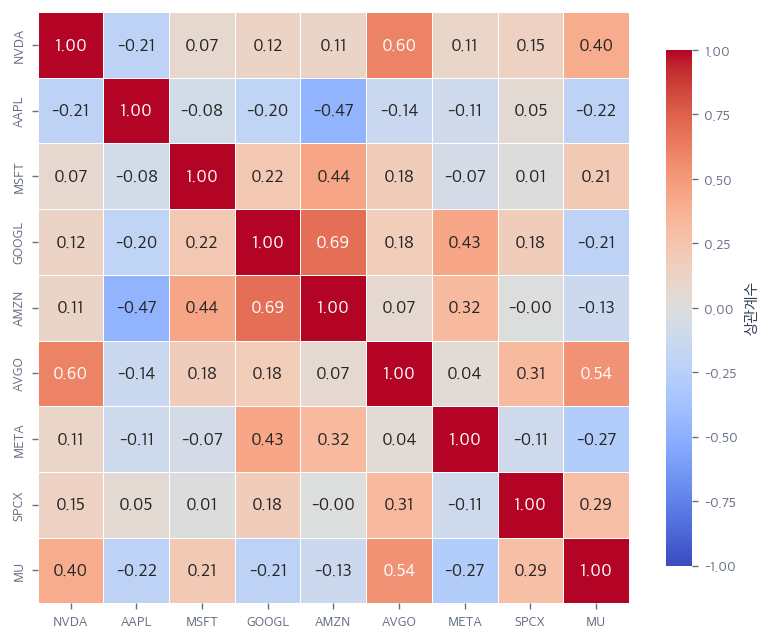
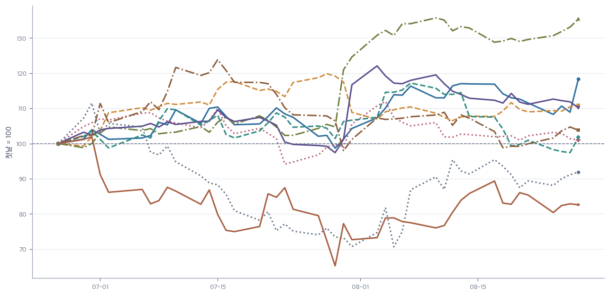
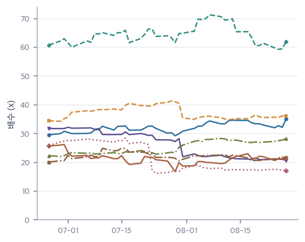
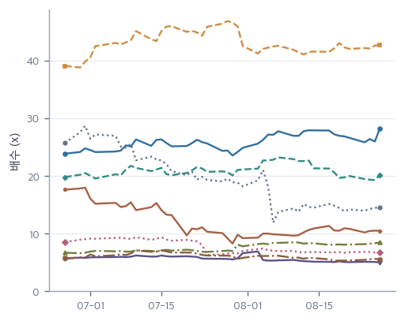
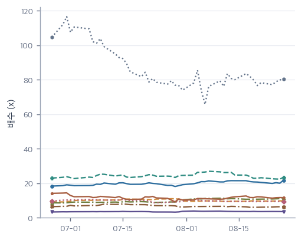

# 나스닥 일일 주가 리포트 - 2026-08-27

- 데이터 날짜: 2026-08-27
- 비교 기준일: 2026-08-26
- 생성 시각(UTC): 2026-08-28T00:03:05+00:00
- 3% 이상 변동 기준: abs(change_pct) >= 3.0%

## 전반적인 장 분위기

<!-- MARKET_SUMMARY:START -->
- **선별적 위험선호·기술주 쏠림:** 2026-08-27 미국 정규장(09:30–16:00 EDT, 한국시간 8월 27일 22:30–28일 05:00)은 나스닥 종합 26,541.35(+1.57%), S&P 500 7,730.99(+0.72%)로 상승했지만 S&P 500 구성종목 과반은 하락해 전면적 강세와는 구별된다. 등락률은 8월 26일 정규장 종가 대비이며 지수 등락 포인트와 종가에서 계산했다. [AP 정규장 마감](https://apnews.com/article/b4216a1f191d0304b4ed59e6912e23a4)
- **QQQ도 상승:** 같은 정규장 종가는 721.11달러로 전일 711.37달러 대비 +1.37%였다. 출처의 16:15 EDT 표시는 공식 종가 갱신 시각이며, 프리마켓·시간외 변동률은 이번 비교에 포함하지 않았다. [FinancialContent 공식 종가](https://markets.financialcontent.com/stocks/quote?Language=english&Symbol=NQ%3AQQQ)
- **핵심 재료는 NVDA 실적·전망:** 전날인 8월 26일 장 마감 후 공개된 FY2027 2분기 매출 962억 달러(+106% 전년비), 데이터센터 매출 890억 달러와 3분기 매출 전망 1,080억 달러(±2%)가 27일 거래에서 AI 수요 우려를 완화한 주요 재료로 보도됐다. 발표 시점과 이날 정규장 반응을 구분한다. [NVIDIA 공식 발표](https://nvidianews.nvidia.com/news/nvidia-announces-financial-results-for-second-quarter-fiscal-2027) · [AP 시장 반응](https://apnews.com/article/b4216a1f191d0304b4ed59e6912e23a4)
- **해석의 한계:** 다우(+0.2%)와 러셀2000(+0.3%)의 상승은 나스닥보다 작았고 국채 수익률도 소폭 올랐다. 금리 하락에 따른 광범위한 랠리라기보다 실적을 확인한 기술주 중심 재평가로 해석하며, 이후 상승 종목의 확산 여부를 확인할 필요가 있다. [AP 마감·금리 동향](https://apnews.com/article/b4216a1f191d0304b4ed59e6912e23a4)
<!-- MARKET_SUMMARY:END -->

## 전체 종목 변화율

### 당일 종목별 등락률

| 종목 | 종가 | 등락률 |
| --- | --- | --- |
| NVDA | 227.98 | +8.74% |
| AVGO | 371.54 | +4.49% |
| MSFT | 505.06 | +1.75% |
| SPCX | 140.87 | +0.89% |
| AAPL | 314.58 | +0.36% |
| MU | 935.39 | -0.32% |
| GOOGL | 340.65 | -0.39% |
| META | 571.10 | -0.87% |
| AMZN | 256.26 | -1.54% |

## 시장 흐름 히트맵

### 날짜별 등락률 히트맵

### 종목 간 수익률 상관 히트맵

## 종목별 변화 추이

### 기준일 대비 정규화 종가

## PER·PBR·PSR 변화 추이

### PER 변화 추이

### PBR 변화 추이

### PSR 변화 추이

## 3% 이상 변동 종목

| 종목 | 종가 | 등락률 |
| --- | --- | --- |
| NVDA | 227.98 | +8.74% |
| AVGO | 371.54 | +4.49% |

## 원인 메모

### NVDA (+8.74%)
<!-- CAUSE:NVDA:START -->
- **확인된 재료:** 8월 26일 장 마감 후 발표한 FY2027 2분기 매출은 962.21억 달러, 조정 EPS는 2.22달러로, AP가 인용한 시장 예상 922.7억 달러·2.09달러를 웃돌았다. 27일 정규장 +8.74%는 이 발표 이후의 반응이며 시간외 수익률과 합산하지 않았다. [AP 실적·예상 비교](https://apnews.com/article/dc8d556e709b50915cca9217a60b1991)
- **전망과 업황:** 회사는 다음 분기 매출 1,080억 달러(±2%)를 제시했고 데이터센터 매출은 전년 대비 117% 증가했다. AP는 실적과 매출 전망이 AI 산업에 대한 우려를 누그러뜨리며 이날 지수 상승을 주도했다고 평가했다. [NVIDIA 공식 전망](https://nvidianews.nvidia.com/news/nvidia-announces-financial-results-for-second-quarter-fiscal-2027) · [AP 정규장 마감](https://apnews.com/article/b4216a1f191d0304b4ed59e6912e23a4)
- **남은 불확실성:** 다음 분기 전망은 중국 데이터센터 컴퓨트 매출을 가정하지 않으며 매출총이익률 전망은 74.0%(±0.5%p)다. 강한 수요와 별개로 중국·제품 전환 관련 위험까지 해소됐다고 해석하지 않는다. [NVIDIA 전망 조건](https://nvidianews.nvidia.com/news/nvidia-announces-financial-results-for-second-quarter-fiscal-2027)
<!-- CAUSE:NVDA:END -->

### AVGO (+4.49%)
<!-- CAUSE:AVGO:START -->
- **가장 잘 뒷받침되는 배경은 반도체 동반 강세:** 당일 보도는 NVDA의 실적·전망이 AI 인프라 수요 신뢰를 높여 AVGO를 포함한 대형 기술·반도체 주식의 투자심리를 지지했다고 설명했다. 장중 보도의 수익률은 인용하지 않고, 이 리포트는 전일 종가 대비 27일 정규장 +4.49%를 사용한다. [당일 반도체 업종 보도](https://finance.yahoo.com/technology/articles/chip-stocks-rise-nvidias-blowout-192956754.html)
- **단일회사 원인은 확정하지 않음:** 확인한 자료만으로 AVGO의 하루 상승 전체를 설명하는 강한 단독 촉매는 확인되지 않았다. 개장 전 보도 역시 NVDA발 업황 기대와 AVGO 실적을 앞둔 포지셔닝을 배경으로 제시했으므로, 업종 재평가라는 해석으로 한정하며 프리마켓 변동률을 정규장 수치와 섞지 않는다. [Benzinga 개장 전 배경 설명](https://www.benzinga.com/markets/tech/26/08/61461849/whats-going-on-with-broadcom-stock-thursday-9)
<!-- CAUSE:AVGO:END -->
