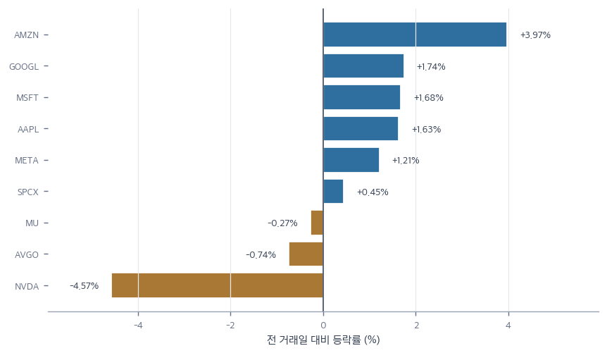
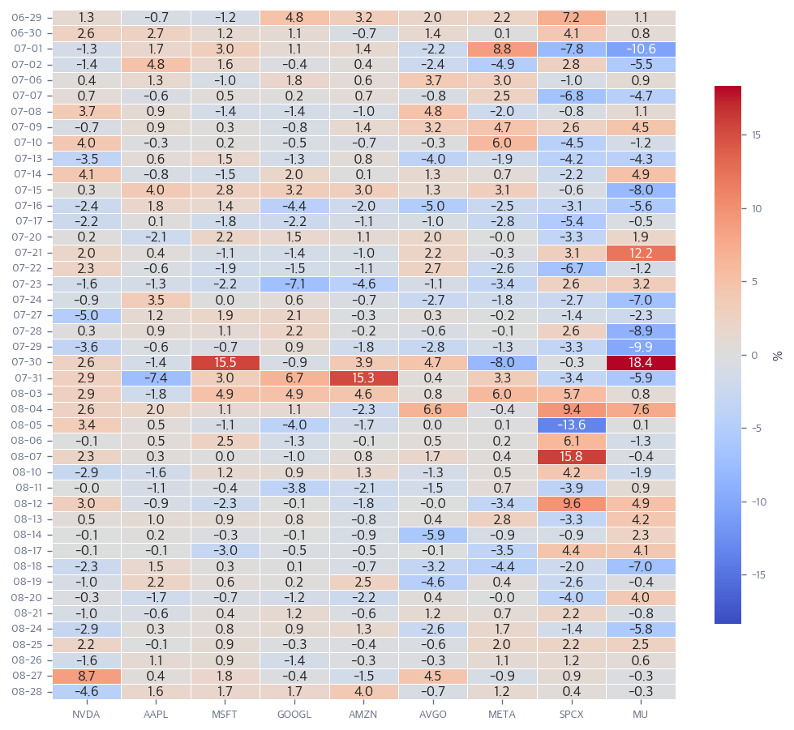
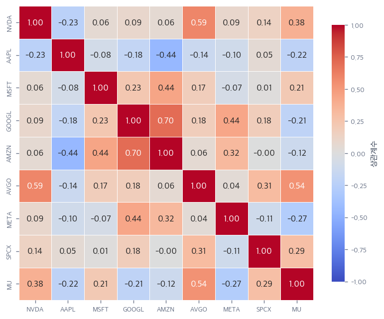
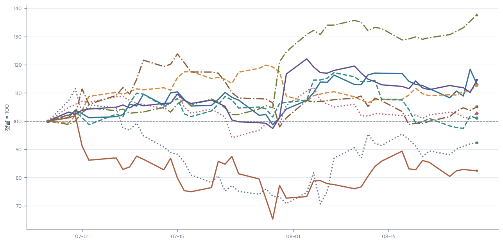
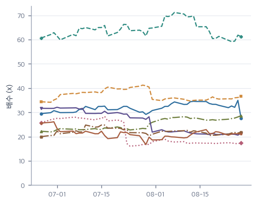
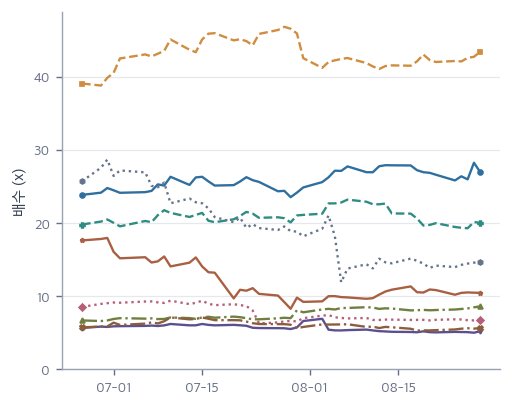
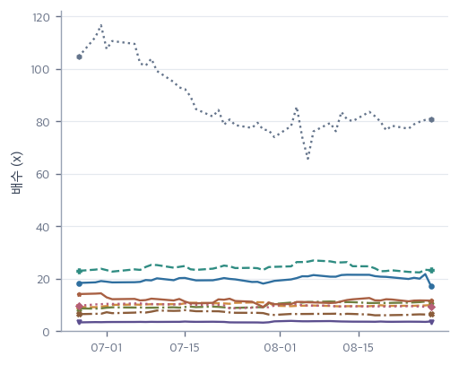

# 나스닥 일일 주가 리포트 - 2026-08-28

- 데이터 날짜: 2026-08-28
- 비교 기준일: 2026-08-27
- 생성 시각(UTC): 2026-08-29T00:03:22+00:00
- 3% 이상 변동 기준: abs(change_pct) >= 3.0%

## 전반적인 장 분위기

<!-- MARKET_SUMMARY:START -->
- **판정: 완만한 위험회피 속 클라우드·반도체 차별화.** 미국 2026-08-28 정규장 09:30~16:00 EDT(한국 8/28 22:30~8/29 05:00), 전일 정규장 종가 대비 QQQ **-0.65%**($721.11→$716.43), 나스닥 종합 **-0.52%**, S&P 500 **-0.25%**였다. [QQQ 일별 종가](https://query1.finance.yahoo.com/v8/finance/chart/QQQ?period1=1787788800&period2=1787961600&interval=1d&events=history) · [AP 종가 집계](https://apnews.com/article/3f3477bcea915ac53ec2ae905ae57919)
- **확인된 거시 재료:** 워시 연준 의장은 잭슨홀 연설에서 물가 안정과 단기금리의 역할을 강조했다. 10년 국채금리는 전일 4.67%에서 4.72%로 올랐다. 금리인상 가능성 재평가가 위험자산에 부담을 줬다는 것이 당일 보도의 해석이며, 실제 인상 결정이 내려진 것은 아니다. [연준 연설 원문](https://www.federalreserve.gov/newsevents/speech/warsh20260828a.htm) · [AP 시장 마감](https://apnews.com/article/0a655f1c042b059279343443d5802907)
- **반도체 약세:** 마벨(MRVL)은 실적 발표 후 **-10.3%** 하락했고, 반도체·AI 인프라주 약세가 시장에 부담을 줬다. MRVL은 추적 종목은 아니지만 AI 반도체 업종 심리에 영향을 준 사례로 구분한다. [AP 마감 보도](https://apnews.com/article/0a655f1c042b059279343443d5802907) · [Barchart 업종 설명](https://www.barchart.com/story/news/4327953/stocks-fall-as-hawkish-warsh-boosts-fed-rate-hike-chances)
- **해석의 한계:** 러셀2000도 **-1.39%**였지만 AMZN·MSFT·GOOGL은 상승해 기술주 전체가 일제히 매도된 장은 아니었다. 클라우드 사업자와 칩 공급자의 차별화로 해석하되, 실제 자금 이동이나 단일 원인을 단정하지 않는다. 모든 수익률은 정규장 기준이며 시간외 움직임은 제외했다. [지수 종가](https://finance.yahoo.com/markets/live/stock-market-today-friday-august-28-dow-sp-500-nasdaq-dip-fed-warsh-jackson-hole-speech-081514091.html) · [당일 클라우드·반도체 차별화 보도](https://247wallst.com/investing/2026/08/28/amazon-jumps-4-on-expanded-aws-chip-deal-why-is-nvidia-falling-4/)
<!-- MARKET_SUMMARY:END -->

## 전체 종목 변화율

### 당일 종목별 등락률

| 종목 | 종가 | 등락률 |
| --- | --- | --- |
| AMZN | 266.43 | +3.97% |
| GOOGL | 346.59 | +1.74% |
| MSFT | 513.53 | +1.68% |
| AAPL | 319.70 | +1.63% |
| META | 578.02 | +1.21% |
| SPCX | 141.50 | +0.45% |
| MU | 932.86 | -0.27% |
| AVGO | 368.79 | -0.74% |
| NVDA | 217.55 | -4.57% |

## 시장 흐름 히트맵

### 날짜별 등락률 히트맵

### 종목 간 수익률 상관 히트맵

## 종목별 변화 추이

### 기준일 대비 정규화 종가

## PER·PBR·PSR 변화 추이

### PER 변화 추이

### PBR 변화 추이

### PSR 변화 추이

## 3% 이상 변동 종목

| 종목 | 종가 | 등락률 |
| --- | --- | --- |
| AMZN | 266.43 | +3.97% |
| NVDA | 217.55 | -4.57% |

## 원인 메모

### AMZN (+3.97%)
<!-- CAUSE:AMZN:START -->
- **확인된 배경:** AWS·NVIDIA는 8월 26일 저녁 발표한 협력 확대를 통해 2027~2028년 GPU 200만 개를 추가 배치할 계획이다. 8월 28일 신규 발표로 오인하지 않고, 이날까지 이어진 AI 클라우드 성장 기대의 배경으로 본다. [AWS 공식 발표](https://www.aboutamazon.com/news/aws/aws-nvidia-2-million-gpus-ai) · [8/28 당일 보도·발표 시점 확인](https://247wallst.com/investing/2026/08/28/amazon-jumps-4-on-expanded-aws-chip-deal-why-is-nvidia-falling-4/)
- **가능한 해석:** 당일 보도는 AMZN 강세를 AWS 협력 확대의 재평가와 연결했다. 같은 정규장에서 MSFT·GOOGL도 상승하고 NVDA는 하락한 점은 클라우드 사업자 선호와 일치하지만, 해당 계약만으로 AMZN **+3.97%**를 설명할 직접 증거는 없다. 기사 속 장중 등락률은 본문의 종가 수익률로 대체하지 않았다. [당일 분석](https://247wallst.com/investing/2026/08/28/amazon-jumps-4-on-expanded-aws-chip-deal-why-is-nvidia-falling-4/)
- **불확실성:** 확인한 자료에서 이날 상승을 단독으로 설명할 새 회사 공시나 확정적인 단일 촉매는 찾지 못했다. 일부 당일 해설도 기존 AWS 실적·AI 기대를 중심으로 설명하므로, 신규 호재로 단정하지 않는다. [Quiver 당일 해설·AI 작성 주의 고지](https://www.quiverquant.com/news/Why%2BAmazon%2B%28AMZN%29%2BStock%2BIs%2BUp%2BToday)
<!-- CAUSE:AMZN:END -->

### NVDA (-4.57%)
<!-- CAUSE:NVDA:START -->
- **확인된 가격 흐름:** 전일 실적 반응으로 **+8.74%** 오른 뒤 8월 28일 정규장에는 **-4.57%**로 상승분 일부를 반납했다. 이는 가격 관측이며 실제 차익실현 매도를 확인한 것은 아니다. [전일 상승 보도](https://www.benzinga.com/markets/equities/26/08/61506880/warsh-sparks-rate-hike-bets-nvidia-reaffirms-ai-growth-story-week-wall-street) · [NVDA 일별 종가](https://query1.finance.yahoo.com/v8/finance/chart/NVDA?period1=1787788800&period2=1787961600&interval=1d&events=history)
- **당일 논점:** 낮아진 마진 가이던스와 공급망 약정 부담이 8월 28일 분석에서도 경계 요인으로 다뤄졌다. 반면 같은 날 다른 애널리스트들은 수요·성장 전망을 긍정적으로 평가했다. 따라서 마진 우려가 하락의 유일한 원인이었다고 확정하지 않는다. [마진·약정 우려 분석](https://www.benzinga.com/markets/tech/26/08/61495853/nvidia-stock-at-crossroads-expert-says-shares-could-double-or-ai-bubble-could-pop) · [긍정적 성장 평가](https://www.benzinga.com/markets/tech/26/08/61489320/nvidia-growth-outlook-signals-multi-year-ai-demand-beyond-supply-limits-analysts)
- **시장·업종 맥락:** 워시 연설 뒤 금리 상승과 반도체·AI 인프라주 약세가 동반됐다. 새 NVDA 단독 악재를 확증할 자료는 부족해, 실적 이후 기대 재조정과 업종 약세가 겹친 가능한 배경으로만 기록한다. [Barchart 정규장 마감 분석](https://www.barchart.com/story/news/4327953/stocks-fall-as-hawkish-warsh-boosts-fed-rate-hike-chances)
<!-- CAUSE:NVDA:END -->
