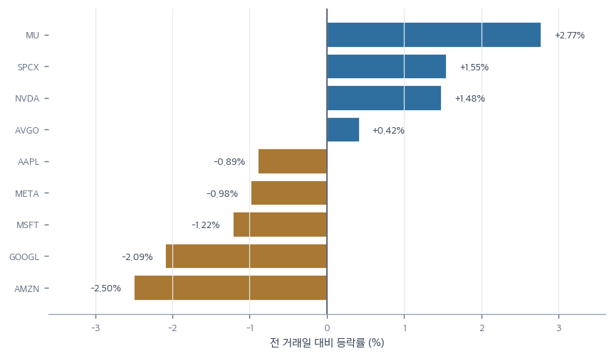
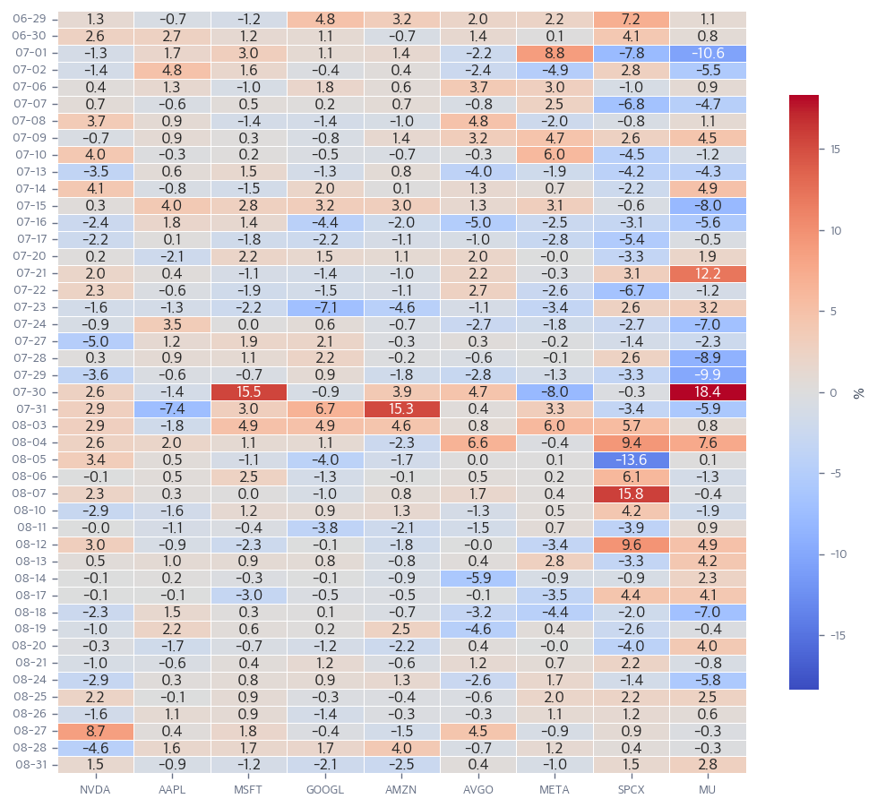
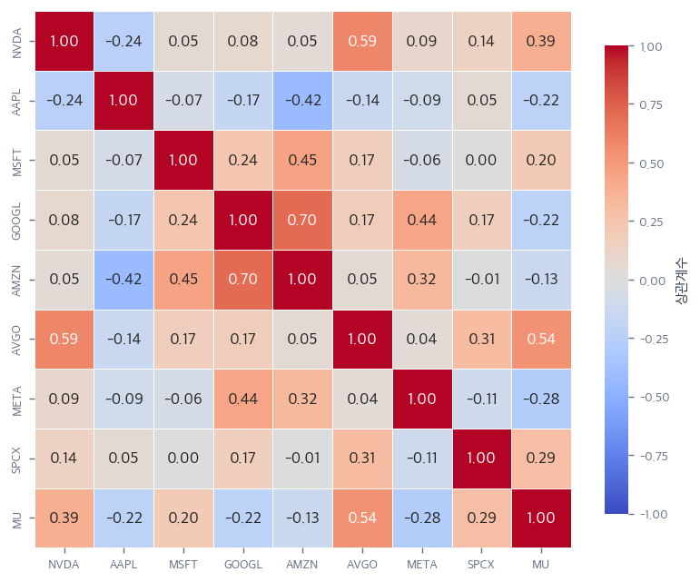
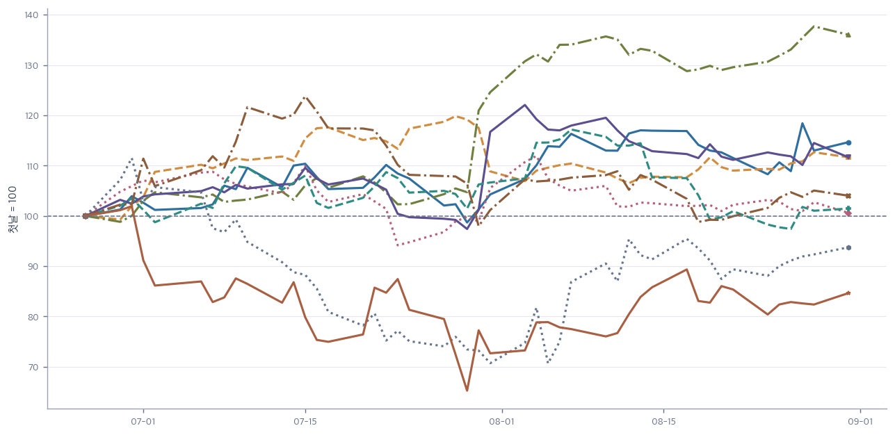
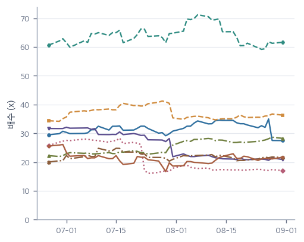
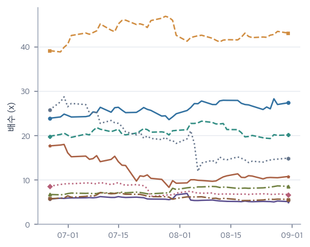
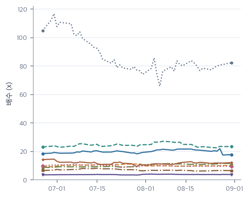

# 나스닥 일일 주가 리포트 - 2026-08-31

- 데이터 날짜: 2026-08-31
- 비교 기준일: 2026-08-28
- 생성 시각(UTC): 2026-09-01T00:11:47+00:00
- 3% 이상 변동 기준: abs(change_pct) >= 3.0%

## 전반적인 장 분위기

<!-- MARKET_SUMMARY:START -->
- **판단 — 광범위한 위험회피 속 대형 기술주 방어:** 2026-08-31 미국 정규장(미 동부시간 09:30~16:00)에서 QQQ는 **+0.05%**였지만 나스닥 종합은 **-0.12%**, S&P 500은 **-0.33%**였고 나스닥 하락 종목이 상승 종목을 2,931 대 1,859로 웃돌아 지수 표면보다 약한 장세였다. ([QQQ 종가](https://stockanalysis.com/etf/qqq/), [Reuters 시장 마감·시장폭](https://www.marketscreener.com/news/wall-street-closes-lower-as-oil-prices-jump-indexes-notch-monthly-gains-ce7858ddd88eff25))
- **관찰 — 지정학·유가:** 미국이 호르무즈 해협의 이란 로켓 발사대를 타격한 뒤 브렌트유가 당일 **2.7% 올라 배럴당 $90.49**에 마감했고, S&P 500 11개 업종 중 에너지를 제외한 거의 모든 업종이 하락했다. ([AP 정규장 마감](https://apnews.com/article/stocks-markets-ipo-oil-rates-fed-future-00f872327d65e5330598054a234dc25a))
- **관찰 — 금리 부담:** 미 10년물 국채금리는 전 거래일 **4.73%에서 4.75%**로 상승했다. AP와 Reuters는 높은 유가가 인플레이션·긴축 우려를 다시 키웠고, 전주 금요일 Kevin Warsh 연준 의장의 매파적 발언도 투자심리를 압박했다고 전했다. ([AP 금리·연준 맥락](https://apnews.com/article/stocks-markets-ipo-oil-rates-fed-future-00f872327d65e5330598054a234dc25a), [Reuters 촉매 정리](https://www.marketscreener.com/news/wall-street-closes-lower-as-oil-prices-jump-indexes-notch-monthly-gains-ce7858ddd88eff25))
- **해석:** QQQ의 소폭 상승과 나스닥100 **+0.08%**는 초대형 기술주의 상대적 방어를 보여주지만, NYSE·나스닥 모두 하락 종목이 우세하고 S&P 500 에너지 외 업종이 약해 시장 전체는 위험선호보다 유가·금리 충격에 따른 방어적 회전으로 보는 편이 타당하다. ([Reuters 지수·업종·시장폭](https://www.marketscreener.com/news/wall-street-closes-lower-as-oil-prices-jump-indexes-notch-monthly-gains-ce7858ddd88eff25))
<!-- MARKET_SUMMARY:END -->

## 전체 종목 변화율

### 당일 종목별 등락률

| 종목 | 종가 | 등락률 |
| --- | --- | --- |
| MU | 958.73 | +2.77% |
| SPCX | 143.69 | +1.55% |
| NVDA | 220.78 | +1.48% |
| AVGO | 370.34 | +0.42% |
| AAPL | 316.85 | -0.89% |
| META | 572.34 | -0.98% |
| MSFT | 507.29 | -1.22% |
| GOOGL | 339.35 | -2.09% |
| AMZN | 259.77 | -2.50% |

## 시장 흐름 히트맵

### 날짜별 등락률 히트맵

### 종목 간 수익률 상관 히트맵

## 종목별 변화 추이

### 기준일 대비 정규화 종가

## PER·PBR·PSR 변화 추이

### PER 변화 추이

### PBR 변화 추이

### PSR 변화 추이

## 3% 이상 변동 종목

데이터 없음.

## 원인 메모

3% 이상 변동 종목 없음.
