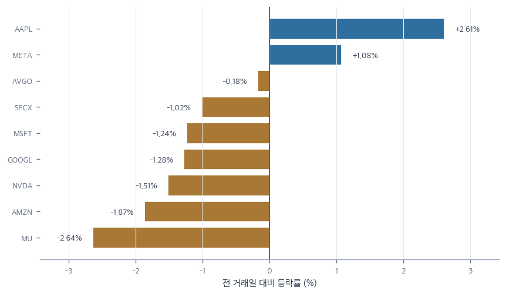
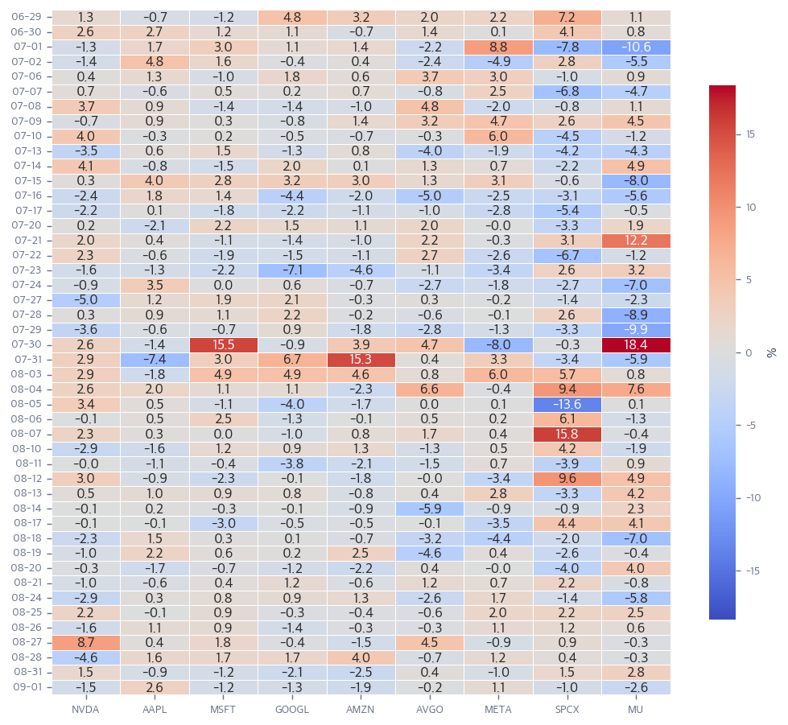
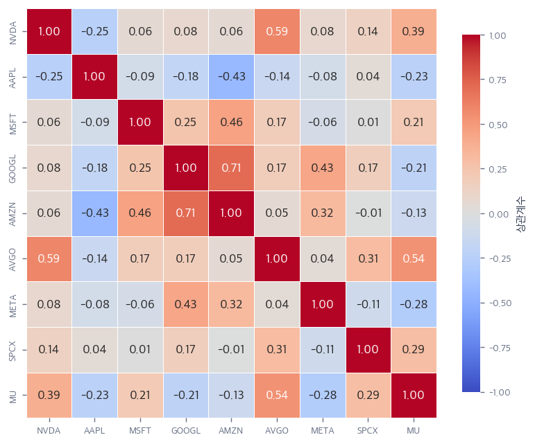
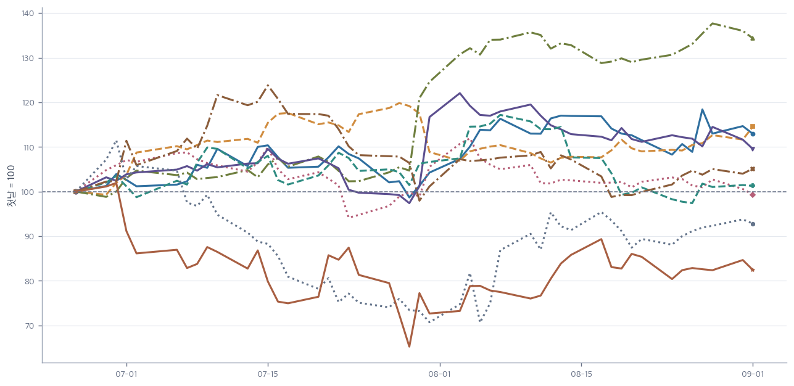
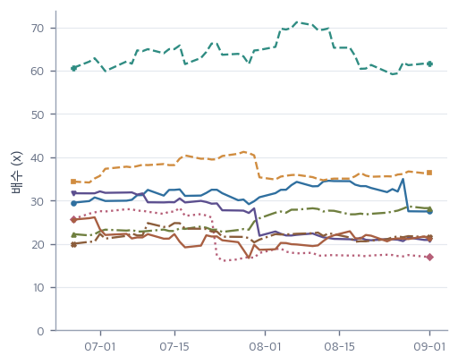
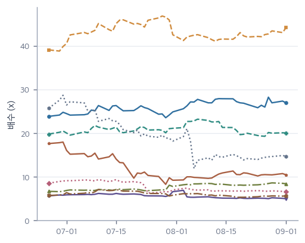
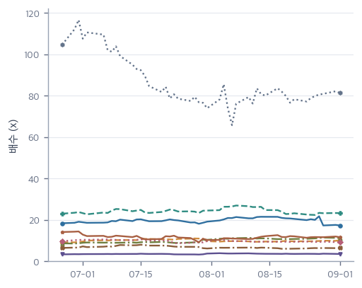

# 나스닥 일일 주가 리포트 - 2026-09-01

- 데이터 날짜: 2026-09-01
- 비교 기준일: 2026-08-31
- 생성 시각(UTC): 2026-09-02T09:37:28+00:00
- 3% 이상 변동 기준: abs(change_pct) >= 3.0%

## 전반적인 장 분위기

<!-- MARKET_SUMMARY:START -->
- **광범위한 위험회피:** 2026-09-01 미국 정규장(09:30~16:00 EDT)에서 QQQ는 **-1.27%**, 나스닥 종합은 **-1.03%**, S&P 500은 **-0.71%**로 마감했고, NYSE와 나스닥 모두 하락 종목이 상승 종목의 2.8배였다. ([QQQ 일별 가격](https://stockanalysis.com/etf/qqq/history/), [Reuters 장 마감](https://www.marketscreener.com/news/wall-street-dips-as-higher-yields-rising-oil-prices-mark-shaky-start-to-september-ce7858d2d88cf124))
- **관찰 사실 — 유가·지정학:** 미국의 대이란 공습 재개와 호르무즈 해협 유조선 피격 속에 브렌트유는 **4.6% 오른 배럴당 $94.65**, WTI는 **5.2% 오른 $90.22**에 결제됐다. ([AP](https://apnews.com/article/stocks-markets-oil-bonds-775d7cf741349c7c8e689c0beb57f074), [Reuters 유조선 보도](https://www.investing.com/news/commodities-news/two-tankers-carrying-saudi-oil-attacked-in-strait-of-hormuz-4883736))
- **관찰 사실 — 금리·업종:** 미 10년물 국채금리는 전일 **4.75%에서 4.79%**로 올랐고, 필라델피아 반도체지수는 구성 종목 전부가 하락하며 **-2.1%**를 기록한 반면 에너지는 S&P 500 주요 업종 중 상승을 주도했다. ([AP](https://apnews.com/article/stocks-markets-oil-bonds-775d7cf741349c7c8e689c0beb57f074), [Reuters](https://www.marketscreener.com/news/wall-street-dips-as-higher-yields-rising-oil-prices-mark-shaky-start-to-september-ce7858d2d88cf124))
- **해석:** 8월 ISM 제조업 PMI가 **54.6**으로 확장 국면을 유지했지만 투입가격지수는 **71.1**로 높게 머물렀다. 유가와 금리의 동반 상승이 인플레이션·차입비용 우려를 키우며 기술·성장주에 더 큰 부담을 준 세션으로 해석된다. ([Reuters/ISM 보도](https://www.investing.com/news/economy-news/us-manufacturing-activity-slows-in-august-input-prices-still-elevated-4884251))
<!-- MARKET_SUMMARY:END -->

## 전체 종목 변화율

### 당일 종목별 등락률

| 종목 | 종가 | 등락률 |
| --- | --- | --- |
| AAPL | 325.13 | +2.61% |
| META | 578.54 | +1.08% |
| AVGO | 369.68 | -0.18% |
| SPCX | 142.23 | -1.02% |
| MSFT | 501.02 | -1.24% |
| GOOGL | 335.02 | -1.28% |
| NVDA | 217.44 | -1.51% |
| AMZN | 254.92 | -1.87% |
| MU | 933.44 | -2.64% |

## 시장 흐름 히트맵

### 날짜별 등락률 히트맵

### 종목 간 수익률 상관 히트맵

## 종목별 변화 추이

### 기준일 대비 정규화 종가

## PER·PBR·PSR 변화 추이

### PER 변화 추이

### PBR 변화 추이

### PSR 변화 추이

## 3% 이상 변동 종목

데이터 없음.

## 원인 메모

3% 이상 변동 종목 없음.
