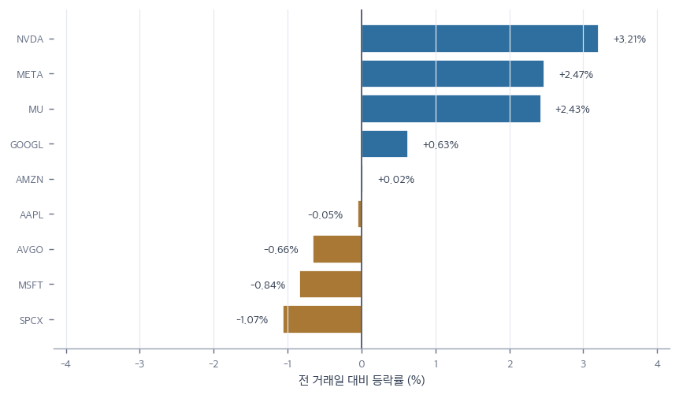
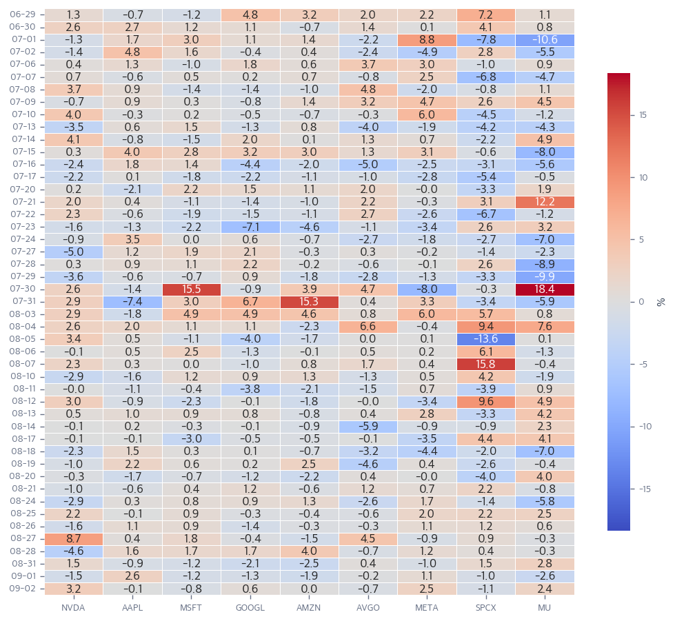
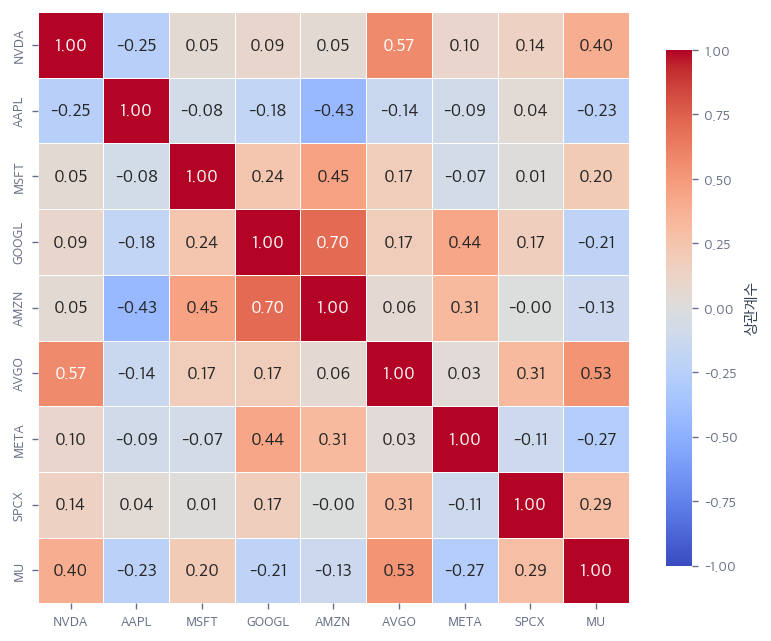
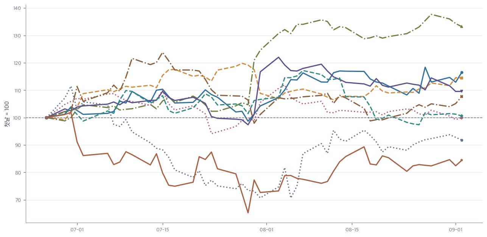
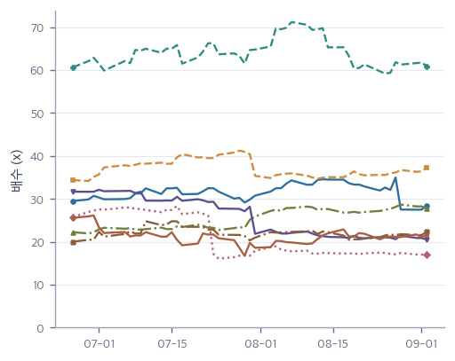
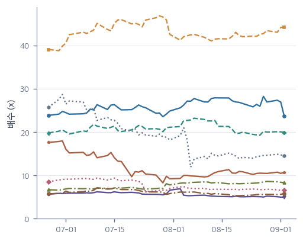
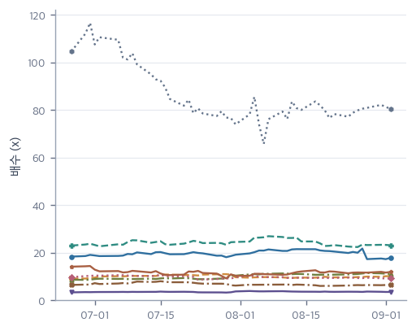

# 나스닥 일일 주가 리포트 - 2026-09-02

- 데이터 날짜: 2026-09-02
- 비교 기준일: 2026-09-01
- 생성 시각(UTC): 2026-09-03T00:10:47+00:00
- 3% 이상 변동 기준: abs(change_pct) >= 3.0%

## 전반적인 장 분위기

<!-- MARKET_SUMMARY:START -->
- **관찰 — 완만한 위험선호:** 2026-09-02 미국 정규장(미 동부시간 09:30~16:00)에서 QQQ는 $709.24로 **+0.23%**, 나스닥 종합지수는 26,217.83으로 **+0.45%**, S&P 500은 7,666.60으로 **+0.46%** 상승했고 러셀 2000도 **+1.13%** 올라 대형 기술주와 중소형주가 함께 반등했다. ([QQQ 가격](https://sogotrade2.websol.barchart.com/?1_selected=etfQuote&module=etfDetail&region=US&symbol=QQQ), [주요 지수](https://apnews.com/article/wall-street-stocks-dow-nasdaq-7cb0aefedfd933d048b8b3e5843449f8))
- **관찰:** 대형 기술주가 반등하며 미 증시는 3거래일 연속 하락을 끝냈고, 10년물 미 국채금리는 전일 4.79%에서 4.78%로 소폭 낮아졌다. 브렌트유는 이란 분쟁이 이어지는 가운데 1% 오른 배럴당 $95.63에 마감했다. ([AP](https://apnews.com/article/stocks-markets-iran-oil-bonds-27b78c349725ac744c96a6b8b8167bae))
- **관찰:** Dell(DELL)은 전날 장 마감 후 AI 서버 수주 $609억·AI 서버 매출 $164억·백로그 $950억을 발표하고 FY27 매출 전망을 $1,920억으로 상향했으며, 9월 2일 주가는 15.8% 급등했다. 이는 같은 날 AI 인프라 수요 기대를 강화한 핵심 섹터 재료였다. ([Dell 발표](https://www.dell.com/en-us/dt/corporate/newsroom/announcements/detailpage.press-releases~usa~2026~09~dell-technologies-delivers-second-quarter-fiscal-2027-financial-results.htm), [AP](https://apnews.com/article/stocks-markets-iran-oil-bonds-27b78c349725ac744c96a6b8b8167bae))
- **해석:** 유가·지정학 위험이 사라진 것은 아니지만, 금리 급등이 멈춘 가운데 Dell의 AI 수요 확인과 NVDA·MU의 반등이 기술주 중심의 위험선호 회복을 이끈 세션으로 보는 것이 타당하다. ([AP](https://apnews.com/article/stocks-markets-iran-oil-bonds-27b78c349725ac744c96a6b8b8167bae))
<!-- MARKET_SUMMARY:END -->

## 전체 종목 변화율

### 당일 종목별 등락률

| 종목 | 종가 | 등락률 |
| --- | --- | --- |
| NVDA | 224.41 | +3.21% |
| META | 592.85 | +2.47% |
| MU | 956.08 | +2.43% |
| GOOGL | 337.12 | +0.63% |
| AMZN | 254.98 | +0.02% |
| AAPL | 324.96 | -0.05% |
| AVGO | 367.24 | -0.66% |
| MSFT | 496.82 | -0.84% |
| SPCX | 140.71 | -1.07% |

## 시장 흐름 히트맵

### 날짜별 등락률 히트맵

### 종목 간 수익률 상관 히트맵

## 종목별 변화 추이

### 기준일 대비 정규화 종가

## PER·PBR·PSR 변화 추이

### PER 변화 추이

### PBR 변화 추이

### PSR 변화 추이

## 3% 이상 변동 종목

| 종목 | 종가 | 등락률 |
| --- | --- | --- |
| NVDA | 224.41 | +3.21% |

## 원인 메모

### NVDA (+3.21%)
<!-- CAUSE:NVDA:START -->
- **관찰:** NVDA는 정규장에서 **+3.21%** 반등했다. AP는 대형 기술주의 반등과 Dell의 강한 AI 컴퓨팅 수요 신호를 함께 지목했고, Dell은 AI 서버 수주 $609억과 백로그 $950억을 공개했다. ([AP](https://apnews.com/article/stocks-markets-iran-oil-bonds-27b78c349725ac744c96a6b8b8167bae), [Dell 발표](https://www.dell.com/en-us/dt/corporate/newsroom/announcements/detailpage.press-releases~usa~2026~09~dell-technologies-delivers-second-quarter-fiscal-2027-financial-results.htm))
- **해석:** 확인 가능한 당일 NVDA 단독 공시성 촉매보다는, 최근 3거래일 하락 뒤의 기술적 반등과 Dell 실적이 재확인한 AI 인프라 지출 강세가 복합적으로 작용한 것으로 보인다. 단일 원인으로 단정하기는 어렵다. ([AP](https://apnews.com/article/stocks-markets-iran-oil-bonds-27b78c349725ac744c96a6b8b8167bae))
<!-- CAUSE:NVDA:END -->
