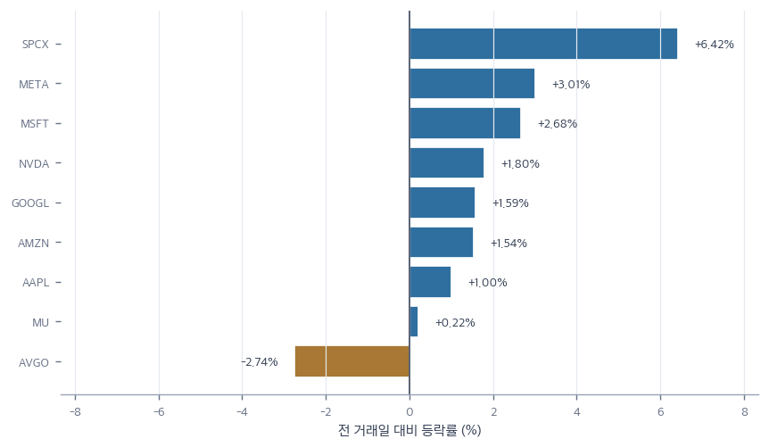
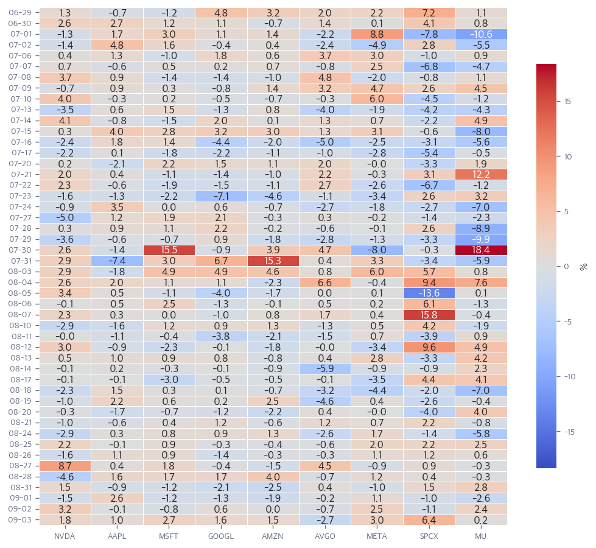
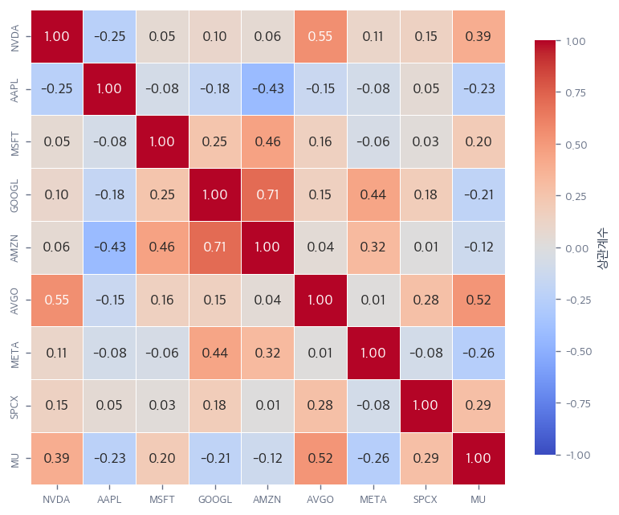
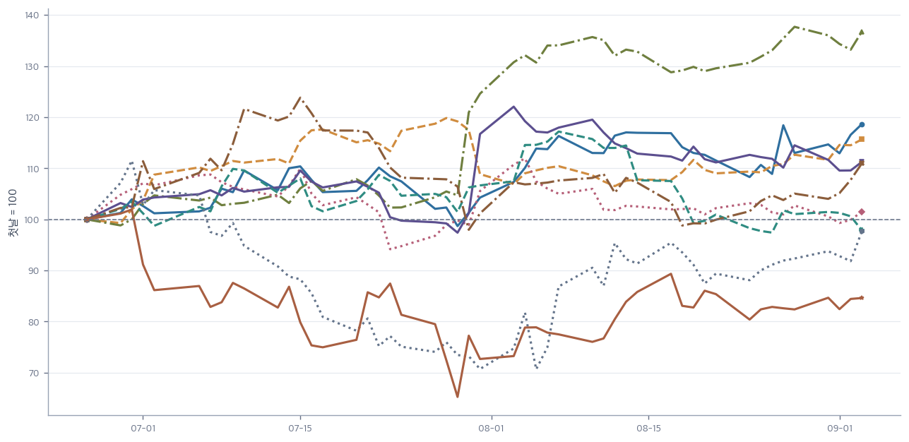
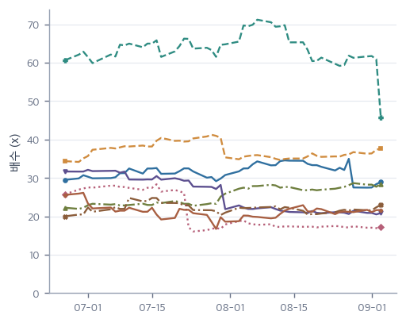
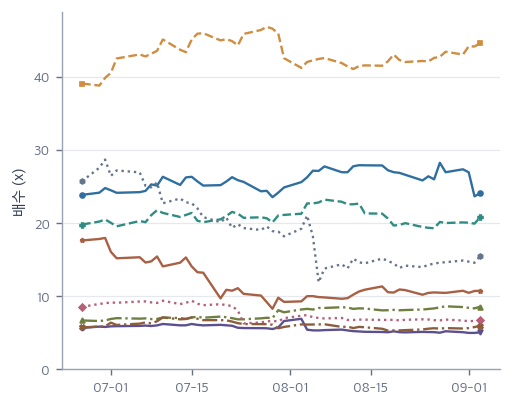
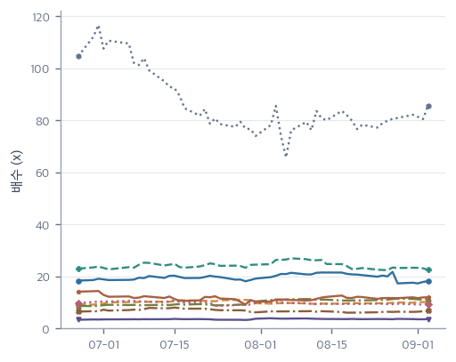

# 나스닥 일일 주가 리포트 - 2026-09-03

- 데이터 날짜: 2026-09-03
- 비교 기준일: 2026-09-02
- 생성 시각(UTC): 2026-09-04T00:01:03+00:00
- 3% 이상 변동 기준: abs(change_pct) >= 3.0%

## 전반적인 장 분위기

<!-- MARKET_SUMMARY:START -->
- **관찰 — 기술주 주도의 위험선호(risk-on):** 2026-09-03 미국 정규장(09:30~16:00 EDT)에서 QQQ는 **+1.19%**, 나스닥 종합지수는 **+1.40%**, S&P 500은 **+1.06%** 상승했다. ([QQQ 정규장 시세](https://stockanalysis.com/etf/qqq/), [AP 마감 보도](https://apnews.com/article/7e1bffd68c53b54806be950f01181994))
- **관찰 — 금리 부담 완화:** AP는 미 10년물 국채금리가 전일 약 4.80%에서 **4.76%**로 낮아졌고, 대형 기술·커뮤니케이션주가 상승을 주도했다고 전했다. ([AP](https://apnews.com/article/7e1bffd68c53b54806be950f01181994))
- **관찰 — 연준 발언:** 크리스토퍼 월러 연준 이사는 향후 물가 둔화가 이어지면 9월 회의에서 금리 동결을 지지할 수 있지만, 8월 물가가 다시 뜨거우면 인상을 검토하겠다고 밝혔다. ([연준 원문](https://www.federalreserve.gov/newsevents/speech/waller20260903a.htm))
- **해석:** 금리 인상 우려가 다소 완화되면서 성장주 밸류에이션에 우호적인 환경이 조성됐다. 여기에 NVIDIA가 Hugging Face를 **129억3,030만 달러**에 인수하기로 한 발표와 NVDA의 정규장 **+1.8%**가 AI 생태계 투자심리를 보탰다. ([NVIDIA 발표](https://blogs.nvidia.com/blog/nvidia-to-acquire-hugging-face/), [AP](https://apnews.com/article/7e1bffd68c53b54806be950f01181994))
<!-- MARKET_SUMMARY:END -->

## 전체 종목 변화율

### 당일 종목별 등락률

| 종목 | 종가 | 등락률 |
| --- | --- | --- |
| SPCX | 149.74 | +6.42% |
| META | 610.68 | +3.01% |
| MSFT | 510.12 | +2.68% |
| NVDA | 228.45 | +1.80% |
| GOOGL | 342.48 | +1.59% |
| AMZN | 258.90 | +1.54% |
| AAPL | 328.21 | +1.00% |
| MU | 958.16 | +0.22% |
| AVGO | 357.16 | -2.74% |

## 시장 흐름 히트맵

### 날짜별 등락률 히트맵

### 종목 간 수익률 상관 히트맵

## 종목별 변화 추이

### 기준일 대비 정규화 종가

## PER·PBR·PSR 변화 추이

### PER 변화 추이

### PBR 변화 추이

### PSR 변화 추이

## 3% 이상 변동 종목

| 종목 | 종가 | 등락률 |
| --- | --- | --- |
| SPCX | 149.74 | +6.42% |
| META | 610.68 | +3.01% |

## 원인 메모

### SPCX (+6.42%)
<!-- CAUSE:SPCX:START -->
- **관찰:** SPCX는 데이터 기준 정규장에서 **+6.42%** 상승했다. 같은 날 보도는 거래량 증가와 함께 6%대 강세가 나타났음을 확인한다. ([MarketBeat](https://www.marketbeat.com/instant-alerts/price-spacex-nasdaq-spcx-shares-up-64-still-a-buy-2026-09-03/))
- **가능성 높은 재료:** 전날 Oppenheimer가 AI 사용량·컴퓨팅 경제성 전망을 근거로 투자의견 Outperform을 유지하고 목표가를 **250달러에서 280달러로 상향**했으며, 당일 보도들은 이 조치와 다른 낙관적 애널리스트 평가를 상승 재료로 지목했다. ([Benzinga 애널리스트 기록](https://www.benzinga.com/quote/spcx/price-targets), [TipRanks 당일 보도](https://www.tipranks.com/news/why-is-spacex-stock-spcx-rising-today-september-3))
- 회사의 당일 신규 공시만으로 단일 원인을 확정하기는 어렵다. 따라서 **애널리스트 목표가 상향과 AI 성장 기대가 위험선호 장세에서 증폭된 움직임**으로 해석하되, 확정적 인과로 단정하지 않는다.
<!-- CAUSE:SPCX:END -->

### META (+3.01%)
<!-- CAUSE:META:START -->
- **관찰:** META는 데이터 기준 정규장에서 **+3.01%** 상승했고, AP도 대형 기술주 주도 랠리 속 Meta가 약 3% 올랐다고 전했다. ([AP](https://apnews.com/article/7e1bffd68c53b54806be950f01181994))
- **기업 재료:** Meta가 코딩·에이전트 작업 능력을 강화한 **Muse Spark 1.3**의 개발자 접근을 확대했고, 당일 시장 보도는 이를 주가 상승의 회사별 재료로 지목했다. ([Meta AI 제품 페이지](https://ai.meta.com/llama), [Motley Fool 당일 보도](https://www.fool.com/investing/2026/09/03/why-is-meta-stock-up-today/))
- **해석:** 모델 공개 효과에 QQQ 상승과 국채금리 하락이라는 기술주 우호적 배경이 겹친 것으로 보이며, 모델 상용화 성과가 이미 확인됐다는 의미로 확대 해석하지 않는다.
<!-- CAUSE:META:END -->
