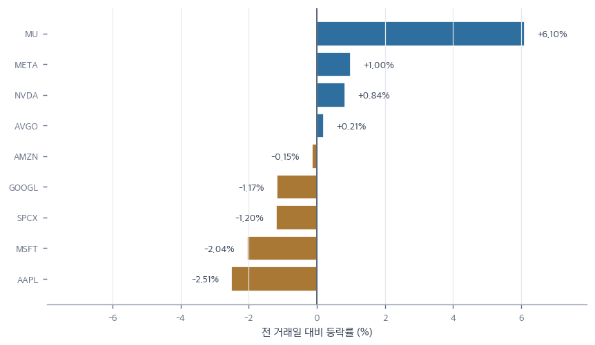
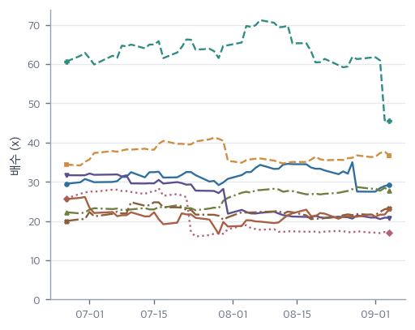

# 나스닥 일일 주가 리포트 - 2026-09-04

- 데이터 날짜: 2026-09-04
- 비교 기준일: 2026-09-03
- 생성 시각(UTC): 2026-09-05T00:43:08+00:00
- 3% 이상 변동 기준: abs(change_pct) >= 3.0%

## 전반적인 장 분위기

<!-- MARKET_SUMMARY:START -->
- **혼조·섹터 로테이션:** 2026-09-04 미국 정규장(09:30~16:00 EDT)에서 QQQ는 718.96으로 전일 대비 **+0.18%**였고, 나스닥100도 +0.21%였지만 나스닥 종합은 **-0.29%**, S&P 500은 **-0.38%**로 마감했다. 성장주 전반의 위험선호라기보다 반도체가 방어한 선택적 장세였다. ([Yahoo Finance QQQ](https://finance.yahoo.com/quote/QQQ/history/), [Reuters/MarketScreener](https://www.marketscreener.com/news/wall-street-ends-lower-as-solid-jobs-data-fuels-hawkish-fed-bets-ce785bdbd889f126))
- **관찰된 거시 재료:** 8월 비농업 고용은 16만2천 명으로 컨센서스 5만6천 명을 크게 웃돌았고 실업률은 4.1%를 유지했다. 9월 25bp 인상 확률은 전일 49.4%에서 58.4%로 높아졌다. **해석:** 견조한 고용이 연준의 추가 긴축 여지를 키운다는 우려가 광범위한 지수에 부담을 줬다. ([Reuters/MarketScreener](https://www.marketscreener.com/news/wall-street-ends-lower-as-solid-jobs-data-fuels-hawkish-fed-bets-ce785bdbd889f126))
- **금리 반응:** 미 국채 2년물 수익률은 4.34%에서 4.37%로, 10년물은 4.77%에서 4.78%로 상승했다. 이는 고용 서프라이즈 뒤의 긴축 경계가 채권시장에도 반영된 관찰값이다. ([AP](https://apnews.com/article/stocks-markets-oil-trump-iran-war-1af16359af43eb8abc66445465f633c8))
- **내부 흐름:** 나스닥 상승 종목은 2,478개로 하락 2,256개를 웃돌았고 반도체는 **+3.4%**, 소프트웨어·서비스는 **-2.1%**였다. 같은 날 브렌트유는 +0.8%인 배럴당 96.28달러로 올라 전쟁발 에너지 인플레이션 부담도 이어졌다. ([Reuters/MarketScreener](https://www.marketscreener.com/news/wall-street-ends-lower-as-solid-jobs-data-fuels-hawkish-fed-bets-ce785bdbd889f126), [AP](https://apnews.com/article/stocks-markets-oil-trump-iran-war-1af16359af43eb8abc66445465f633c8))
<!-- MARKET_SUMMARY:END -->

## 전체 종목 변화율

### 당일 종목별 등락률

| 종목 | 종가 | 등락률 |
| --- | --- | --- |
| MU | 1016.59 | +6.10% |
| META | 616.77 | +1.00% |
| NVDA | 230.36 | +0.84% |
| AVGO | 357.89 | +0.21% |
| AMZN | 258.51 | -0.15% |
| GOOGL | 338.46 | -1.17% |
| SPCX | 147.95 | -1.20% |
| MSFT | 499.70 | -2.04% |
| AAPL | 319.97 | -2.51% |

## 시장 흐름 히트맵

### 날짜별 등락률 히트맵

### 종목 간 수익률 상관 히트맵

## 종목별 변화 추이

### 기준일 대비 정규화 종가

## PER·PBR·PSR 변화 추이

### PER 변화 추이

### PBR 변화 추이

### PSR 변화 추이

## 3% 이상 변동 종목

| 종목 | 종가 | 등락률 |
| --- | --- | --- |
| MU | 1016.59 | +6.10% |

## 원인 메모

### MU (+6.10%)
<!-- CAUSE:MU:START -->
- **관찰:** MU는 정규장에서 +6.10% 올랐고, 같은 날 SanDisk +11.9%, AMD +4.7%, Nvidia +0.8% 등 반도체주가 강했다. 반도체 업종 전체도 +3.4%여서 MU만의 단일 재료보다 업종·메모리 테마의 동반 강세가 확인된다. ([AP](https://apnews.com/article/stocks-markets-oil-trump-iran-war-1af16359af43eb8abc66445465f633c8), [Reuters/MarketScreener](https://www.marketscreener.com/news/wall-street-ends-lower-as-solid-jobs-data-fuels-hawkish-fed-bets-ce785bdbd889f126))
- **가능성이 높은 당일 배경:** Dell 경영진이 DRAM·NAND 공급 부족과 서버 수요 우위를 강조한 가운데, Susquehanna는 이번 분기 DRAM 계약가격이 50% 이상, NAND 가격이 약 60% 오를 것으로 전망했다. DRAM이 MU 매출의 약 4분의 3을 차지한다는 점에서 가격·공급 기대가 주가 강세를 뒷받침한 것으로 해석된다. ([Yahoo Finance/Benzinga](https://finance.yahoo.com/markets/stocks/articles/micron-sandisk-jump-4-even-151013489.html))
- 같은 날 공개된 Lynx Equity 코멘트도 MU 목표가 1,325달러를 유지하며 변동성 정상화와 타이트한 DRAM·NAND 현물가격을 긍정적으로 평가했다. 다만 Micron 뉴스룸에는 9월 4일 신규 회사 발표가 없어 이를 확정적 단일 촉매로 단정하지 않는다. ([StreetInsider](https://www.streetinsider.com/dr/news.php?id=27028315), [Micron 뉴스룸](https://www.micron.com/about/press/news))
<!-- CAUSE:MU:END -->
