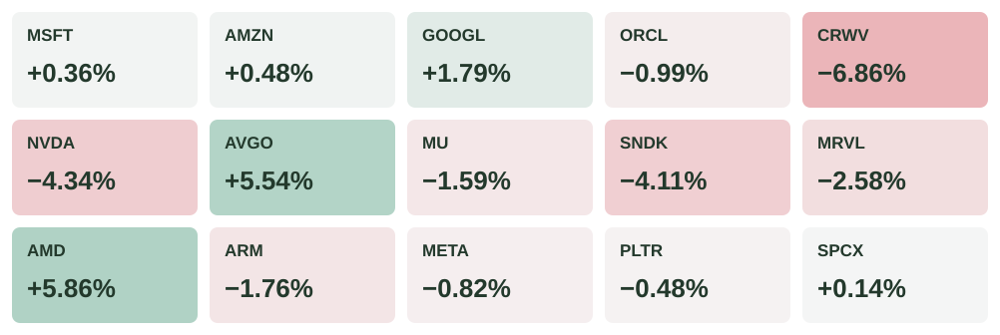

# 2026-11-12 시장 현황

미국 정규장 마감 기준 · [사건 기록](../events/2026-11-12.md)

## 지수

| 지수 | 종가 | 등락률 |
| --- | ---: | ---: |
| 나스닥 종합 | 25,366.09 | −0.39% |
| S&P 500 | 7,592.40 | −0.35% |
| 다우 산업 | 52,297.09 | −0.36% |
| 러셀 2000 | 2,799.06 | −1.66% |

[\[AP\]](https://apnews.com/article/3f3668a937a11535103e3a5c8d82c9fc) 미국 증시는 엔비디아 경영진 교체와 유가 변동을 소화하며 하락 마감했습니다. 주요 지수 낙폭은 0.4% 안팎이었고, 소형주 지수인 러셀 2000은 1.7% 내렸습니다.

| ETF | 종가($) | 등락률 |
| --- | ---: | ---: |
| [QQQ](https://stockanalysis.com/etf/qqq/history/) | 688.17 | −0.32% |
| [SPY](https://stockanalysis.com/etf/spy/history/) | 757.12 | −0.35% |

## 히트맵

## 종목별 현황

| 종목 | 종가($) | 등락률 | QQQ 대비 | 20일선($) · 이격률 | RSI 14 | 거래량 배수 | 사건 |
| --- | ---: | ---: | ---: | ---: | ---: | ---: | --- |
| [MSFT](https://stockanalysis.com/stocks/msft/history/) | 523.00 | +0.36% | +0.68%p | 529.64 · −1.25% | 48.2 | 0.70× | [네비우스](../events/2026-11-12.md#네비우스-외부-시설-지연과-투자-확대-계획-공개) 연계, [365 장애](../events/2026-11-12.md#microsoft-365outlook-장애-ai-연결-기능에도-영향) |
| [AMZN](https://stockanalysis.com/stocks/amzn/history/) | 267.44 | +0.48% | +0.80%p | 256.50 · +4.26% | 58.0 | 0.68× | — |
| [GOOGL](https://stockanalysis.com/stocks/googl/history/) | 298.70 | +1.79% | +2.11%p | 305.66 · −2.28% | 42.6 | 0.89× | — |
| [ORCL](https://stockanalysis.com/stocks/orcl/history/) | 127.11 | −0.99% | −0.67%p | 126.74 · +0.29% | 47.7 | 0.53× | — |
| [CRWV](https://stockanalysis.com/stocks/crwv/history/) | 56.60 | −6.86% | −6.54%p | 55.40 · +2.16% | 45.8 | 1.44× | [네비우스](../events/2026-11-12.md#네비우스-외부-시설-지연과-투자-확대-계획-공개) 연계 |
| [NVDA](https://stockanalysis.com/stocks/nvda/history/) | 166.19 | −4.34% | −4.02%p | 201.25 · −17.42% | 25.3 | 4.52× | [CEO 교체](../events/2026-11-12.md#젠슨-황-퇴임-크레스-임시-ceo-체제로-전환), [네비우스](../events/2026-11-12.md#네비우스-외부-시설-지연과-투자-확대-계획-공개) 연계 |
| [AVGO](https://stockanalysis.com/stocks/avgo/history/) | 364.36 | +5.54% | +5.86%p | 330.05 · +10.40% | 59.6 | 1.68× | — |
| [MU](https://stockanalysis.com/stocks/mu/history/) | 798.44 | −1.59% | −1.26%p | 843.03 · −5.29% | 43.8 | 0.88× | — |
| [SNDK](https://stockanalysis.com/stocks/sndk/history/) | 937.46 | −4.11% | −3.79%p | 1,145.06 · −18.13% | 35.4 | 1.13× | — |
| [MRVL](https://stockanalysis.com/stocks/mrvl/history/) | 164.45 | −2.58% | −2.26%p | 198.30 · −17.07% | 37.4 | 0.72× | — |
| [AMD](https://stockanalysis.com/stocks/amd/history/) | 585.30 | +5.86% | +6.18%p | 518.76 · +12.83% | 58.0 | 1.73× | — |
| [ARM](https://stockanalysis.com/stocks/arm/history/) | 199.78 | −1.76% | −1.44%p | 207.39 · −3.67% | 44.0 | 0.68× | — |
| [META](https://stockanalysis.com/stocks/meta/history/) | 623.61 | −0.82% | −0.50%p | 640.44 · −2.63% | 43.0 | 0.42× | [네비우스](../events/2026-11-12.md#네비우스-외부-시설-지연과-투자-확대-계획-공개) 연계 |
| [PLTR](https://stockanalysis.com/stocks/pltr/history/) | 171.58 | −0.48% | −0.16%p | 183.26 · −6.37% | 41.8 | 0.48× | — |
| [SPCX](https://stockanalysis.com/stocks/spcx/history/) | 139.94 | +0.14% | +0.46%p | 142.45 · −1.76% | 46.8 | 0.84× | [합병 협상](../events/2026-11-12.md#스페이스x테슬라-합병-협상-진전-보도) |

가격·거래량: 각 종목 링크의 Stock Analysis 이력. 거래량 배수는 직전 20거래일 평균 대비.

QQQ 대비는 당일 등락률 차이(%p). 20일선은 당일 포함 20거래일 평균. RSI 14는 확보한 49거래일의 종가로 계산한 Wilder 방식.
